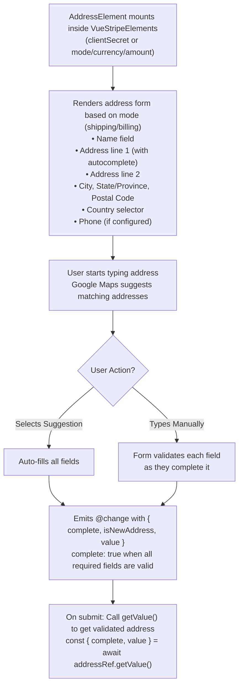

# VueStripeAddressElement

A complete address collection form with built-in autocomplete powered by Google Maps.

::: tip No Intent Required
VueStripeAddressElement does not need a PaymentIntent. Wrap it in `VueStripeProvider` and `VueStripeElements`; when you have no `clientSecret`, give `VueStripeElements` a `mode` / `currency` / `amount` (deferred Intent flow).
:::

::: warning Pass `mode` when there is no `clientSecret`
With neither `clientSecret` nor `mode` on `VueStripeElements`, Stripe.js Endive logs "Unable to select session" inside the Address Element's iframe. Use `<VueStripeElements mode="payment" currency="usd" :amount="1099">` (or `mode="setup"`) until you have an Intent.
:::

## What is Address Element?

Address Element provides a complete, validated address collection form:

| Capability | Description |
|------------|-------------|
| **Google Maps Autocomplete** | Suggests addresses as the user types |
| **Address Validation** | Validates addresses against postal databases |
| **International Support** | Works with addresses from 200+ countries |
| **Phone Collection** | Optional phone number field with country code |
| **Shipping/Billing Modes** | Configurable for different use cases |

## How It Works



## Usage

```vue
<template>
  <VueStripeProvider :publishable-key="publishableKey">
    <VueStripeElements mode="payment" currency="usd" :amount="1099">
      <VueStripeAddressElement
        :options="addressOptions"
        @ready="onReady"
        @change="onChange"
      />
      <button @click="handleSubmit">Continue</button>
    </VueStripeElements>
  </VueStripeProvider>
</template>

<script setup>
import {
  VueStripeProvider,
  VueStripeElements,
  VueStripeAddressElement
} from '@vue-stripe/vue-stripe'

const publishableKey = import.meta.env.VITE_STRIPE_PUBLISHABLE_KEY

const addressOptions = {
  mode: 'shipping',
  autocomplete: { mode: 'automatic' }
}

const onReady = () => {
  console.log('Address element ready')
}

const onChange = (event) => {
  if (event.complete) {
    console.log('Address complete:', event.value)
  }
}
</script>
```

## Props

| Prop | Type | Required | Description |
|------|------|----------|-------------|
| `options` | `StripeAddressElementOptions` | No | Address element configuration (defaults to `{ mode: 'shipping' }`) |

::: info Updating options
Changes to `options` are applied to the mounted element with `element.update()`, and only when they really change: a re-render that passes a new but deep-equal object (e.g. an inline `:options="{ ... }"`) does not call `update()`.

`mode` is the exception: Stripe cannot change it after creation, so it is never passed to `update()`. To switch between `'shipping'` and `'billing'`, re-mount the component (e.g. `:key="mode"`).
:::

### Options Object

```ts
interface StripeAddressElementOptions {
  mode: 'shipping' | 'billing'
  autocomplete?: {
    mode: 'automatic' | 'disabled'
  }
  allowedCountries?: string[]
  blockPoBox?: boolean
  contacts?: Array<{
    name: string
    address: AddressValue
  }>
  defaultValues?: {
    name?: string
    firstName?: string
    lastName?: string
    phone?: string
    address?: {
      line1?: string
      line2?: string
      city?: string
      state?: string
      postal_code?: string
      country?: string
    }
  }
  display?: {
    name?: 'full' | 'split' | 'organization'
  }
  fields?: {
    phone?: 'always' | 'never' | 'auto'
  }
  validation?: {
    phone?: {
      required?: 'always' | 'never' | 'auto'
    }
  }
}
```

## Events

| Event | Payload | Description |
|-------|---------|-------------|
| `@ready` | `StripeAddressElement` | Emitted when the element is fully rendered |
| `@change` | `StripeAddressElementChangeEvent` | Emitted when the address value changes |
| `@focus` | - | Emitted when any field gains focus |
| `@blur` | - | Emitted when any field loses focus |
| `@escape` | - | Emitted when the escape key is pressed |
| `@loaderstart` | `{ elementType: 'address' }` | Emitted when the element starts loading (Stripe shows its loader) |
| `@loaderror` | `{ elementType: 'address'; error: StripeError }` | Emitted if the element fails to load. Renamed from `@loadError` in v6: update `@loadError` listeners to `@loaderror` |

`@loaderror` also fires when creating the element fails (for example when the surrounding provider does not support it), with the payload `{ elementType: 'address', error: { message } }`; the message is also shown through the `#error` slot.

### Change Event

```ts
interface StripeAddressElementChangeEvent {
  elementType: 'address'
  complete: boolean
  isNewAddress: boolean
  value: {
    name?: string
    firstName?: string
    lastName?: string
    phone?: string
    address: {
      line1: string
      line2: string | null
      city: string
      state: string
      postal_code: string
      country: string
    }
  }
}
```

## Slots

| Slot | Slot Props | Description |
|------|-----------|-------------|
| `#loading` | - | Rendered while the element is loading (default: "Loading address form...") |
| `#error` | `{ error: string }` | Rendered when the element has an error: the validation message from `@change`, a load error or a creation error |

```vue
<VueStripeAddressElement>
  <template #loading>
    <div class="skeleton-loader">Loading...</div>
  </template>

  <template #error="{ error }">
    <p class="my-error">{{ error }}</p>
  </template>
</VueStripeAddressElement>
```

## Exposed Methods & Properties

Access these via a template ref:

| Member | Type | Description |
|--------|------|-------------|
| `element` | `ShallowRef<StripeAddressElement \| null>` | The Stripe element instance (`null` until created) |
| `loading` | `Ref<boolean>` | `true` until the element emits `ready` |
| `error` | `Ref<string \| null>` | Current error message (validation, load or creation error) |
| `focus()` | `() => void` | Focus the element |
| `blur()` | `() => void` | Blur the element |
| `clear()` | `() => void` | Clear the element's value |
| `getValue(options?)` | `(options?: { format?: 'localized' \| 'latin' }) => Promise<...>` | Validate the form and read the address (forwards to Stripe's `getValue()`) |

Refs are unwrapped on the template ref, so `addressRef.value.element` is a `StripeAddressElement | null`. Type the template ref with the component type and the element with the Stripe type:

```vue
<script setup lang="ts">
import { ref } from 'vue'
import { VueStripeAddressElement } from '@vue-stripe/vue-stripe'
import type { StripeAddressElement } from '@stripe/stripe-js'

const addressRef = ref<InstanceType<typeof VueStripeAddressElement> | null>(null)

const focus = () => addressRef.value?.focus()
const clear = () => addressRef.value?.clear()
const stripeElement = (): StripeAddressElement | null => addressRef.value?.element ?? null
const readAddress = () => addressRef.value?.getValue({ format: 'localized' })
</script>

<template>
  <VueStripeAddressElement ref="addressRef" />
</template>
```

### getValue() and the `state` format

`getValue(options?)` forwards its options to Stripe's `addressElement.getValue()`. Since Stripe.js Dahlia, `value.address.state` is returned in **Latin** characters by default (e.g. a Japanese prefecture is romanized). Pass `{ format: 'localized' }` for the previous, localized behaviour:

```ts
const { complete, value } = await addressRef.value!.getValue({ format: 'localized' })
```

## With Checkout Sessions

Inside a [VueStripeCheckoutElementsProvider](/api/components/stripe-checkout-provider), the component is created with the Checkout SDK: `options.mode` picks `createBillingAddressElement()` (`'billing'`) or `createShippingAddressElement()` (`'shipping'`, the default). The Checkout SDK accepts only `contacts`, `display` and `fields`; other options are dropped. The address flows into the Checkout Session automatically.

```vue
<VueStripeCheckoutElementsProvider :client-secret="clientSecret">
  <VueStripeAddressElement :options="{ mode: 'shipping', display: { name: 'split' } }" />
  <VueStripeAddressElement :options="{ mode: 'billing' }" />
  <VueStripePaymentElement />
</VueStripeCheckoutElementsProvider>
```

## Styling

The component renders this markup around Stripe's iframe:

```html
<div class="vue-stripe-address-element vue-stripe-element">
  <!-- only when there is an error (#error slot) -->
  <div class="vue-stripe-address-element-error vue-stripe-element-error">...</div>
  <!-- Stripe mounts its iframe here; plus vue-stripe-address-element-loading / vue-stripe-element-loading while loading -->
  <div class="vue-stripe-address-element-mount vue-stripe-element-mount"></div>
  <!-- only while loading (#loading slot) -->
  <div class="vue-stripe-address-element-loader vue-stripe-element-loader">...</div>
</div>
```

The default styles for these classes ship in the package stylesheet. Import it once in your app:

```ts
import '@vue-stripe/vue-stripe/style.css'
```

Target `.vue-stripe-element*` to style every element at once, or `.vue-stripe-address-element*` for this one.

## Examples

### Shipping vs Billing Mode

`mode` cannot change after the element is created, so the example re-mounts the component with `:key`:

```vue
<script setup>
import { ref, computed } from 'vue'

const mode = ref('shipping')

const options = computed(() => ({
  mode: mode.value
}))
</script>

<template>
  <div>
    <button @click="mode = 'shipping'">Shipping</button>
    <button @click="mode = 'billing'">Billing</button>
  </div>
  <VueStripeAddressElement :key="mode" :options="options" />
</template>
```

### With Default Values (Pre-fill)

```vue
<script setup>
const options = {
  mode: 'shipping',
  defaultValues: {
    name: 'John Doe',
    phone: '+1 555-123-4567',
    address: {
      line1: '123 Main Street',
      line2: 'Apt 4B',
      city: 'San Francisco',
      state: 'CA',
      postal_code: '94102',
      country: 'US'
    }
  }
}
</script>

<template>
  <VueStripeAddressElement :options="options" />
</template>
```

### With Phone Field

```vue
<script setup>
const options = {
  mode: 'shipping',
  fields: {
    phone: 'always'
  },
  validation: {
    phone: {
      required: 'always'
    }
  }
}
</script>

<template>
  <VueStripeAddressElement :options="options" />
</template>
```

### Limit Countries

```vue
<script setup>
const options = {
  mode: 'shipping',
  allowedCountries: ['US', 'CA', 'GB', 'AU']
}
</script>

<template>
  <VueStripeAddressElement :options="options" />
</template>
```

### Block P.O. Boxes

```vue
<script setup>
const options = {
  mode: 'shipping',
  blockPoBox: true
}
</script>

<template>
  <VueStripeAddressElement :options="options" />
</template>
```

### Using getValue() for Validation

```vue
<script setup>
import { ref } from 'vue'

const addressRef = ref()
const isValid = ref(false)
const addressData = ref(null)

const handleSubmit = async () => {
  if (!addressRef.value) return

  const result = await addressRef.value.getValue()

  if (result.complete) {
    isValid.value = true
    addressData.value = result.value
    // Proceed with checkout
    console.log('Shipping to:', addressData.value.address)
  } else {
    isValid.value = false
    alert('Please complete the address form')
  }
}
</script>

<template>
  <VueStripeAddressElement ref="addressRef" :options="{ mode: 'shipping' }" />
  <button @click="handleSubmit">Continue to Payment</button>

  <div v-if="addressData">
    <h4>Confirmed Address:</h4>
    <p>{{ addressData.name }}</p>
    <p>{{ addressData.address.line1 }}</p>
    <p>{{ addressData.address.city }}, {{ addressData.address.state }} {{ addressData.address.postal_code }}</p>
  </div>
</template>
```

### Integration with Payment Element

The composables must run in a component rendered **inside** `VueStripeElements`, so the page is split in two:

```vue
<!-- CheckoutPage.vue -->
<template>
  <VueStripeProvider :publishable-key="publishableKey">
    <VueStripeElements :client-secret="clientSecret">
      <CheckoutSteps />
    </VueStripeElements>
  </VueStripeProvider>
</template>
```

```vue
<!-- CheckoutSteps.vue -->
<script setup>
import { ref } from 'vue'
import {
  VueStripeAddressElement,
  VueStripePaymentElement,
  useStripe,
  useStripeElements
} from '@vue-stripe/vue-stripe'

const addressRef = ref(null)
const step = ref('address')

const { stripe } = useStripe()
const { elements } = useStripeElements()

const handleContinue = async () => {
  const result = await addressRef.value?.getValue()
  if (result?.complete) {
    step.value = 'payment'
  }
}

const handlePayment = async () => {
  const addressResult = await addressRef.value?.getValue()

  const { error } = await stripe.value.confirmPayment({
    elements: elements.value,
    confirmParams: {
      return_url: window.location.origin + '/success',
      shipping: {
        name: addressResult.value.name,
        address: addressResult.value.address
      }
    }
  })

  if (error) {
    console.error(error)
  }
}
</script>

<template>
  <!-- v-show keeps the Address Element mounted, so getValue() still works on step 2 -->
  <div v-show="step === 'address'">
    <h3>Shipping Address</h3>
    <VueStripeAddressElement ref="addressRef" :options="{ mode: 'shipping' }" />
    <button @click="handleContinue">Continue to Payment</button>
  </div>

  <div v-show="step === 'payment'">
    <h3>Payment</h3>
    <VueStripePaymentElement />
    <button @click="handlePayment">Pay Now</button>
    <button @click="step = 'address'">Back</button>
  </div>
</template>
```

## TypeScript

```ts
import { ref } from 'vue'
import { VueStripeAddressElement } from '@vue-stripe/vue-stripe'
import type {
  StripeAddressElement,
  StripeAddressElementChangeEvent,
  StripeAddressElementOptions
} from '@stripe/stripe-js'

// Options
const options: StripeAddressElementOptions = {
  mode: 'shipping',
  autocomplete: { mode: 'automatic' },
  fields: { phone: 'always' }
}

// Event handlers
const handleReady = (element: StripeAddressElement) => {
  console.log('Address element ready', element)
}

const handleChange = (event: StripeAddressElementChangeEvent) => {
  console.log('Complete:', event.complete)
  console.log('Address:', event.value.address)
}

// Template ref with getValue()
const addressRef = ref<InstanceType<typeof VueStripeAddressElement> | null>(null)

const validateAddress = async () => {
  const result = await addressRef.value?.getValue()
  if (result?.complete) {
    // Type-safe address access
    const { line1, city, state, postal_code, country } = result.value.address
    console.log(`${line1}, ${city}, ${state} ${postal_code}, ${country}`)
  }
}
```

## Key Features

- **Google Maps Autocomplete**: Built-in address suggestions as you type
- **No Intent Required**: Works with a deferred-Intent `VueStripeElements` (`mode` / `currency` / `amount`)
- **Checkout Sessions**: Works inside `VueStripeCheckoutElementsProvider` as the billing or shipping address element
- **International Support**: Handles addresses from all countries with proper formatting
- **Phone Number Support**: Optional phone field with country-aware formatting
- **Validation**: Built-in validation for complete addresses
- **Pre-fill Support**: Populate with existing customer data
- **P.O. Box Blocking**: Option to prevent P.O. Box addresses for physical delivery

## Use Cases

1. **Checkout shipping address** - Collect where to ship physical goods
2. **Billing address** - Collect for payment verification
3. **Customer profile** - Store addresses for future use
4. **Multi-step checkout** - Collect address before payment details

## See Also

- [VueStripeElements](/api/components/stripe-elements) - Parent container component
- [VueStripeCheckoutElementsProvider](/api/components/stripe-checkout-provider) - Parent for Checkout Sessions
- [VueStripePaymentElement](/api/components/stripe-payment-element) - All-in-one payment UI
- [Address Element Guide](/guide/address-element) - Step-by-step guide
