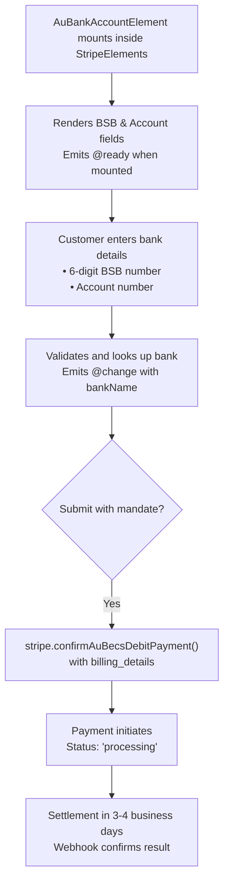

# VueStripeAuBankAccountElement

A form element for collecting Australian bank account details (BSB and account number) for BECS Direct Debit payments.

::: tip When to Use
Use VueStripeAuBankAccountElement for Australian customers. BECS Direct Debit is ideal for recurring payments and only supports AUD (Australian Dollar) currency.
:::

## What is AU Bank Account Element?

AU Bank Account Element collects bank details for Australian payments:

| Capability | Description |
|------------|-------------|
| **BSB Input** | 6-digit bank identifier with validation |
| **Account Number** | Bank account number input |
| **Bank Lookup** | Automatic bank/branch name from BSB |
| **AUD Only** | Supports Australian Dollar exclusively |
| **Direct Debit** | For recurring and one-time payments |

## How It Works



## Usage

```vue
<template>
  <VueStripeProvider :publishable-key="publishableKey">
    <VueStripeElements>
      <VueStripeAuBankAccountElement
        :options="options"
        @ready="onReady"
        @change="onChange"
      />
    </VueStripeElements>
  </VueStripeProvider>
</template>

<script setup>
import {
  VueStripeProvider,
  VueStripeElements,
  VueStripeAuBankAccountElement
} from '@vue-stripe/vue-stripe'

const publishableKey = import.meta.env.VITE_STRIPE_PUBLISHABLE_KEY

const options = {
  style: {
    base: {
      fontSize: '16px',
      color: '#424770'
    }
  },
  iconStyle: 'solid'
}

const onReady = (element) => {
  console.log('AU Bank Account element ready', element)
}

const onChange = (event) => {
  console.log('Bank:', event.bankName)
  console.log('Branch:', event.branchName)
  console.log('Complete:', event.complete)
}
</script>
```

## Props

| Prop | Type | Required | Description |
|------|------|----------|-------------|
| `options` | `StripeAuBankAccountElementOptions` | No | Element configuration |

::: info Updating options
Changes to `options` are applied to the mounted element with `element.update()`, and only when they really change: a re-render that passes a new but deep-equal object (e.g. an inline `:options="{ ... }"`) does not call `update()`.
:::

### Options Object

```ts
interface StripeAuBankAccountElementOptions {
  classes?: StripeElementClasses
  style?: {
    base?: StripeElementStyle
    complete?: StripeElementStyle
    empty?: StripeElementStyle
    invalid?: StripeElementStyle
  }
  iconStyle?: 'default' | 'solid'
  hideIcon?: boolean
  disabled?: boolean
}
```

### Style Properties

```ts
interface StripeElementStyle {
  color?: string
  fontFamily?: string
  fontSize?: string
  fontWeight?: string
  iconColor?: string
  lineHeight?: string
  letterSpacing?: string
  padding?: string
  '::placeholder'?: { color?: string }
  ':focus'?: StripeElementStyle
  ':hover'?: StripeElementStyle
}
```

### Icon Options

| Option | Type | Default | Description |
|--------|------|---------|-------------|
| `iconStyle` | `'default' \| 'solid'` | `'default'` | Style of the bank icon |
| `hideIcon` | `boolean` | `false` | Whether to hide the icon |

## Events

| Event | Payload | Description |
|-------|---------|-------------|
| `@ready` | `StripeAuBankAccountElement` | Emitted when the element is fully rendered |
| `@change` | `StripeAuBankAccountElementChangeEvent` | Emitted when input changes |
| `@focus` | - | Emitted when the element gains focus |
| `@blur` | - | Emitted when the element loses focus |
| `@escape` | - | Emitted when Escape key is pressed |

### Change Event

```ts
interface StripeAuBankAccountElementChangeEvent {
  elementType: 'auBankAccount'
  empty: boolean
  complete: boolean
  bankName?: string   // Bank name from BSB lookup
  branchName?: string // Branch name from BSB lookup
  error?: {
    message: string
    type: string
  }
}
```

## Slots

| Slot | Slot Props | Description |
|------|-----------|-------------|
| `#loading` | - | Rendered while the element is loading (default: "Loading BECS Direct Debit form...") |
| `#error` | `{ error: string }` | Rendered when the element has an error: the validation message from `@change` or a creation error |

```vue
<VueStripeAuBankAccountElement>
  <template #loading>
    <div class="skeleton-loader">Loading...</div>
  </template>

  <template #error="{ error }">
    <p class="my-error">{{ error }}</p>
  </template>
</VueStripeAuBankAccountElement>
```

## Exposed Methods & Properties

Access these via a template ref:

| Member | Type | Description |
|--------|------|-------------|
| `element` | `ShallowRef<StripeAuBankAccountElement \| null>` | The Stripe element instance (`null` until created) |
| `loading` | `Ref<boolean>` | `true` until the element emits `ready` |
| `error` | `Ref<string \| null>` | Current error message (validation, load or creation error) |
| `focus()` | `() => void` | Focus the element |
| `blur()` | `() => void` | Blur the element |
| `clear()` | `() => void` | Clear the element's value |

Refs are unwrapped on the template ref, so `auBankRef.value.element` is a `StripeAuBankAccountElement | null`. Type the template ref with the component type and the element with the Stripe type:

```vue
<script setup lang="ts">
import { ref } from 'vue'
import { VueStripeAuBankAccountElement } from '@vue-stripe/vue-stripe'
import type { StripeAuBankAccountElement } from '@stripe/stripe-js'

const auBankRef = ref<InstanceType<typeof VueStripeAuBankAccountElement> | null>(null)

const focus = () => auBankRef.value?.focus()
const clear = () => auBankRef.value?.clear()
const stripeElement = (): StripeAuBankAccountElement | null => auBankRef.value?.element ?? null
</script>

<template>
  <VueStripeAuBankAccountElement ref="auBankRef" />
</template>
```

## Styling

The component renders this markup around Stripe's iframe:

```html
<div class="vue-stripe-au-bank-account-element vue-stripe-element">
  <!-- only when there is an error (#error slot) -->
  <div class="vue-stripe-au-bank-account-element-error vue-stripe-element-error">...</div>
  <!-- Stripe mounts its iframe here; plus vue-stripe-au-bank-account-element-loading / vue-stripe-element-loading while loading -->
  <div class="vue-stripe-au-bank-account-element-mount vue-stripe-element-mount"></div>
  <!-- only while loading (#loading slot) -->
  <div class="vue-stripe-au-bank-account-element-loader vue-stripe-element-loader">...</div>
</div>
```

The default styles for these classes ship in the package stylesheet. Import it once in your app:

```ts
import '@vue-stripe/vue-stripe/style.css'
```

Target `.vue-stripe-element*` to style every element at once, or `.vue-stripe-au-bank-account-element*` for this one.

## Examples

### Basic Usage

```vue
<VueStripeAuBankAccountElement
  @change="(e) => console.log('Bank:', e.bankName)"
/>
```

### With Icon Options

```vue
<VueStripeAuBankAccountElement
  :options="{
    iconStyle: 'solid',
    hideIcon: false
  }"
/>
```

### With Custom Styling

```vue
<script setup>
const options = {
  style: {
    base: {
      fontSize: '16px',
      color: '#32325d',
      fontFamily: '"Helvetica Neue", Helvetica, sans-serif',
      '::placeholder': {
        color: '#aab7c4'
      }
    }
  },
  iconStyle: 'solid'
}
</script>

<template>
  <VueStripeAuBankAccountElement :options="options" />
</template>
```

### Complete BECS Payment with Mandate

```vue
<script setup lang="ts">
import { ref } from 'vue'
import {
  VueStripeProvider,
  VueStripeElements,
  VueStripeAuBankAccountElement,
  useStripe,
  useStripeElements
} from '@vue-stripe/vue-stripe'

const publishableKey = import.meta.env.VITE_STRIPE_PUBLISHABLE_KEY
const bankName = ref('')
const isComplete = ref(false)
const mandateAccepted = ref(false)

const handleChange = (event: any) => {
  bankName.value = event.bankName || ''
  isComplete.value = event.complete
}

// In child component inside provider:
const confirmPayment = async (clientSecret: string) => {
  const { stripe } = useStripe()
  const { elements } = useStripeElements()

  const auBankElement = elements.value?.getElement('auBankAccount')

  const { error, paymentIntent } = await stripe.value.confirmAuBecsDebitPayment(
    clientSecret,
    {
      payment_method: {
        au_becs_debit: auBankElement,
        billing_details: {
          name: 'John Smith',
          email: 'john@example.com'
        }
      }
    }
  )

  if (error) {
    console.error(error.message)
  } else if (paymentIntent.status === 'processing') {
    console.log('Payment processing - settles in 3-4 business days')
  }
}
</script>

<template>
  <VueStripeProvider :publishable-key="publishableKey">
    <VueStripeElements>
      <form @submit.prevent="confirmPayment(clientSecret)">
        <VueStripeAuBankAccountElement @change="handleChange" />

        <div v-if="bankName" class="bank-info">
          Bank: {{ bankName }}
        </div>

        <!-- Mandate Agreement (Required) -->
        <div class="mandate">
          <label>
            <input v-model="mandateAccepted" type="checkbox" />
            I agree to the Direct Debit Request service agreement
          </label>
        </div>

        <button :disabled="!isComplete || !mandateAccepted">
          Pay with BECS Direct Debit
        </button>
      </form>
    </VueStripeElements>
  </VueStripeProvider>
</template>
```

### Displaying Bank Information

```vue
<script setup>
import { ref } from 'vue'

const bankInfo = ref({
  bankName: '',
  branchName: ''
})

const handleChange = (event) => {
  if (event.bankName) {
    bankInfo.value.bankName = event.bankName
  }
  if (event.branchName) {
    bankInfo.value.branchName = event.branchName
  }
}
</script>

<template>
  <div>
    <VueStripeAuBankAccountElement @change="handleChange" />

    <div v-if="bankInfo.bankName" class="bank-details">
      <p><strong>Bank:</strong> {{ bankInfo.bankName }}</p>
      <p v-if="bankInfo.branchName">
        <strong>Branch:</strong> {{ bankInfo.branchName }}
      </p>
    </div>
  </div>
</template>
```

## TypeScript

```ts
import { ref } from 'vue'
import { VueStripeAuBankAccountElement } from '@vue-stripe/vue-stripe'
import type {
  StripeAuBankAccountElement,
  StripeAuBankAccountElementChangeEvent,
  StripeAuBankAccountElementOptions
} from '@stripe/stripe-js'

// Options
const options: StripeAuBankAccountElementOptions = {
  style: {
    base: {
      fontSize: '16px'
    }
  },
  iconStyle: 'solid',
  hideIcon: false
}

// Event handlers
const handleReady = (element: StripeAuBankAccountElement) => {
  console.log('Ready:', element)
}

const handleChange = (event: StripeAuBankAccountElementChangeEvent) => {
  console.log('Bank:', event.bankName)
  console.log('Branch:', event.branchName)
  console.log('Complete:', event.complete)
}

// Template ref
const auBankRef = ref<InstanceType<typeof VueStripeAuBankAccountElement> | null>(null)
```

## Mandate Agreement

BECS Direct Debit requires displaying and collecting consent for the Direct Debit Request Service Agreement:

```vue
<template>
  <div class="mandate-text">
    <p>
      By providing your bank account details and confirming this payment, you agree
      to this Direct Debit Request and the
      <a href="https://stripe.com/au-becs-dd-service-agreement/legal" target="_blank">
        Direct Debit Request service agreement
      </a>,
      and authorise Stripe Payments Australia Pty Ltd ACN 160 180 343 Direct Debit
      User ID number 507156 ("Stripe") to debit your account through the Bulk Electronic
      Clearing System (BECS) on behalf of <strong>{{ businessName }}</strong>
      (the "Merchant") for any amounts separately communicated to you by the Merchant.
    </p>
  </div>
</template>
```

## Payment Status Flow

| Status | Meaning | When |
|--------|---------|------|
| `processing` | Payment initiated | Immediately after confirm |
| `succeeded` | Payment successful | 3-4 business days |
| `requires_payment_method` | Payment failed | 3-4 business days |

Use webhooks to track final status:

```ts
// webhook handler
switch (event.type) {
  case 'payment_intent.succeeded':
    // BECS payment settled
    break
  case 'payment_intent.payment_failed':
    // BECS payment failed
    break
}
```

## Error Handling

| Error | Cause | Solution |
|-------|-------|----------|
| `invalid_bsb` | BSB number is invalid | Verify BSB format (6 digits) |
| `invalid_account_number` | Account number invalid | Check account number format |
| `payment_intent_unexpected_state` | PaymentIntent not in expected state | Check PaymentIntent status |
| `mandate_data_missing` | The customer hasn't agreed to the BECS Direct Debit Request (DDR) service agreement | Collect the customer's mandate consent (show the DDR terms and pass `mandate_data` on confirmation) |

## See Also

- [VueStripeElements](/api/components/stripe-elements) - Parent container component
- [useStripeElements](/api/composables/use-stripe-elements) - Access elements in child components
- [AU Bank Account Element Guide](/guide/au-bank-account-element) - Step-by-step implementation
- [VueStripePaymentElement](/api/components/stripe-payment-element) - FPX and other payment methods
- [VueStripeIbanElement](/api/components/stripe-iban-element) - SEPA payments
