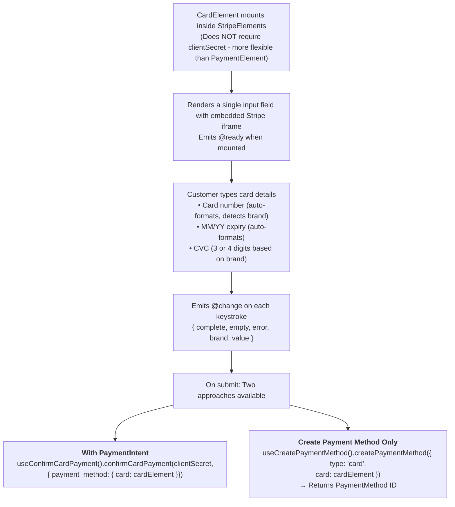

# VueStripeCardElement

A single, unified card input field that collects card number, expiration date, and CVC.

::: tip When to Use
Use StripeCardElement for a classic card-only payment experience. For modern payments that support cards, wallets, and bank transfers, consider [StripePaymentElement](/api/components/stripe-payment-element) instead.
:::

## What is Card Element?

Card Element is the classic Stripe card input that provides:

| Capability | Description |
|------------|-------------|
| **Unified Input** | Single field for card number, expiry, and CVC |
| **Real-time Validation** | Validates card number format, expiry, and CVC as user types |
| **Card Brand Detection** | Automatically detects and displays card brand icon |
| **Customizable Styling** | Full control over fonts, colors, and appearance |
| **No clientSecret Required** | Can be used without a PaymentIntent (flexible integration) |

## How It Works



## Usage

```vue
<template>
  <VueStripeProvider :publishable-key="publishableKey">
    <VueStripeElements>
      <VueStripeCardElement
        :options="cardOptions"
        @ready="onReady"
        @change="onChange"
      />
      <button @click="handleSubmit">Pay</button>
    </VueStripeElements>
  </VueStripeProvider>
</template>

<script setup>
import {
  VueStripeProvider,
  VueStripeElements,
  VueStripeCardElement
} from '@vue-stripe/vue-stripe'

const publishableKey = import.meta.env.VITE_STRIPE_PUBLISHABLE_KEY

const cardOptions = {
  style: {
    base: {
      fontSize: '16px',
      color: '#424770',
      '::placeholder': { color: '#aab7c4' }
    }
  }
}

const onReady = (element) => {
  console.log('Card element ready', element)
}

const onChange = (event) => {
  if (event.error) {
    console.error(event.error.message)
  }
}
</script>
```

## Props

| Prop | Type | Required | Description |
|------|------|----------|-------------|
| `options` | `StripeCardElementOptions` | No | Card element configuration |

::: info Updating options
Changes to `options` are applied to the mounted element with `element.update()`, and only when they really change: a re-render that passes a new but deep-equal object (e.g. an inline `:options="{ ... }"`) does not call `update()`.
:::

### Options Object

```ts
interface StripeCardElementOptions {
  style?: {
    base?: StripeElementStyle
    complete?: StripeElementStyle
    empty?: StripeElementStyle
    invalid?: StripeElementStyle
  }
  hidePostalCode?: boolean
  iconStyle?: 'default' | 'solid'
  disabled?: boolean
}
```

#### Style Properties

```ts
interface StripeElementStyle {
  color?: string
  fontFamily?: string
  fontSize?: string
  fontSmoothing?: string
  fontStyle?: string
  fontVariant?: string
  fontWeight?: string
  iconColor?: string
  lineHeight?: string
  letterSpacing?: string
  textAlign?: string
  textDecoration?: string
  textShadow?: string
  textTransform?: string
  '::placeholder'?: { color?: string }
  ':-webkit-autofill'?: { color?: string }
  ':focus'?: StripeElementStyle
  ':hover'?: StripeElementStyle
  '::selection'?: { color?: string; backgroundColor?: string }
}
```

## Events

| Event | Payload | Description |
|-------|---------|-------------|
| `@ready` | `StripeCardElement` | Emitted when the element is fully rendered |
| `@change` | `StripeCardElementChangeEvent` | Emitted when the element value changes |
| `@focus` | - | Emitted when the element gains focus |
| `@blur` | - | Emitted when the element loses focus |
| `@escape` | - | Emitted when the escape key is pressed |
| `@networkschange` | `{ elementType: 'card' }` | Emitted when the card networks available for the entered number change (co-badged cards) |
| `@loaderror` | `{ elementType: 'card'; error: StripeError }` | Emitted when the element fails to load |

`@loaderror` also fires when creating the element fails (for example when the surrounding provider does not support it), with the payload `{ elementType: 'card', error: { message } }`; the message is also shown through the `#error` slot.

### Change Event

```ts
interface StripeCardElementChangeEvent {
  elementType: 'card'
  empty: boolean
  complete: boolean
  error?: {
    type: string
    code: string
    message: string
  }
  value: {
    postalCode: string
  }
  brand: 'visa' | 'mastercard' | 'amex' | 'discover' | 'diners' | 'jcb' | 'unionpay' | 'unknown'
}
```

## Slots

| Slot | Slot Props | Description |
|------|-----------|-------------|
| `#loading` | - | Rendered while the element is loading (default: "Loading card form...") |
| `#error` | `{ error: string }` | Rendered when the element has an error: the validation message from `@change`, a load error or a creation error |

```vue
<VueStripeCardElement>
  <template #loading>
    <div class="skeleton-loader">Loading...</div>
  </template>

  <template #error="{ error }">
    <p class="my-error">{{ error }}</p>
  </template>
</VueStripeCardElement>
```

## Exposed Methods & Properties

Access these via a template ref:

| Member | Type | Description |
|--------|------|-------------|
| `element` | `ShallowRef<StripeCardElement \| null>` | The Stripe element instance (`null` until created) |
| `loading` | `Ref<boolean>` | `true` until the element emits `ready` |
| `error` | `Ref<string \| null>` | Current error message (validation, load or creation error) |
| `focus()` | `() => void` | Focus the element |
| `blur()` | `() => void` | Blur the element |
| `clear()` | `() => void` | Clear the element's value |

The component owns the element's lifecycle: it creates, mounts and destroys the element. Removing the component (for example with `v-if`) destroys the element, which takes the place of Stripe's `element.unmount()`; for a one-time listener use Vue's `.once` modifier (`@ready.once`) instead of `element.once()`.

Refs are unwrapped on the template ref, so `cardRef.value.element` is a `StripeCardElement | null`. Type the template ref with the component type and the element with the Stripe type:

```vue
<script setup lang="ts">
import { ref } from 'vue'
import { VueStripeCardElement } from '@vue-stripe/vue-stripe'
import type { StripeCardElement } from '@stripe/stripe-js'

const cardRef = ref<InstanceType<typeof VueStripeCardElement> | null>(null)

const focus = () => cardRef.value?.focus()
const clear = () => cardRef.value?.clear()
const stripeElement = (): StripeCardElement | null => cardRef.value?.element ?? null
</script>

<template>
  <VueStripeCardElement ref="cardRef" />
</template>
```

## Styling

The component renders this markup around Stripe's iframe:

```html
<div class="vue-stripe-card-element vue-stripe-element">
  <!-- only when there is an error (#error slot) -->
  <div class="vue-stripe-card-element-error vue-stripe-element-error">...</div>
  <!-- Stripe mounts its iframe here; plus vue-stripe-card-element-loading / vue-stripe-element-loading while loading -->
  <div class="vue-stripe-card-element-mount vue-stripe-element-mount"></div>
  <!-- only while loading (#loading slot) -->
  <div class="vue-stripe-card-element-loader vue-stripe-element-loader">...</div>
</div>
```

The default styles for these classes ship in the package stylesheet. Import it once in your app:

```ts
import '@vue-stripe/vue-stripe/style.css'
```

Target `.vue-stripe-element*` to style every element at once, or `.vue-stripe-card-element*` for this one.

## Examples

### Basic Styling

```vue
<script setup>
const options = {
  style: {
    base: {
      fontSize: '16px',
      color: '#32325d',
      fontFamily: '"Helvetica Neue", Helvetica, sans-serif',
      '::placeholder': {
        color: '#aab7c4'
      }
    },
    invalid: {
      color: '#fa755a',
      iconColor: '#fa755a'
    }
  }
}
</script>

<template>
  <VueStripeCardElement :options="options" />
</template>
```

### Hide Postal Code

```vue
<VueStripeCardElement
  :options="{ hidePostalCode: true }"
/>
```

### Tracking Validation State

```vue
<script setup>
import { ref } from 'vue'

const cardComplete = ref(false)
const cardError = ref('')

const handleChange = (event) => {
  cardComplete.value = event.complete
  cardError.value = event.error?.message || ''
}
</script>

<template>
  <VueStripeCardElement @change="handleChange" />
  <p v-if="cardError" class="error">{{ cardError }}</p>
  <button :disabled="!cardComplete">Pay</button>
</template>
```

### Complete Payment Form

```vue
<!-- CardForm.vue: rendered inside VueStripeElements -->
<script setup>
import { ref } from 'vue'
import {
  VueStripeCardElement,
  useConfirmCardPayment,
  useStripeElements
} from '@vue-stripe/vue-stripe'

const props = defineProps({
  clientSecret: { type: String, required: true }
})

const { getElement } = useStripeElements()
const { confirmCardPayment, loading: processing } = useConfirmCardPayment()

const cardComplete = ref(false)

const handleSubmit = async () => {
  const cardElement = getElement('card')
  if (!cardElement) return

  const { error, paymentIntent } = await confirmCardPayment(props.clientSecret, {
    payment_method: {
      card: cardElement,
      billing_details: {
        name: 'Customer Name'
      }
    }
  })

  if (error) {
    console.error(error.message)
  } else if (paymentIntent.status === 'succeeded') {
    console.log('Payment successful!')
  }
}
</script>

<template>
  <form @submit.prevent="handleSubmit">
    <VueStripeCardElement @change="(e) => (cardComplete = e.complete)" />
    <button :disabled="!cardComplete || processing">Pay</button>
  </form>
</template>
```

### With Custom Container Styling

```vue
<template>
  <div class="card-container">
    <VueStripeCardElement
      :options="options"
      @change="onChange"
    />
  </div>
</template>

<style scoped>
.card-container {
  padding: 12px;
  border: 1px solid #e0e0e0;
  border-radius: 8px;
  background: white;
  transition: border-color 0.2s ease;
}

.card-container:focus-within {
  border-color: #635bff;
  box-shadow: 0 0 0 3px rgba(99, 91, 255, 0.1);
}
</style>
```

## TypeScript

```ts
import { ref } from 'vue'
import { VueStripeCardElement } from '@vue-stripe/vue-stripe'
import type {
  StripeCardElement,
  StripeCardElementChangeEvent,
  StripeCardElementOptions
} from '@stripe/stripe-js'

// Options
const options: StripeCardElementOptions = {
  style: {
    base: {
      fontSize: '16px'
    }
  },
  hidePostalCode: true
}

// Event handlers
const handleReady = (element: StripeCardElement) => {
  console.log('Ready:', element)
}

const handleChange = (event: StripeCardElementChangeEvent) => {
  console.log('Complete:', event.complete)
  console.log('Brand:', event.brand)
}

// Template ref
const cardRef = ref<InstanceType<typeof VueStripeCardElement> | null>(null)
```

## Test Cards

Use these test card numbers in test mode:

| Card | Number |
|------|--------|
| Visa | `4242 4242 4242 4242` |
| Visa (debit) | `4000 0566 5566 5556` |
| Mastercard | `5555 5555 5555 4444` |
| American Express | `3782 822463 10005` |
| Discover | `6011 1111 1111 1117` |
| Declined | `4000 0000 0000 0002` |
| Insufficient funds | `4000 0000 0000 9995` |

Use any future expiration date and any 3-digit CVC (4-digit for Amex).

## See Also

- [StripeElements](/api/components/stripe-elements) - Parent container component
- [useStripeElements](/api/composables/use-stripe-elements) - Access elements in child components
- [Card Element Guide](/guide/card-element) - Step-by-step guide
