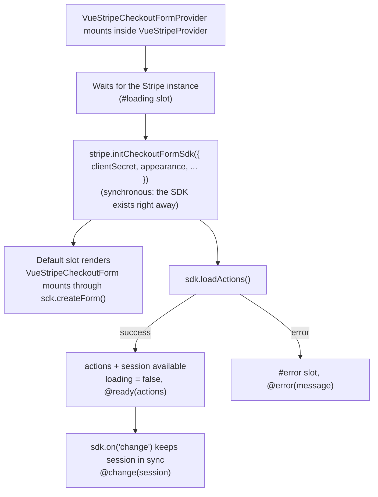

# VueStripeCheckoutFormProvider

Initializes the **Checkout Form** via `stripe.initCheckoutFormSdk()` and provides the Checkout Form SDK to descendants. Place [`VueStripeCheckoutForm`](/api/components/stripe-checkout-form) inside it to render Stripe's complete checkout form on your page, and confirm with the [`useCheckoutForm`](/api/composables/use-checkout-form) composable.

::: warning Beta: requires Stripe access
The Checkout Form SDK is a Stripe beta (`ui_mode: 'form'`). Your Stripe account needs access; contact [Stripe support](https://support.stripe.com/) to join. Some form options have their own gate: the `compact` layout is a separate private preview, and without it the form reports *"The `compact` layout is not available for your account"* through its `#error` slot and `@loaderror`.
:::

::: tip Checkout Form vs. Elements with Checkout Sessions
- **`VueStripeCheckoutFormProvider`** (this): Stripe renders the whole form (contact, addresses, shipping, tax ID, express checkout, payment and the Pay button) in one element. Least code.
- **[`VueStripeCheckoutElementsProvider`](/api/components/stripe-checkout-provider)**: you compose the page from individual elements (Payment, Address, Express Checkout, ...) and drive the session yourself.
- **[`VueStripeCheckout`](/api/components/stripe-checkout)**: redirect to Stripe's hosted Checkout page.
:::

## Requirements

- Must be used **inside** [`VueStripeProvider`](/api/components/stripe-provider), or in an app that installs the [`createVueStripe()`](/api/plugin) plugin.
- Needs a Checkout Session created on your server with `ui_mode: 'form'` (Stripe API version `2026-03-25.dahlia` or later); pass its `client_secret` to the provider.

```js
// Node.js
const session = await stripe.checkout.sessions.create({
  ui_mode: 'form',
  line_items: [{ price: 'price_xxx', quantity: 1 }],
  mode: 'payment',
  return_url: 'https://example.com/complete?session_id={CHECKOUT_SESSION_ID}'
})

res.json({ clientSecret: session.client_secret })
```

## How It Works



## Usage

```vue
<template>
  <VueStripeProvider :publishable-key="publishableKey">
    <VueStripeCheckoutFormProvider :client-secret="clientSecret">
      <PayForm />
    </VueStripeCheckoutFormProvider>
  </VueStripeProvider>
</template>

<script setup>
import { VueStripeProvider, VueStripeCheckoutFormProvider } from '@vue-stripe/vue-stripe'
import PayForm from './PayForm.vue'

const publishableKey = import.meta.env.VITE_STRIPE_PUBLISHABLE_KEY

// From your backend: stripe.checkout.sessions.create({ ui_mode: 'form', ... })
const clientSecret = fetch('/api/checkout-session', {
  method: 'POST',
  headers: { 'Content-Type': 'application/json' },
  body: JSON.stringify({ uiMode: 'form' })
})
  .then((res) => res.json())
  .then((data) => data.clientSecret)
</script>
```

```vue
<!-- PayForm.vue -->
<template>
  <VueStripeCheckoutForm @confirm="onConfirm" />
  <p v-if="message">{{ message }}</p>
</template>

<script setup>
import { ref } from 'vue'
import { VueStripeCheckoutForm, useCheckoutForm } from '@vue-stripe/vue-stripe'

const { confirm } = useCheckoutForm()
const message = ref('')

// The form's Pay button (or a wallet) fires @confirm; hand the event to Stripe.
const onConfirm = async (event) => {
  const result = await confirm({ formConfirmEvent: event })
  if (result.type === 'error') message.value = result.error.message
}
</script>
```

## Props

| Prop | Type | Required | Description |
|------|------|----------|-------------|
| `clientSecret` | `string \| Promise<string>` | No\* | Client secret of a `ui_mode: 'form'` Checkout Session, or a Promise resolving to it (passed to Stripe as is) |
| `fetchClientSecret` | `() => Promise<string>` | No\* | Function returning the client secret. **Takes precedence** over `clientSecret` |
| `appearance` | `Omit<Appearance, 'rules'>` | No | [Appearance](https://docs.stripe.com/elements/appearance-api) of the form; the Form SDK does not accept `rules` |
| `loader` | `'auto' \| 'always' \| 'never'` | No | Whether Stripe shows a loader while the form loads |
| `fonts` | `Array<CssFontSource \| CustomFontSource>` | No | Custom fonts for the form |
| `savedPaymentMethod` | `SavedPaymentMethodOption` | No | Saved payment methods: `enableSave`, `enableRedisplay` (`'auto'` or `'never'`) |
| `defaultValues` | `object` | No | Prefill `email`, `phoneNumber`, `billingAddress`, `shippingAddress` |

\* Provide **either** `clientSecret` **or** `fetchClientSecret`. If neither is set, the error slot renders and `@error` fires.

The props are read once, when the SDK is initialized. To use another session, re-mount the provider (for example with a `:key`). To restyle the form later, call `useCheckoutForm().changeAppearance()`.

### defaultValues

```ts
interface DefaultValues {
  email?: string
  phoneNumber?: string
  billingAddress?: StripeCheckoutContact
  shippingAddress?: StripeCheckoutContact
}
```

## Events

| Event | Payload | Description |
|-------|---------|-------------|
| `@ready` | `StripeCheckoutFormLoadActionsSuccess` | Emitted once `loadActions()` resolves. Payload is the Form SDK actions object |
| `@change` | `StripeCheckoutSession` | Emitted on every Stripe `change` event with the new session snapshot |
| `@error` | `string` | Emitted if `initCheckoutFormSdk()` throws, `loadActions()` returns an error, or no client secret is given |

## Slots

| Slot | Props | Rendered when |
|------|-------|---------------|
| `default` | `{ checkout, actions, session, loading }` | As soon as the Checkout Form SDK exists (before the actions load) |
| `loading` | - | Until the Checkout Form SDK exists (Stripe.js still loading) |
| `error` | `{ error }` | Initialization failed |

The default slot renders early so `VueStripeCheckoutForm` can mount while the actions are still loading. Its `loading` prop (and `useCheckoutForm().loading`) stays `true` until `loadActions()` resolves; `actions` and `session` are `null` until then.

| Slot Prop | Type | Description |
|-----------|------|-------------|
| `checkout` | `StripeCheckoutFormSdk` | The Checkout Form SDK instance |
| `actions` | `StripeCheckoutFormLoadActionsSuccess \| null` | Form SDK actions (`null` until loaded) |
| `session` | `StripeCheckoutSession \| null` | Current session snapshot (`null` until loaded) |
| `loading` | `boolean` | `true` until the actions have loaded |

## Components inside the provider

| Component | Created with | Accepted `options` |
|-----------|--------------|--------------------|
| [VueStripeCheckoutForm](/api/components/stripe-checkout-form) | `createForm()` | `layout`, `contacts`, `expressCheckout`, `features` |
| [VueStripeCurrencySelectorElement](/api/components/stripe-currency-selector-element) | `createCurrencySelectorElement()` | None |

The Form SDK creates nothing else: any other element component placed inside this provider sets its error state (*"... is not available inside VueStripeCheckoutFormProvider"*) and logs an error. When you render a `VueStripeCurrencySelectorElement` yourself, the form leaves out its built-in currency picker.

## Provides

| Key | Type | Description |
|-----|------|-------------|
| `checkout` | `Ref<StripeCheckoutFormSdk \| null>` | The Checkout Form SDK instance |
| `actions` | `Ref<StripeCheckoutFormLoadActionsSuccess \| null>` | Form SDK actions, once `loadActions()` resolves |
| `session` | `Ref<StripeCheckoutSession \| null>` | Reactive session snapshot (updates on every Stripe `change`) |
| `loading` | `Ref<boolean>` | `true` until the actions have loaded |
| `error` | `Ref<string \| null>` | Initialization error, if any |

The provider uses its own injection key, so `useCheckoutSession()` does not work inside it. Access these via [`useCheckoutForm()`](/api/composables/use-checkout-form).

## TypeScript

```ts
import type {
  StripeCheckoutFormLoadActionsSuccess,
  StripeCheckoutSession,
  VueStripeCheckoutFormProviderProps
} from '@vue-stripe/vue-stripe'

const props: VueStripeCheckoutFormProviderProps = {
  clientSecret: 'cs_test_..._secret_...',
  appearance: { theme: 'stripe' },
  savedPaymentMethod: { enableSave: 'never' }
}

const onReady = (actions: StripeCheckoutFormLoadActionsSuccess) => {
  console.log(actions.getSession().total.total.amount)
}

const onChange = (session: StripeCheckoutSession) => {
  console.log('Status:', session.status.type)
}
```

## See Also

- [VueStripeCheckoutForm](/api/components/stripe-checkout-form) - the form itself
- [useCheckoutForm](/api/composables/use-checkout-form) - confirm and drive the session from descendants
- [Checkout Form guide](/guide/checkout-form) - end-to-end walkthrough
- [VueStripeCheckoutElementsProvider](/api/components/stripe-checkout-provider) - compose your own form from elements instead
