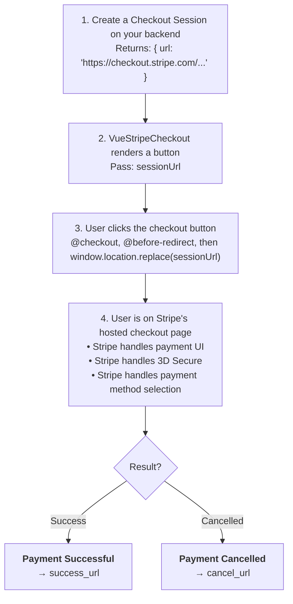

# VueStripeCheckout

A button component that redirects users to Stripe's hosted Checkout page for completing payments.

::: tip Simple Integration
`VueStripeCheckout` only needs a Checkout Session URL from your server. It does **not** need `VueStripeProvider`, `VueStripeElements` or a `clientSecret`: it is the simplest way to accept payments with Stripe.
:::

::: warning URL-only since v6
Stripe.js removed `stripe.redirectToCheckout()` in Stripe.js Clover, so the client can no longer start Checkout from a session ID or a price ID. Your server creates the Checkout Session and returns `session.url`; the component redirects to that URL. The v5 `sessionId`, `priceId`, `mode`, `successUrl`, `cancelUrl`, `customerEmail`, `clientReferenceId` and `submitType` props are gone: set those parameters when you create the session on your server.
:::

## What is Stripe Checkout?

Stripe Checkout provides a hosted, pre-built payment page:

| Feature | Description |
|---------|-------------|
| **Hosted by Stripe** | Secure, PCI-compliant payment page |
| **Automatic Payment Methods** | Cards, wallets, bank transfers based on customer location |
| **Built-in Features** | Discounts, taxes, shipping, receipts included |
| **No Custom UI** | Zero frontend payment UI development needed |

## How It Works



## Usage

```vue
<template>
  <VueStripeCheckout
    :session-url="sessionUrl"
    :disabled="!sessionUrl"
    button-text="Pay $49.99"
    @checkout="onCheckoutClick"
    @error="onCheckoutError"
  />
</template>

<script setup>
import { ref, onMounted } from 'vue'
import { VueStripeCheckout } from '@vue-stripe/vue-stripe'

const sessionUrl = ref('')

onMounted(async () => {
  // Create the Checkout Session on your server
  const response = await fetch('/api/create-checkout-session', { method: 'POST' })
  const data = await response.json()
  sessionUrl.value = data.url // Backend returns session.url
})

const onCheckoutClick = () => {
  console.log('Redirecting to checkout...')
}

const onCheckoutError = (error) => {
  console.error('Checkout error:', error.message)
}
</script>
```

## Props

| Prop | Type | Required | Default | Description |
|------|------|----------|---------|-------------|
| `sessionUrl` | `string` | Yes* | - | Hosted Checkout Session URL (`session.url`) created on your server |
| `buttonText` | `string` | No | `'Checkout'` | Text displayed on the button |
| `loadingText` | `string` | No | `'Redirecting...'` | Text shown during the redirect |
| `disabled` | `boolean` | No | `false` | Disable the checkout button |
| `buttonClass` | `string` | No | `'vue-stripe-checkout-button'` | CSS class of the default button |

\* The prop is optional so the component can render before the URL arrives, but clicking without it emits `@error` with a `VueStripeCheckoutError`.

## Events

| Event | Payload | Description |
|-------|---------|-------------|
| `@checkout` | - | Emitted when checkout is initiated (button clicked or `checkout()` called) |
| `@before-redirect` | `{ url: string }` | Emitted right before the browser navigates to `sessionUrl` |
| `@success` | - | Emitted once the redirect has been started |
| `@error` | `VueStripeCheckoutError` | Emitted when `sessionUrl` is missing |

```ts
import { VueStripeCheckoutError } from '@vue-stripe/vue-stripe'

const onError = (error: VueStripeCheckoutError) => {
  // "VueStripeCheckout: `sessionUrl` is required (create the Checkout Session on your server)"
  console.error(error.message)
}
```

Errors from Stripe itself (an expired or invalid session) are shown on Stripe's hosted page, not emitted by the component.

## Exposed Methods

The component exposes `checkout` and `loading` via template ref for programmatic control:

```vue
<template>
  <VueStripeCheckout ref="checkoutRef" :session-url="sessionUrl" />
  <button @click="triggerCheckout">Custom Trigger</button>
</template>

<script setup lang="ts">
import { ref } from 'vue'
import { VueStripeCheckout } from '@vue-stripe/vue-stripe'

const sessionUrl = ref('https://checkout.stripe.com/c/pay/cs_test_...')
const checkoutRef = ref<InstanceType<typeof VueStripeCheckout> | null>(null)

const triggerCheckout = () => {
  checkoutRef.value?.checkout()
}
</script>
```

| Member | Type | Description |
|--------|------|-------------|
| `checkout()` | `() => void` | Trigger the checkout redirect (ignored while `loading` or `disabled`) |
| `loading` | `Ref<boolean>` | `true` once the redirect has started |

## Slots

### Default Slot

Replace the button with your own markup. The component wraps the slot in a `<span class="vue-stripe-checkout-wrapper">` that triggers checkout on click, so a plain slot works without any wiring:

```vue
<VueStripeCheckout :session-url="sessionUrl">
  <button class="my-custom-button">Pay Now</button>
</VueStripeCheckout>
```

Use the scoped slot props to reflect the state:

```vue
<VueStripeCheckout :session-url="sessionUrl">
  <template #default="{ loading, disabled }">
    <MyCustomButton :loading="loading" :disabled="disabled">
      {{ loading ? 'Redirecting...' : 'Pay Now' }}
    </MyCustomButton>
  </template>
</VueStripeCheckout>
```

| Slot Prop | Type | Description |
|-----------|------|-------------|
| `checkout` | `() => void` | Function to trigger checkout (useful for non-click triggers) |
| `loading` | `boolean` | Whether the redirect has started |
| `disabled` | `boolean` | Value of the `disabled` prop |

::: tip Automatic Click Handling
Clicking anywhere inside the slot content triggers checkout, because the wrapper handles the click. The wrapper uses `display: contents` (from the package stylesheet), so it does not affect your layout.
:::

## Styling

The default button uses the `vue-stripe-checkout-button` class and shows a `vue-stripe-loading-spinner` while redirecting. These styles ship in the package stylesheet:

```ts
import '@vue-stripe/vue-stripe/style.css'
```

Pass `button-class` to use your own class instead.

## Examples

### With Custom Styling

```vue
<template>
  <VueStripeCheckout
    :session-url="sessionUrl"
    button-class="my-checkout-button"
    button-text="Pay $99.00"
  />
</template>

<style scoped>
.my-checkout-button {
  background: linear-gradient(135deg, #667eea 0%, #764ba2 100%);
  color: white;
  padding: 1rem 2rem;
  border: none;
  border-radius: 8px;
  font-size: 1rem;
  cursor: pointer;
}
</style>
```

### Subscription Checkout

The subscription parameters live on the server; the component is the same:

```vue
<template>
  <div class="pricing-card">
    <h3>Pro Plan</h3>
    <p class="price">$29/month</p>

    <VueStripeCheckout
      :session-url="proSessionUrl"
      :disabled="!proSessionUrl"
      button-text="Start Pro Plan"
    />
  </div>
</template>
```

### With Error Handling

```vue
<template>
  <div class="checkout-container">
    <VueStripeCheckout
      :session-url="sessionUrl"
      @error="handleError"
    />

    <div v-if="error" class="error-message">
      {{ error }}
    </div>
  </div>
</template>

<script setup>
import { ref } from 'vue'

const sessionUrl = ref('')
const error = ref(null)

const handleError = (err) => {
  // VueStripeCheckoutError: sessionUrl is missing
  error.value = err.message
}
</script>
```

### Creating the Session on Click

When the session should be created only when the customer clicks, use the [useStripeCheckout](/api/composables/use-stripe-checkout) composable instead:

```vue
<script setup>
import { useStripeCheckout } from '@vue-stripe/vue-stripe'

const { redirectToCheckout, loading } = useStripeCheckout()

const checkout = async () => {
  const res = await fetch('/api/create-checkout-session', { method: 'POST' })
  const { url } = await res.json()
  await redirectToCheckout({ url })
}
</script>

<template>
  <button :disabled="loading" @click="checkout">Checkout</button>
</template>
```

## Backend Setup

### Create Checkout Session (Node.js)

```js
const stripe = require('stripe')('sk_test_...')

app.post('/api/create-checkout-session', async (req, res) => {
  const session = await stripe.checkout.sessions.create({
    line_items: [
      {
        price: 'price_xxx', // Look up the price on the server, never trust the client
        quantity: 1
      }
    ],
    mode: 'payment', // or 'subscription'
    success_url: 'https://example.com/success?session_id={CHECKOUT_SESSION_ID}',
    cancel_url: 'https://example.com/cancel'
  })

  res.json({ url: session.url })
})
```

### Using Stripe CLI

```bash
# Create a one-time payment session and print its URL
stripe checkout sessions create \
  --line-items[0][price]=price_xxx \
  --line-items[0][quantity]=1 \
  --mode=payment \
  --success-url=https://example.com/success \
  --cancel-url=https://example.com/cancel
```

## TypeScript

```ts
import { ref } from 'vue'
import { VueStripeCheckout, VueStripeCheckoutError } from '@vue-stripe/vue-stripe'

const sessionUrl = ref<string>('')
const checkoutRef = ref<InstanceType<typeof VueStripeCheckout> | null>(null)

const handleBeforeRedirect = ({ url }: { url: string }) => {
  console.log('Navigating to', url)
}

const handleError = (error: VueStripeCheckoutError) => {
  console.error('Checkout failed:', error.message)
}
```

## Checkout vs Payment Element

| Feature | Checkout | Payment Element |
|---------|----------|-----------------|
| **Integration** | Simple (redirect) | Complex (embedded) |
| **Customization** | Limited | Full control |
| **Location** | Stripe-hosted | Your site |
| **PCI Compliance** | Stripe handles | You manage |
| **Development Time** | Minutes | Hours/Days |

Choose **Checkout** when you want the fastest integration with minimal code.
Choose **Payment Element** when you need full UI customization. To keep Checkout Sessions but render the UI on your own page, see [VueStripeCheckoutElementsProvider](/api/components/stripe-checkout-provider).

## Migrating from v5

| v5 | v6 |
|----|----|
| `<VueStripeCheckout :session-id="id" />` | Return `session.url` from your server and pass `:session-url="url"` |
| `<VueStripeCheckout :price-id="..." mode="..." :success-url="..." />` | Create the session on your server with `line_items`, `mode`, `success_url`; pass `:session-url` |
| `customerEmail`, `clientReferenceId`, `submitType` props | `customer_email`, `client_reference_id`, `submit_type` on `stripe.checkout.sessions.create()` |
| Wrapped in `VueStripeProvider` | Provider no longer needed |

## See Also

- [useStripeCheckout](/api/composables/use-stripe-checkout) - Programmatic checkout redirect
- [Checkout Guide](/guide/checkout) - Step-by-step implementation guide
- [VueStripeCheckoutElementsProvider](/api/components/stripe-checkout-provider) - Checkout Sessions with embedded Elements
- [Payment Element](/api/components/stripe-payment-element) - Embedded payment UI
- [Stripe Checkout Docs](https://docs.stripe.com/payments/checkout) - Official documentation
