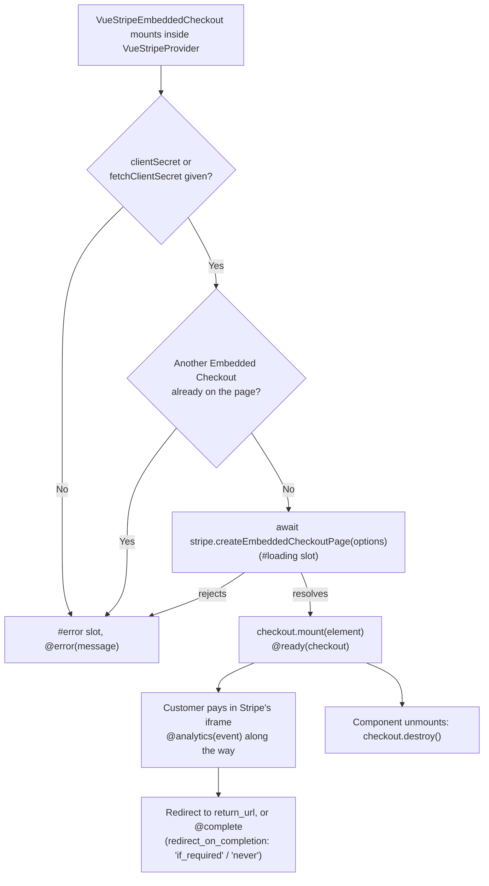

# VueStripeEmbeddedCheckout

Embeds Stripe's prebuilt Checkout page in your site with `stripe.createEmbeddedCheckoutPage()`. Stripe renders the whole payment form (line items, totals, payment methods, address and tax fields) in an iframe on your page, driven by a Checkout Session.

::: tip Embedded Checkout vs. the other checkout options
- **`VueStripeEmbeddedCheckout`** (this) - Stripe's Checkout page inside your page (`ui_mode: 'embedded_page'`). The least code; you do not lay out the form.
- **`VueStripeCheckout`** - redirect to Stripe's hosted Checkout page on `checkout.stripe.com`.
- **`VueStripeCheckoutElementsProvider`** - your own layout with Stripe Elements, backed by a Checkout Session (`ui_mode: 'elements'`).
:::

## Requirements

- Must be used **inside** [`VueStripeProvider`](/api/components/stripe-provider). It does not need `VueStripeElements`.
- Needs a Checkout Session created on your server with `ui_mode: 'embedded_page'` and a `return_url`; pass its `client_secret` to the component.
- Stripe allows **one** Embedded Checkout per page. A second `VueStripeEmbeddedCheckout` mounted at the same time reports an error instead of loading.

```js
// Node.js
const session = await stripe.checkout.sessions.create({
  ui_mode: 'embedded_page',
  line_items: [{ price: 'price_xxx', quantity: 1 }],
  mode: 'payment',
  return_url: 'https://example.com/complete?session_id={CHECKOUT_SESSION_ID}'
})

res.json({ clientSecret: session.client_secret })
```

## How It Works



## Usage

```vue
<template>
  <VueStripeProvider :publishable-key="publishableKey">
    <VueStripeEmbeddedCheckout
      :fetch-client-secret="fetchClientSecret"
      @ready="onReady"
      @complete="onComplete"
      @error="onError"
    />
  </VueStripeProvider>
</template>

<script setup>
import { VueStripeProvider, VueStripeEmbeddedCheckout } from '@vue-stripe/vue-stripe'

const publishableKey = import.meta.env.VITE_STRIPE_PUBLISHABLE_KEY

const fetchClientSecret = () =>
  fetch('/api/checkout-session', { method: 'POST' })
    .then((response) => response.json())
    .then((data) => data.clientSecret)

const onReady = () => console.log('Embedded Checkout is on the page')
const onComplete = () => console.log('Checkout Session completed')
const onError = (message) => console.error(message)
</script>
```

## Props

| Prop | Type | Required | Description |
|------|------|----------|-------------|
| `clientSecret` | `string` | One of the two | Client secret of a Checkout Session created with `ui_mode: 'embedded_page'` |
| `fetchClientSecret` | `() => Promise<string>` | One of the two | Function resolving to the client secret. Stripe calls it when the page is created |
| `onLineItemsChange` | `(event: StripeEmbeddedCheckoutLineItemsChangeEvent) => Promise<ResultAction>` | No | Called when the customer adds, removes or changes a line item. Resolve `{ type: 'accept' }` or `{ type: 'reject', errorMessage }`. Required when the session sets `permissions.update.line_items: 'server_only'` |

The options are read once, when the page is created. To show another Checkout Session, re-mount the component, for example by changing its `key`:

```vue
<VueStripeEmbeddedCheckout :key="clientSecret" :client-secret="clientSecret" />
```

### onLineItemsChange

`onLineItemsChange` is a function prop, not an event, because Stripe waits for its result before it applies the change. Update the session on your server, then accept or reject:

```vue
<script setup>
const onLineItemsChange = async (event) => {
  const response = await fetch('/api/checkout-session/line-items', {
    method: 'POST',
    headers: { 'Content-Type': 'application/json' },
    body: JSON.stringify({ sessionId: event.checkoutSessionId, lineItems: event.lineItems })
  })
  return response.ok
    ? { type: 'accept' }
    : { type: 'reject', errorMessage: 'That quantity is not available' }
}
</script>

<template>
  <VueStripeEmbeddedCheckout
    :client-secret="clientSecret"
    :on-line-items-change="onLineItemsChange"
  />
</template>
```

::: info `onShippingDetailsChange` is not supported
Stripe deprecated dynamic shipping updates in Embedded Checkout (`onShippingDetailsChange`, deprecated since Stripe.js 9.14), so the component does not expose it.
:::

### Props Interface

```ts
interface VueStripeEmbeddedCheckoutProps {
  clientSecret?: string
  fetchClientSecret?: () => Promise<string>
  onLineItemsChange?: (
    event: StripeEmbeddedCheckoutLineItemsChangeEvent
  ) => Promise<{ type: 'accept' } | { type: 'reject'; errorMessage?: string }>
}
```

## Events

| Event | Payload | Description |
|-------|---------|-------------|
| `@ready` | `StripeEmbeddedCheckout` | Emitted after the page is created and mounted |
| `@complete` | none | Stripe's `onComplete`: the Checkout Session completed. Fires when Stripe does not redirect, see below |
| `@analytics` | `StripeEmbeddedCheckoutAnalyticsEventUnion` | Stripe's `onAnalyticsEvent`: `rendered`, `deviceData`, `promotionCodeApplied`, `lineItemChange`, `checkoutSubmitted`, `checkoutSubmitFailed` |
| `@error` | `string` | No client secret was given, another Embedded Checkout is already mounted, or `createEmbeddedCheckoutPage` failed |

::: tip Redirect or `@complete`
By default (`redirect_on_completion: 'always'`) Stripe sends the customer to your `return_url` after payment. To stay on the page and react to `@complete`, create the session with `redirect_on_completion: 'if_required'` (redirect-based payment methods still use `return_url`) or `'never'` (omit `return_url`).
:::

### Tracking analytics events

```vue
<script setup>
const onAnalytics = (event) => {
  if (event.eventType === 'checkoutSubmitted') {
    analytics.track('checkout_submitted', { amount: event.details.amount })
  }
}
</script>

<template>
  <VueStripeEmbeddedCheckout :client-secret="clientSecret" @analytics="onAnalytics" />
</template>
```

## Slots

### Loading Slot

Rendered while `stripe.createEmbeddedCheckoutPage()` is pending. Stripe then shows its own loader inside the iframe.

```vue
<VueStripeEmbeddedCheckout :client-secret="clientSecret">
  <template #loading>
    <p>Preparing checkout...</p>
  </template>
</VueStripeEmbeddedCheckout>
```

### Error Slot

Rendered when the page could not be created:

```vue
<VueStripeEmbeddedCheckout :client-secret="clientSecret">
  <template #error="{ error }">
    <p class="error">Checkout could not load: {{ error }}</p>
  </template>
</VueStripeEmbeddedCheckout>
```

## Exposed Properties

| Property | Type | Description |
|----------|------|-------------|
| `checkout` | `Ref<StripeEmbeddedCheckout \| null>` | The Embedded Checkout instance once created |
| `loading` | `Ref<boolean>` | `true` until the page is mounted |
| `error` | `Ref<string \| null>` | Error message, if creating the page failed |

The component calls `checkout.destroy()` when it unmounts, so you rarely need the instance yourself.

## Markup and Styling

The component renders the same parts as the element components, so the shared `vue-stripe-element-*` styles apply:

```html
<div class="vue-stripe-embedded-checkout vue-stripe-element">
  <div class="vue-stripe-embedded-checkout-error vue-stripe-element-error">...</div>
  <div class="vue-stripe-embedded-checkout-mount vue-stripe-element-mount"><!-- Stripe iframe --></div>
  <div class="vue-stripe-embedded-checkout-loader vue-stripe-element-loader">...</div>
</div>
```

Style the Checkout page itself in the [Stripe Dashboard branding settings](https://dashboard.stripe.com/settings/branding) or with the session's `branding_settings`.

## Error Handling

| Error | Cause | Solution |
|-------|-------|----------|
| `VueStripeProviderError` (thrown) | Not inside `VueStripeProvider` | Wrap the component in `VueStripeProvider` |
| `requires a clientSecret or fetchClientSecret prop` | Neither prop given | Pass one of them |
| `Only one VueStripeEmbeddedCheckout can be mounted at a time` | A second instance mounted while the first is on the page | Unmount the first one (`v-if`) before mounting another |
| Stripe error message | Invalid or expired client secret, session not `ui_mode: 'embedded_page'` | Create a new session on your server |

## TypeScript

```ts
import { VueStripeEmbeddedCheckout } from '@vue-stripe/vue-stripe'
import type {
  VueStripeEmbeddedCheckoutProps,
  StripeEmbeddedCheckout,
  StripeEmbeddedCheckoutOptions,
  StripeEmbeddedCheckoutAnalyticsEventUnion,
  StripeEmbeddedCheckoutLineItemsChangeEvent
} from '@vue-stripe/vue-stripe'

const onReady = (checkout: StripeEmbeddedCheckout): void => {
  console.log('mounted', checkout)
}
const onAnalytics = (event: StripeEmbeddedCheckoutAnalyticsEventUnion): void => {
  console.log(event.eventType)
}
```

## See Also

- [Embedded Checkout Guide](/guide/embedded-checkout) - Step-by-step tutorial
- [Embedded Checkout Live Demo](/live-demo/embedded-checkout) - Pay with a test card
- [VueStripeCheckout](/api/components/stripe-checkout) - Redirect to hosted Checkout instead
- [VueStripeCheckoutElementsProvider](/api/components/stripe-checkout-provider) - Your own layout on a Checkout Session
- [Stripe Embedded Checkout docs](https://docs.stripe.com/payments/accept-a-payment?platform=web&ui=embedded-form)
