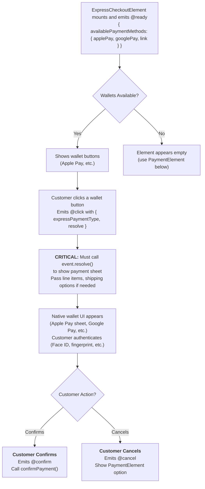

# VueStripeExpressCheckoutElement

Displays wallet payment buttons like Apple Pay, Google Pay, and Link for one-click checkout.

::: tip Standalone Element
Unlike `VueStripeLinkAuthenticationElement`, Express Checkout **can process payments independently**. It handles the full payment flow through the wallet's native interface.
:::

::: warning Requires an Intent context
Express Checkout needs `VueStripeElements` with a `clientSecret` (PaymentIntent) or a deferred Intent (`mode` / `currency` / `amount`), or a [VueStripeCheckoutElementsProvider](/api/components/stripe-checkout-provider) (see [With Checkout Sessions](#with-checkout-sessions)).
:::

## What This Element Does

| Capability | Description |
|------------|-------------|
| **Wallet Buttons** | Displays Apple Pay, Google Pay, and Link buttons |
| **One-Click Checkout** | Customers pay with saved wallet payment methods |
| **Full Payment Flow** | Handles payment authorization through wallet interface |
| **Shipping Collection** | Can collect shipping address and rates (optional) |

## Wallet Availability

| Wallet | Requirements |
|--------|--------------|
| **Apple Pay** | Safari on macOS/iOS with Apple Wallet configured |
| **Google Pay** | Chrome/Android with Google Pay configured |
| **Link** | Customer has a Stripe Link account |

::: info Device-Dependent
Express Checkout buttons only appear when wallets are available on the customer's device. Testing typically requires a real device with a configured wallet.
:::

## How It Works



## Usage

### Basic Usage

```vue
<template>
  <VueStripeProvider :publishable-key="publishableKey">
    <VueStripeElements :client-secret="clientSecret">
      <VueStripeExpressCheckoutElement
        :options="options"
        @ready="onReady"
        @click="onClick"
        @confirm="onConfirm"
      />
    </VueStripeElements>
  </VueStripeProvider>
</template>

<script setup>
import { ref } from 'vue'
import {
  VueStripeProvider,
  VueStripeElements,
  VueStripeExpressCheckoutElement
} from '@vue-stripe/vue-stripe'

const publishableKey = import.meta.env.VITE_STRIPE_PUBLISHABLE_KEY
const clientSecret = 'pi_xxx_secret_xxx' // From your backend

const options = {
  buttonType: {
    applePay: 'buy',
    googlePay: 'buy'
  },
  buttonTheme: {
    applePay: 'black',
    googlePay: 'black'
  }
}

const onReady = (event) => {
  // Check which wallets are available
  console.log('Available:', event.availablePaymentMethods)
}

const onClick = (event) => {
  // Required: Call resolve() to show payment sheet
  event.resolve({})
}

const onConfirm = async (event) => {
  // Payment authorized - confirm with your backend
  console.log('Payment type:', event.expressPaymentType)
}
</script>
```

## Props

| Prop | Type | Required | Description |
|------|------|----------|-------------|
| `options` | `StripeExpressCheckoutElementOptions` | No | Element configuration options |

::: info Updating options
Changes to `options` are applied to the mounted element with `element.update()`, and only when they really change: a re-render that passes a new but deep-equal object (e.g. an inline `:options="{ ... }"`) does not call `update()`.
:::

### Options Object

```ts
interface StripeExpressCheckoutElementOptions {
  buttonType?: {
    applePay?: 'plain' | 'buy' | 'check-out' | 'subscribe' | 'add-money' | 'book' | 'contribute' | 'donate' | 'order' | 'reload' | 'rent' | 'support' | 'tip' | 'top-up'
    googlePay?: 'plain' | 'buy' | 'book' | 'checkout' | 'donate' | 'order' | 'pay' | 'subscribe'
  }
  buttonTheme?: {
    applePay?: 'black' | 'white' | 'white-outline'
    googlePay?: 'black' | 'white'
  }
  layout?: {
    maxColumns?: number  // Max buttons per row
    maxRows?: number     // Max rows to display
    overflow?: 'auto' | 'never'
  }
  paymentMethods?: {
    applePay?: 'auto' | 'never'
    googlePay?: 'auto' | 'never'
    link?: 'auto' | 'never'
  }
}
```

## Events

| Event | Payload | Description |
|-------|---------|-------------|
| `@ready` | `StripeExpressCheckoutElementReadyEvent` | Emitted when mounted, includes available wallets |
| `@click` | `StripeExpressCheckoutElementClickEvent` | Emitted when a wallet button is clicked |
| `@confirm` | `StripeExpressCheckoutElementConfirmEvent` | Emitted when payment is authorized |
| `@cancel` | - | Emitted when customer cancels payment sheet |
| `@shippingaddresschange` | `StripeExpressCheckoutElementShippingAddressChangeEvent` | Emitted when shipping address changes. Call `event.resolve()` with updated line items/shipping rates, or `event.reject()` if the address is unsupported |
| `@shippingratechange` | `StripeExpressCheckoutElementShippingRateChangeEvent` | Emitted when shipping rate changes. Call `event.resolve()` with updated line items, or `event.reject()` if the rate is unsupported |
| `@loaderror` | `{ elementType: 'expressCheckout', error: StripeError }` | Emitted when the element fails to load |
| `@availablepaymentmethodschange` | `StripeExpressCheckoutElementAvailablePaymentMethodsChangeEvent` | Emitted when the wallets that can be shown change |
| `@focus` | - | Emitted when a button gains focus |
| `@blur` | - | Emitted when a button loses focus |
| `@escape` | - | Emitted when the escape key is pressed |

Unlike the other element components, `@ready` emits Stripe's ready event (it carries `availablePaymentMethods`), not the element. Use the exposed `element` member to reach the Stripe element.

`@loaderror` also fires when creating the element fails (for example when the surrounding provider does not support it), with the payload `{ elementType: 'expressCheckout', error: { message } }`; the message is also shown through the `#error` slot.

### Ready Event

```ts
interface StripeExpressCheckoutElementReadyEvent {
  availablePaymentMethods?: {
    applePay?: boolean
    googlePay?: boolean
    link?: boolean
  }
}
```

### Click Event (Critical!)

The `@click` event **must call `event.resolve()`** to continue with the payment sheet:

```ts
interface StripeExpressCheckoutElementClickEvent {
  expressPaymentType: 'apple_pay' | 'google_pay' | 'link'
  resolve: (options?: ClickResolveOptions) => void
}

interface ClickResolveOptions {
  lineItems?: Array<{
    name: string
    amount: number
  }>
  shippingOptions?: Array<{
    id: string
    label: string
    amount: number
  }>
  applePay?: {
    recurringPaymentRequest?: { ... }
  }
}
```

### Confirm Event

```ts
interface StripeExpressCheckoutElementConfirmEvent {
  expressPaymentType: 'apple_pay' | 'google_pay' | 'link'
  paymentMethodId?: string
  billingDetails?: {
    name?: string
    email?: string
    phone?: string
    address?: { ... }
  }
  shippingAddress?: { ... }
  shippingRate?: { ... }
}
```

## Slots

| Slot | Slot Props | Description |
|------|-----------|-------------|
| `#loading` | - | Rendered while the element is loading (default: "Loading express checkout...") |
| `#error` | `{ error: string }` | Rendered when the element has an error: a load error or a creation error |

```vue
<VueStripeExpressCheckoutElement>
  <template #loading>
    <div class="skeleton-loader">Loading...</div>
  </template>

  <template #error="{ error }">
    <p class="my-error">{{ error }}</p>
  </template>
</VueStripeExpressCheckoutElement>
```

## Exposed Methods & Properties

Access these via a template ref:

| Member | Type | Description |
|--------|------|-------------|
| `element` | `ShallowRef<StripeExpressCheckoutElement \| null>` | The Stripe element instance (`null` until created) |
| `loading` | `Ref<boolean>` | `true` until the element emits `ready` |
| `error` | `Ref<string \| null>` | Current error message (validation, load or creation error) |
| `focus()` | `() => void` | Focus the element |
| `blur()` | `() => void` | Blur the element |
| `clear()` | `() => void` | Clear the element's value |

Refs are unwrapped on the template ref, so `expressRef.value.element` is a `StripeExpressCheckoutElement | null`. Type the template ref with the component type and the element with the Stripe type:

```vue
<script setup lang="ts">
import { ref } from 'vue'
import { VueStripeExpressCheckoutElement } from '@vue-stripe/vue-stripe'
import type { StripeExpressCheckoutElement } from '@stripe/stripe-js'

const expressRef = ref<InstanceType<typeof VueStripeExpressCheckoutElement> | null>(null)

const focus = () => expressRef.value?.focus()
const clear = () => expressRef.value?.clear()
const stripeElement = (): StripeExpressCheckoutElement | null => expressRef.value?.element ?? null
</script>

<template>
  <VueStripeExpressCheckoutElement ref="expressRef" />
</template>
```

## With Checkout Sessions

Inside a [VueStripeCheckoutElementsProvider](/api/components/stripe-checkout-provider), the component is created with `checkout.createExpressCheckoutElement()`. The Checkout SDK accepts only `buttonHeight`, `buttonTheme`, `buttonType`, `layout`, `paymentMethods` and `paymentMethodOrder`; other options are dropped.

::: warning Events that never fire with Checkout Sessions
Under Checkout Sessions, `@click`, `@shippingaddresschange` and `@shippingratechange` **never fire**: line items, shipping address and shipping rates come from the session. Listen to `@confirm` and pass the event to `confirm()`.
:::

```vue
<script setup>
import { VueStripeExpressCheckoutElement, useCheckoutSession } from '@vue-stripe/vue-stripe'

const { confirm } = useCheckoutSession()

const onConfirm = async (event) => {
  const result = await confirm({ expressCheckoutConfirmEvent: event })
  if (result.type === 'error') console.error(result.error.message)
}
</script>

<template>
  <VueStripeExpressCheckoutElement @confirm="onConfirm" />
</template>
```

## Styling

The component renders this markup around Stripe's iframe:

```html
<div class="vue-stripe-express-checkout-element vue-stripe-element">
  <!-- only when there is an error (#error slot) -->
  <div class="vue-stripe-express-checkout-element-error vue-stripe-element-error">...</div>
  <!-- Stripe mounts its iframe here; plus vue-stripe-express-checkout-element-loading / vue-stripe-element-loading while loading -->
  <div class="vue-stripe-express-checkout-element-mount vue-stripe-element-mount"></div>
  <!-- only while loading (#loading slot) -->
  <div class="vue-stripe-express-checkout-element-loader vue-stripe-element-loader">...</div>
</div>
```

The default styles for these classes ship in the package stylesheet. Import it once in your app:

```ts
import '@vue-stripe/vue-stripe/style.css'
```

Target `.vue-stripe-element*` to style every element at once, or `.vue-stripe-express-checkout-element*` for this one.

## Examples

### Click Event Handling

The click event must resolve before the payment sheet appears:

```vue
<script setup>
const onClick = (event) => {
  // Simple case: just show payment sheet
  event.resolve({})
}

// Or with line items (for Apple Pay)
const onClickWithItems = (event) => {
  event.resolve({
    lineItems: [
      { name: 'Product', amount: 1999 },
      { name: 'Tax', amount: 200 }
    ]
  })
}

// Or with shipping options
const onClickWithShipping = (event) => {
  event.resolve({
    shippingOptions: [
      { id: 'standard', label: 'Standard Shipping', amount: 500 },
      { id: 'express', label: 'Express Shipping', amount: 1500 }
    ]
  })
}
</script>
```

### Confirm and Payment Completion

The confirm event does **not** carry the Elements instance (`StripeExpressCheckoutElementConfirmEvent` has no `elements` field). Confirm with the Elements group provided by `VueStripeElements`: `usePaymentIntent()` picks it up automatically (and calls `elements.submit()` first), or read it with `useStripeElements().elements.value`.

```vue
<!-- ExpressCheckout.vue: rendered inside <VueStripeElements :client-secret="clientSecret"> -->
<script setup>
import { VueStripeExpressCheckoutElement, usePaymentIntent } from '@vue-stripe/vue-stripe'

const props = defineProps({ clientSecret: String })

const { confirmPayment } = usePaymentIntent()

const onConfirm = async (event) => {
  const { error } = await confirmPayment({
    clientSecret: props.clientSecret,
    confirmParams: {
      return_url: window.location.href
    },
    redirect: 'if_required'
  })

  if (error) {
    // Let the wallet sheet show the failure
    event.paymentFailed({ reason: 'fail' })
    console.error('Payment failed:', error.message)
  } else {
    console.log('Payment succeeded!')
  }
}
</script>

<template>
  <VueStripeExpressCheckoutElement @confirm="onConfirm" />
</template>
```

The same with the raw Stripe instance:

```ts
import { useStripe, useStripeElements } from '@vue-stripe/vue-stripe'

const { stripe } = useStripe()
const { elements } = useStripeElements()

const onConfirm = async () => {
  if (!stripe.value || !elements.value) return

  const { error: submitError } = await elements.value.submit()
  if (submitError) return

  const { error } = await stripe.value.confirmPayment({
    elements: elements.value, // from VueStripeElements, not from the event
    clientSecret,
    confirmParams: { return_url: window.location.href },
    redirect: 'if_required'
  })
}
```

### Shipping Address Collection

```vue
<script setup>
const options = {
  // Enable shipping collection in Payment Intent options
}

const onShippingAddressChange = (event) => {
  // event.address / event.name describe the customer's selected address
  console.log('Shipping to:', event.name, event.address)

  // Recalculate shipping rates based on the address, then either:
  event.resolve({
    shippingRates: [
      { id: 'standard', displayName: 'Standard Shipping', amount: 500 },
      { id: 'express', displayName: 'Express Shipping', amount: 1500 }
    ]
  })
  // ...or reject if the address is unsupported:
  // event.reject()
}

const onShippingRateChange = (event) => {
  // event.shippingRate is the rate the customer selected
  console.log('Selected shipping:', event.shippingRate.displayName)

  // Update line items for the new rate, then resolve (or reject if unsupported)
  event.resolve({
    lineItems: [
      { name: 'Subtotal', amount: 1999 },
      { name: 'Shipping', amount: event.shippingRate.amount }
    ]
  })
}
</script>

<template>
  <VueStripeExpressCheckoutElement
    @shippingaddresschange="onShippingAddressChange"
    @shippingratechange="onShippingRateChange"
  />
</template>
```

### Custom Button Styling

```vue
<script setup>
const options = {
  buttonType: {
    applePay: 'check-out',  // "Check out with Apple Pay"
    googlePay: 'checkout'    // "Checkout"
  },
  buttonTheme: {
    applePay: 'white-outline',
    googlePay: 'white'
  },
  layout: {
    maxColumns: 2,
    maxRows: 1
  }
}
</script>
```

### Paired with Payment Element (Recommended)

Place Express Checkout above PaymentElement as a fast-path option:

```vue
<template>
  <VueStripeProvider :publishable-key="publishableKey">
    <VueStripeElements :client-secret="clientSecret">
      <!-- Fast checkout option -->
      <div class="express-section">
        <h3>Express Checkout</h3>
        <VueStripeExpressCheckoutElement
          @click="e => e.resolve({})"
          @confirm="onExpressConfirm"
        />
      </div>

      <div class="divider">Or pay with card</div>

      <!-- Traditional payment fallback -->
      <div class="card-section">
        <VueStripePaymentElement @change="onChange" />
        <button @click="handleSubmit">Pay</button>
      </div>
    </VueStripeElements>
  </VueStripeProvider>
</template>
```

### Detect Wallet Availability

```vue
<script setup>
import { ref } from 'vue'

const hasWallets = ref(false)
const availableWallets = ref([])

const onReady = (event) => {
  if (event.availablePaymentMethods) {
    const methods = Object.entries(event.availablePaymentMethods)
      .filter(([, available]) => available)
      .map(([method]) => method)

    availableWallets.value = methods
    hasWallets.value = methods.length > 0
  }
}
</script>

<template>
  <div>
    <VueStripeExpressCheckoutElement @ready="onReady" />

    <div v-if="!hasWallets" class="no-wallets-message">
      <p>No wallet payment methods available on this device.</p>
      <p>Use the card payment form below instead.</p>
    </div>
  </div>
</template>
```

## TypeScript

```ts
import { ref } from 'vue'
import { VueStripeExpressCheckoutElement } from '@vue-stripe/vue-stripe'
import type {
  StripeExpressCheckoutElement,
  StripeExpressCheckoutElementOptions,
  StripeExpressCheckoutElementReadyEvent,
  StripeExpressCheckoutElementClickEvent,
  StripeExpressCheckoutElementConfirmEvent,
  StripeExpressCheckoutElementShippingAddressChangeEvent,
  StripeExpressCheckoutElementShippingRateChangeEvent,
  StripeError
} from '@stripe/stripe-js'

// Options
const options: StripeExpressCheckoutElementOptions = {
  buttonType: {
    applePay: 'buy',
    googlePay: 'buy'
  },
  buttonTheme: {
    applePay: 'black',
    googlePay: 'black'
  },
  layout: {
    maxColumns: 3,
    maxRows: 1
  }
}

// Event handlers
const handleReady = (event: StripeExpressCheckoutElementReadyEvent) => {
  console.log('Available wallets:', event.availablePaymentMethods)
}

const handleClick = (event: StripeExpressCheckoutElementClickEvent) => {
  event.resolve({})
}

const handleConfirm = (event: StripeExpressCheckoutElementConfirmEvent) => {
  console.log('Payment type:', event.expressPaymentType)
}

const handleShippingAddressChange = (
  event: StripeExpressCheckoutElementShippingAddressChangeEvent
) => {
  // event.resolve({ shippingRates, lineItems }) or event.reject()
  event.resolve({})
}

const handleShippingRateChange = (
  event: StripeExpressCheckoutElementShippingRateChangeEvent
) => {
  // event.resolve({ lineItems }) or event.reject()
  event.resolve({})
}

const handleLoadError = (
  event: { elementType: 'expressCheckout'; error: StripeError }
) => {
  console.error('Express checkout failed to load:', event.error.message)
}

// Template ref: type it with the component; `.element` is the Stripe element
const expressCheckoutRef = ref<InstanceType<typeof VueStripeExpressCheckoutElement> | null>(null)
const stripeElement = (): StripeExpressCheckoutElement | null =>
  expressCheckoutRef.value?.element ?? null
```

## Comparison with PaymentElement

| Feature | Express Checkout | Payment Element |
|---------|-----------------|-----------------|
| **Use Case** | Fast-path for wallet users | Full payment method support |
| **User Action** | One-click (saved wallet) | Enter payment details |
| **Wallet Support** | Primary focus | Secondary option |
| **Card Input** | No | Yes |
| **Bank Transfers** | No | Yes |
| **Placement** | Top of checkout | Primary payment form |

## Requirements

| Requirement | Details |
|-------------|---------|
| **Intent context** | `clientSecret` or `mode` / `currency` / `amount` on `VueStripeElements`, or a Checkout Session provider |
| **HTTPS** | Required (except localhost) |
| **Wallet Enabled** | Must be enabled in Stripe Dashboard |
| **Real Device** | Wallet buttons typically require real devices with configured wallets |

## Pairing Recommendation

::: tip Recommended Pattern
**Place Express Checkout Element above StripePaymentElement** to offer customers a fast checkout option while maintaining a fallback for those without wallets configured.
:::

```
┌─────────────────────────────────────┐
│  Express Checkout (optional fast    │
│  path for wallet users)             │
├─────────────────────────────────────┤
│  ─── Or pay with card ───           │
├─────────────────────────────────────┤
│  Payment Element (full payment      │
│  form for all customers)            │
└─────────────────────────────────────┘
```

## Related Components

| Component | Relationship |
|-----------|--------------|
| [VueStripeElements](/api/components/stripe-elements) | **Parent** - Provides Elements context |
| [VueStripeCheckoutElementsProvider](/api/components/stripe-checkout-provider) | **Alternative parent** - Checkout Sessions |
| [StripePaymentElement](/api/components/stripe-payment-element) | **Recommended pair** - Fallback payment form |
| [StripeLinkAuthenticationElement](/api/components/stripe-link-authentication-element) | Alternative - Email-based Link authentication |

## See Also

- [StripeElements](/api/components/stripe-elements) - Parent container component
- [StripePaymentElement](/api/components/stripe-payment-element) - All-in-one payment UI
- [Stripe Express Checkout Documentation](https://stripe.com/docs/elements/express-checkout-element) - Official Stripe docs
