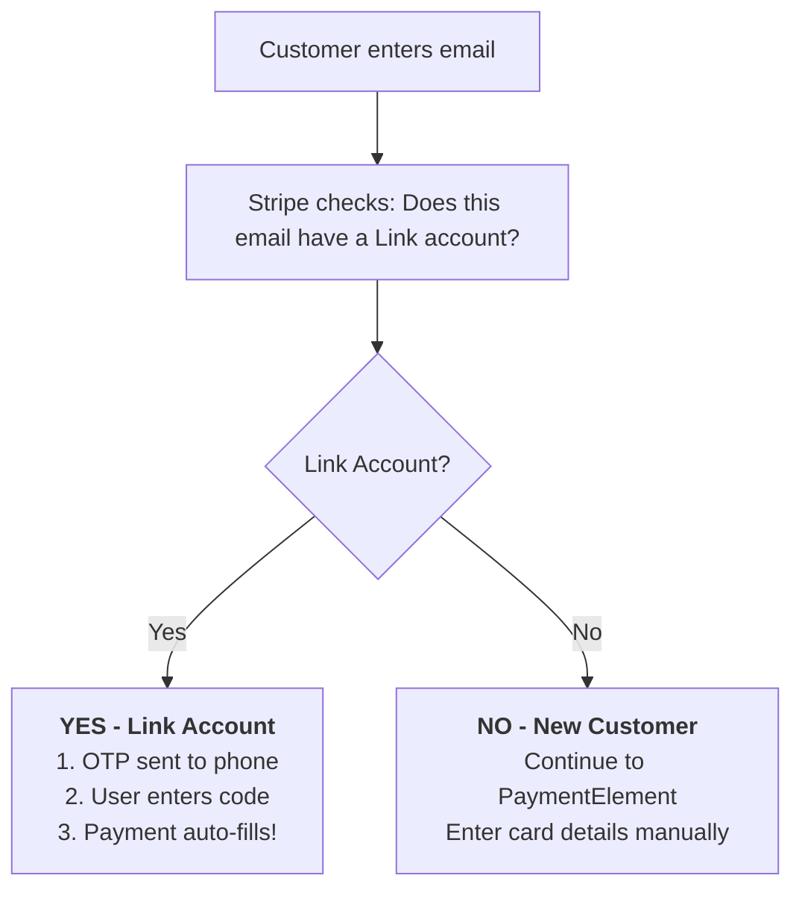

# VueStripeLinkAuthenticationElement

Collects customer email and authenticates them with Stripe Link for faster checkout.

::: tip Pairing Requirement
**This element must be paired with `VueStripePaymentElement`** to create a complete checkout flow. It cannot process payments on its own—it only handles email collection and Link authentication.
:::

::: warning Requires an Intent context
VueStripeLinkAuthenticationElement needs `VueStripeElements` with a `clientSecret` (PaymentIntent or SetupIntent) or a deferred Intent (`mode` / `currency` / `amount`). It is not available inside `VueStripeCheckoutElementsProvider` (Checkout Sessions collect the email themselves).
:::

## What This Element Does

| Capability | Description |
|------------|-------------|
| **Email Collection** | Validates and collects customer email address |
| **Link Detection** | Automatically checks if email has a saved Link account |
| **OTP Authentication** | Sends one-time password for Link account verification |
| **Auto-fill Trigger** | When authenticated, triggers auto-fill in PaymentElement |

## What This Element Does NOT Do

| Limitation | Explanation |
|------------|-------------|
| **Cannot process payments** | Must be paired with PaymentElement or other payment components |
| **Cannot collect payment info** | Only handles email, not card numbers or payment methods |
| **Cannot work standalone** | Requires VueStripeElements with a clientSecret or deferred Intent |

## Usage

### Basic Usage (Paired with PaymentElement)

```vue
<template>
  <VueStripeProvider :publishable-key="publishableKey">
    <VueStripeElements :client-secret="clientSecret">
      <!-- Step 1: Email collection + Link detection -->
      <VueStripeLinkAuthenticationElement
        @change="onEmailChange"
      />

      <!-- Step 2: Payment method selection -->
      <VueStripePaymentElement
        @change="onPaymentChange"
      />

      <button :disabled="!canPay" @click="handleSubmit">
        Pay Now
      </button>
    </VueStripeElements>
  </VueStripeProvider>
</template>

<script setup>
import { ref, computed } from 'vue'
import {
  VueStripeProvider,
  VueStripeElements,
  VueStripeLinkAuthenticationElement,
  VueStripePaymentElement
} from '@vue-stripe/vue-stripe'

const publishableKey = import.meta.env.VITE_STRIPE_PUBLISHABLE_KEY
const clientSecret = 'pi_xxx_secret_xxx' // From your backend

const emailComplete = ref(false)
const paymentComplete = ref(false)

const canPay = computed(() => emailComplete.value && paymentComplete.value)

const onEmailChange = (event) => {
  emailComplete.value = event.complete
  if (event.complete) {
    console.log('Email:', event.value.email)
  }
}

const onPaymentChange = (event) => {
  paymentComplete.value = event.complete
}
</script>
```

## How Link Authentication Works



## Props

| Prop | Type | Required | Description |
|------|------|----------|-------------|
| `options` | `StripeLinkAuthenticationElementOptions` | No | Element configuration options |

::: info Updating options
Changes to `options` are applied to the mounted element with `element.update()`, and only when they really change: a re-render that passes a new but deep-equal object (e.g. an inline `:options="{ ... }"`) does not call `update()`.
:::

### Options Object

```ts
interface StripeLinkAuthenticationElementOptions {
  defaultValues?: {
    email?: string  // Pre-fill email for logged-in users
  }
}
```

## Events

| Event | Payload | Description |
|-------|---------|-------------|
| `@ready` | `StripeLinkAuthenticationElement` | Emitted when the element is mounted and ready |
| `@change` | `StripeLinkAuthenticationElementChangeEvent` | Emitted when the email value changes |
| `@focus` | `void` | Emitted when the element gains focus |
| `@blur` | `void` | Emitted when the element loses focus |
| `@escape` | `void` | Emitted when the user presses the Escape key |
| `@loaderstart` | `{ elementType: 'linkAuthentication' }` | Emitted when the element starts loading |
| `@loaderror` | `{ elementType: 'linkAuthentication'; error: StripeError }` | Emitted when the element fails to load |

`@loaderror` also fires when creating the element fails (for example when the surrounding provider does not support it), with the payload `{ elementType: 'linkAuthentication', error: { message } }`; the message is also shown through the `#error` slot.

### Change Event

```ts
interface StripeLinkAuthenticationElementChangeEvent {
  elementType: 'linkAuthentication'
  complete: boolean        // true when email is valid
  value: {
    email: string         // The entered email address
  }
}
```

## Slots

| Slot | Slot Props | Description |
|------|-----------|-------------|
| `#loading` | - | Rendered while the element is loading (default: "Loading...") |
| `#error` | `{ error: string }` | Rendered when the element has an error: the validation message from `@change`, a load error or a creation error |

```vue
<VueStripeLinkAuthenticationElement>
  <template #loading>
    <div class="skeleton-loader">Loading...</div>
  </template>

  <template #error="{ error }">
    <p class="my-error">{{ error }}</p>
  </template>
</VueStripeLinkAuthenticationElement>
```

## Exposed Methods & Properties

Access these via a template ref:

| Member | Type | Description |
|--------|------|-------------|
| `element` | `ShallowRef<StripeLinkAuthenticationElement \| null>` | The Stripe element instance (`null` until created) |
| `loading` | `Ref<boolean>` | `true` until the element emits `ready` |
| `error` | `Ref<string \| null>` | Current error message (validation, load or creation error) |
| `focus()` | `() => void` | Focus the element |
| `blur()` | `() => void` | Blur the element |
| `clear()` | `() => void` | Clear the element's value |

The component owns the element's lifecycle: it creates, mounts and destroys the element. Removing the component (for example with `v-if`) destroys the element, which takes the place of Stripe's `element.unmount()`; for a one-time listener use Vue's `.once` modifier (`@ready.once`) instead of `element.once()`.

Refs are unwrapped on the template ref, so `linkAuthRef.value.element` is a `StripeLinkAuthenticationElement | null`. Type the template ref with the component type and the element with the Stripe type:

```vue
<script setup lang="ts">
import { ref } from 'vue'
import { VueStripeLinkAuthenticationElement } from '@vue-stripe/vue-stripe'
import type { StripeLinkAuthenticationElement } from '@stripe/stripe-js'

const linkAuthRef = ref<InstanceType<typeof VueStripeLinkAuthenticationElement> | null>(null)

const focus = () => linkAuthRef.value?.focus()
const clear = () => linkAuthRef.value?.clear()
const stripeElement = (): StripeLinkAuthenticationElement | null => linkAuthRef.value?.element ?? null
</script>

<template>
  <VueStripeLinkAuthenticationElement ref="linkAuthRef" />
</template>
```

## Styling

The component renders this markup around Stripe's iframe:

```html
<div class="vue-stripe-link-auth vue-stripe-element">
  <!-- only when there is an error (#error slot) -->
  <div class="vue-stripe-link-auth-error vue-stripe-element-error">...</div>
  <!-- Stripe mounts its iframe here; plus vue-stripe-link-auth-loading / vue-stripe-element-loading while loading -->
  <div class="vue-stripe-link-auth-mount vue-stripe-element-mount"></div>
  <!-- only while loading (#loading slot) -->
  <div class="vue-stripe-link-auth-loader vue-stripe-element-loader">...</div>
</div>
```

The default styles for these classes ship in the package stylesheet. Import it once in your app:

```ts
import '@vue-stripe/vue-stripe/style.css'
```

Target `.vue-stripe-element*` to style every element at once, or `.vue-stripe-link-auth*` for this one.

## Examples

### Pre-fill Email for Logged-in Users

```vue
<script setup>
import { computed } from 'vue'

// User from your auth system
const user = { email: 'john@example.com' }

const options = computed(() => ({
  defaultValues: {
    email: user.email
  }
}))
</script>

<template>
  <VueStripeLinkAuthenticationElement :options="options" />
</template>
```

### Complete Checkout Flow with Link

This example shows the recommended pattern for integrating Link Authentication:

```vue
<script setup>
import { ref, computed, defineComponent, h } from 'vue'
import {
  VueStripeProvider,
  VueStripeElements,
  VueStripeLinkAuthenticationElement,
  VueStripePaymentElement,
  usePaymentIntent
} from '@vue-stripe/vue-stripe'

const publishableKey = import.meta.env.VITE_STRIPE_PUBLISHABLE_KEY
const clientSecret = ref('pi_xxx_secret_xxx') // Fetch from backend

// Track form state
const customerEmail = ref('')
const emailComplete = ref(false)
const paymentComplete = ref(false)
const isProcessing = ref(false)
const paymentError = ref('')

const canSubmit = computed(() =>
  emailComplete.value && paymentComplete.value && !isProcessing.value
)

const onEmailChange = (event) => {
  emailComplete.value = event.complete
  if (event.complete) {
    customerEmail.value = event.value.email
  }
}

const onPaymentChange = (event) => {
  paymentComplete.value = event.complete
}

// Submit button component: rendered inside VueStripeElements, so its
// setup() can call usePaymentIntent()
const SubmitButton = defineComponent({
  props: ['clientSecret', 'disabled', 'email'],
  emits: ['success', 'error'],
  setup(props, { emit }) {
    const { confirmPayment } = usePaymentIntent()

    const handleSubmit = async () => {
      isProcessing.value = true
      paymentError.value = ''

      // Validates the elements (elements.submit()), then confirms the payment
      const { error, paymentIntent } = await confirmPayment({
        clientSecret: props.clientSecret,
        confirmParams: {
          return_url: window.location.href,
          receipt_email: props.email
        },
        redirect: 'if_required'
      })

      if (error) {
        emit('error', error.message)
      } else {
        emit('success', paymentIntent)
      }
      isProcessing.value = false
    }

    return () => h('button', {
      disabled: props.disabled,
      onClick: handleSubmit,
      class: 'pay-button'
    }, isProcessing.value ? 'Processing...' : 'Pay Now')
  }
})
</script>

<template>
  <VueStripeProvider :publishable-key="publishableKey">
    <VueStripeElements :client-secret="clientSecret">
      <div class="checkout-form">
        <!-- Email + Link Authentication -->
        <div class="form-section">
          <label>Email</label>
          <VueStripeLinkAuthenticationElement @change="onEmailChange" />
        </div>

        <!-- Payment Methods -->
        <div class="form-section">
          <label>Payment</label>
          <VueStripePaymentElement @change="onPaymentChange" />
        </div>

        <!-- Error Display -->
        <div v-if="paymentError" class="error">
          {{ paymentError }}
        </div>

        <!-- Submit Button -->
        <SubmitButton
          :client-secret="clientSecret"
          :disabled="!canSubmit"
          :email="customerEmail"
          @error="paymentError = $event"
        />
      </div>
    </VueStripeElements>
  </VueStripeProvider>
</template>
```

### Email-Only Demo (Testing the Element)

If you just want to test the element's email collection without payment:

```vue
<script setup>
import { ref } from 'vue'
import {
  VueStripeProvider,
  VueStripeElements,
  VueStripeLinkAuthenticationElement
} from '@vue-stripe/vue-stripe'

const publishableKey = import.meta.env.VITE_STRIPE_PUBLISHABLE_KEY
const clientSecret = 'pi_xxx_secret_xxx'

const linkAuthRef = ref()
const collectedEmail = ref('')
const isComplete = ref(false)

const handleChange = (event) => {
  isComplete.value = event.complete
  collectedEmail.value = event.value.email
}
</script>

<template>
  <VueStripeProvider :publishable-key="publishableKey">
    <VueStripeElements :client-secret="clientSecret">
      <div class="email-demo">
        <label>Email</label>
        <VueStripeLinkAuthenticationElement
          ref="linkAuthRef"
          @change="handleChange"
        />

        <div class="controls">
          <button @click="linkAuthRef?.focus()">Focus</button>
          <button @click="linkAuthRef?.blur()">Blur</button>
          <button @click="linkAuthRef?.clear()">Clear</button>
        </div>

        <div class="status">
          <p>Status: {{ isComplete ? 'Valid' : 'Incomplete' }}</p>
          <p v-if="collectedEmail">Email: {{ collectedEmail }}</p>
        </div>
      </div>
    </VueStripeElements>
  </VueStripeProvider>
</template>
```

## TypeScript

```ts
import { ref } from 'vue'
import { VueStripeLinkAuthenticationElement } from '@vue-stripe/vue-stripe'
import type {
  StripeLinkAuthenticationElement,
  StripeLinkAuthenticationElementChangeEvent,
  StripeLinkAuthenticationElementOptions
} from '@stripe/stripe-js'

// Options
const options: StripeLinkAuthenticationElementOptions = {
  defaultValues: {
    email: 'user@example.com'
  }
}

// Event handlers
const handleReady = (element: StripeLinkAuthenticationElement) => {
  console.log('Element ready:', element)
}

const handleChange = (event: StripeLinkAuthenticationElementChangeEvent) => {
  console.log('Complete:', event.complete)
  console.log('Email:', event.value.email)
}

// Template ref
const linkAuthRef = ref<InstanceType<typeof VueStripeLinkAuthenticationElement> | null>(null)

const focusEmail = () => {
  linkAuthRef.value?.focus()
}
```

## What is Stripe Link?

Stripe Link is a one-click checkout solution that saves customer payment information across all Stripe merchants:

| Feature | Benefit |
|---------|---------|
| **Cross-merchant** | Saved once, works everywhere that accepts Stripe |
| **Secure** | OTP verification, no passwords stored |
| **Fast** | Returning customers checkout in seconds |
| **Higher conversion** | Less friction = more completed purchases |

### The Link Experience

**For returning customers (has Link account):**
1. Enter email → Stripe detects Link account
2. Receive OTP on phone → Enter code
3. Payment details auto-fill → One-click checkout!

**For new customers (no Link account):**
1. Enter email → Continue normally
2. Fill payment details manually
3. Option to save to Link for next time

## Requirements

| Requirement | Details |
|-------------|---------|
| **clientSecret** | From PaymentIntent or SetupIntent |
| **Link enabled** | In [Stripe Dashboard](https://dashboard.stripe.com/settings/link) |
| **Paired element** | Must use with PaymentElement for payments |

## Integration Checklist

- StripeProvider with publishable key
- StripeElements with clientSecret
- StripeLinkAuthenticationElement for email
- StripePaymentElement for payment methods
- Submit button with payment confirmation logic
- Link enabled in Stripe Dashboard

## Related Components

| Component | Relationship |
|-----------|--------------|
| [StripeElements](/api/components/stripe-elements) | **Required parent** - Provides Elements context |
| [StripePaymentElement](/api/components/stripe-payment-element) | **Required pair** - Handles payment method selection |
| [StripeAddressElement](/api/components/stripe-address-element) | Optional - Add shipping/billing address collection |

## See Also

- [StripeElements](/api/components/stripe-elements) - Parent container component
- [StripePaymentElement](/api/components/stripe-payment-element) - All-in-one payment UI
- [Stripe Link Documentation](https://stripe.com/docs/payments/link) - Official Stripe Link docs
