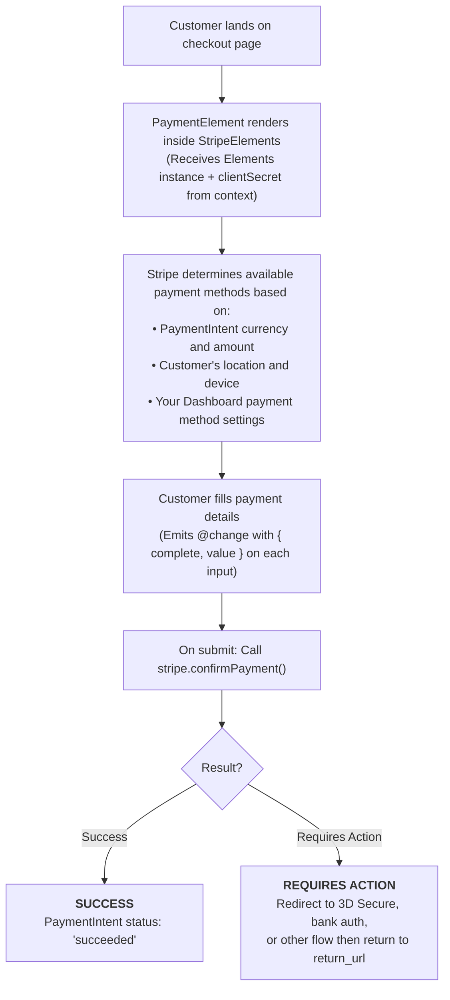

# VueStripePaymentElement

Stripe's recommended all-in-one payment component that supports cards, wallets (Apple Pay, Google Pay), bank transfers, and more.

::: tip Recommended
This is Stripe's recommended component for accepting payments. It automatically displays the most relevant payment methods based on the customer's location and transaction.
:::

## What is Payment Element?

Payment Element is Stripe's modern, unified payment interface that:

| Capability | Description |
|------------|-------------|
| **40+ Payment Methods** | Cards, wallets, bank transfers, BNPL, and regional methods |
| **Dynamic Display** | Automatically shows relevant methods based on customer location |
| **Built-in Validation** | Real-time error handling and input validation |
| **Responsive Design** | Adapts to any screen size and device |
| **Localization** | Automatic translation based on customer's locale |

## How It Works



## Usage

```vue
<template>
  <VueStripeProvider :publishable-key="publishableKey">
    <VueStripeElements :client-secret="clientSecret">
      <VueStripePaymentElement
        :options="paymentOptions"
        @ready="onReady"
        @change="onChange"
      />
      <button @click="handleSubmit" :disabled="!isComplete">
        Pay
      </button>
    </VueStripeElements>
  </VueStripeProvider>
</template>

<script setup>
import {
  VueStripeProvider,
  VueStripeElements,
  VueStripePaymentElement
} from '@vue-stripe/vue-stripe'
import { ref } from 'vue'

const publishableKey = 'pk_test_...'
const clientSecret = 'pi_xxx_secret_xxx' // From your backend

const isComplete = ref(false)

const paymentOptions = {
  layout: 'tabs'
}

const onReady = (element) => {
  console.log('Payment element ready', element)
}

const onChange = (event) => {
  isComplete.value = event.complete
}
</script>
```

## Requirements

The Payment Element needs one of:

- **A `clientSecret`** on `VueStripeElements` from a PaymentIntent or SetupIntent:
  1. **Create via your backend** - Recommended for production
  2. **Create via Stripe Dashboard** - For testing:
     - Go to [Stripe Dashboard → Payments](https://dashboard.stripe.com/test/payments)
     - Click **"+ Create"** → **"Create payment"**
     - Enter an amount and copy the `client_secret`
- **A deferred Intent**: `mode` / `currency` / `amount` on `VueStripeElements`, creating the Intent on your server at submit time. Restrict payment methods here with `:options="{ allowedPaymentMethodTypes: [...] }"` on `VueStripeElements` (the v5 `paymentMethodTypes` prop was removed).
- **A Checkout Session**: place it inside [VueStripeCheckoutElementsProvider](/api/components/stripe-checkout-provider) (see [With Checkout Sessions](#with-checkout-sessions)).

## Props

| Prop | Type | Required | Description |
|------|------|----------|-------------|
| `options` | `StripePaymentElementOptions` | No | Payment element configuration |

::: info Updating options
Changes to `options` are applied to the mounted element with `element.update()`, and only when they really change: a re-render that passes a new but deep-equal object (e.g. an inline `:options="{ ... }"`) does not call `update()`.
:::

### Options Object

```ts
interface StripePaymentElementOptions {
  layout?: 'tabs' | 'accordion' | 'auto' | {
    type: 'tabs' | 'accordion'
    defaultCollapsed?: boolean
    radios?: boolean
    spacedAccordionItems?: boolean
  }
  defaultValues?: {
    billingDetails?: {
      name?: string
      email?: string
      phone?: string
      address?: {
        line1?: string
        line2?: string
        city?: string
        state?: string
        postal_code?: string
        country?: string
      }
    }
  }
  business?: {
    name?: string
  }
  paymentMethodOrder?: string[]
  fields?: {
    billingDetails?: 'auto' | 'never' | {
      name?: 'auto' | 'never'
      email?: 'auto' | 'never'
      phone?: 'auto' | 'never'
      address?: 'auto' | 'never' | {
        line1?: 'auto' | 'never'
        line2?: 'auto' | 'never'
        city?: 'auto' | 'never'
        state?: 'auto' | 'never'
        postal_code?: 'auto' | 'never'
        country?: 'auto' | 'never'
      }
    }
  }
  wallets?: {
    applePay?: 'auto' | 'never'
    googlePay?: 'auto' | 'never'
  }
  terms?: {
    card?: 'auto' | 'always' | 'never'
    auBecsDebit?: 'auto' | 'always' | 'never'
    bancontact?: 'auto' | 'always' | 'never'
    ideal?: 'auto' | 'always' | 'never'
    sepaDebit?: 'auto' | 'always' | 'never'
    sofort?: 'auto' | 'always' | 'never'
    usBankAccount?: 'auto' | 'always' | 'never'
  }
}
```

## Events

| Event | Payload | Description |
|-------|---------|-------------|
| `@ready` | `StripePaymentElement` | Emitted when the element is fully rendered |
| `@change` | `StripePaymentElementChangeEvent` | Emitted when the element value changes |
| `@focus` | - | Emitted when the element gains focus |
| `@blur` | - | Emitted when the element loses focus |
| `@escape` | - | Emitted when the escape key is pressed |
| `@loaderstart` | `{ elementType: 'payment' }` | Emitted when the element starts loading |
| `@loaderror` | `{ elementType: 'payment'; error: StripeError }` | Emitted when the element fails to load |
| `@availablepaymentmethodschange` | `StripePaymentElementAvailablePaymentMethodsChangeEvent` | Emitted when the set of payment methods shown changes |
| `@carddetailschange` | `StripePaymentElementCardDetailsChangeEvent` | Emitted when the entered card's brand or details change |
| `@savedpaymentmethodupdate` | `StripePaymentElementSavedPaymentMethodUpdateEvent` | Emitted when a saved payment method is updated |
| `@savedpaymentmethodremove` | `StripePaymentElementSavedPaymentMethodRemoveEvent` | Emitted when a saved payment method is removed |

`@loaderror` also fires when creating the element fails (for example when the surrounding provider does not support it), with the payload `{ elementType: 'payment', error: { message } }`; the message is also shown through the `#error` slot.

There is no `@loaderstop` event: Stripe.js never emits one (v5 listed it by mistake). The element is loaded when `@ready` fires.

### Change Event

```ts
interface StripePaymentElementChangeEvent {
  elementType: 'payment'
  empty: boolean
  complete: boolean
  collapsed?: boolean
  value: {
    type: string // e.g., 'card', 'ideal', 'sepa_debit'
  }
}
```

## Slots

| Slot | Slot Props | Description |
|------|-----------|-------------|
| `#loading` | - | Rendered while the element is loading (default: "Loading payment form...") |
| `#error` | `{ error: string }` | Rendered when the element has an error: the validation message from `@change`, a load error or a creation error |

```vue
<VueStripePaymentElement>
  <template #loading>
    <div class="skeleton-loader">Loading...</div>
  </template>

  <template #error="{ error }">
    <p class="my-error">{{ error }}</p>
  </template>
</VueStripePaymentElement>
```

## Exposed Methods & Properties

Access these via a template ref:

| Member | Type | Description |
|--------|------|-------------|
| `element` | `ShallowRef<StripePaymentElement \| null>` | The Stripe element instance (`null` until created) |
| `loading` | `Ref<boolean>` | `true` until the element emits `ready` |
| `error` | `Ref<string \| null>` | Current error message (validation, load or creation error) |
| `focus()` | `() => void` | Focus the element |
| `blur()` | `() => void` | Blur the element |
| `clear()` | `() => void` | Clear the element's value |
| `collapse()` | `() => void` | Collapse the Payment Element (accordion layout) |

Refs are unwrapped on the template ref, so `paymentRef.value.element` is a `StripePaymentElement | null`. Type the template ref with the component type and the element with the Stripe type:

```vue
<script setup lang="ts">
import { ref } from 'vue'
import { VueStripePaymentElement } from '@vue-stripe/vue-stripe'
import type { StripePaymentElement } from '@stripe/stripe-js'

const paymentRef = ref<InstanceType<typeof VueStripePaymentElement> | null>(null)

const focus = () => paymentRef.value?.focus()
const clear = () => paymentRef.value?.clear()
const stripeElement = (): StripePaymentElement | null => paymentRef.value?.element ?? null
const collapse = () => paymentRef.value?.collapse()
</script>

<template>
  <VueStripePaymentElement ref="paymentRef" />
</template>
```

## With Checkout Sessions

Inside a [VueStripeCheckoutElementsProvider](/api/components/stripe-checkout-provider), the component is created with `checkout.createPaymentElement()`. The Checkout SDK accepts only `layout`, `paymentMethodOrder`, `readOnly`, `terms`, `fields`, `wallets` and `walletOptions`; other options are dropped. Confirm with `useCheckoutSession().confirm()` instead of `usePaymentIntent()`.

Saved payment methods are on by default with Checkout Sessions since Stripe.js Clover; control them with the provider's `elementsOptions.savedPaymentMethod`.

```vue
<VueStripeCheckoutElementsProvider :client-secret="clientSecret">
  <VueStripePaymentElement :options="{ layout: 'accordion' }" />
</VueStripeCheckoutElementsProvider>
```

## Styling

The component renders this markup around Stripe's iframe:

```html
<div class="vue-stripe-payment-element vue-stripe-element">
  <!-- only when there is an error (#error slot) -->
  <div class="vue-stripe-payment-element-error vue-stripe-element-error">...</div>
  <!-- Stripe mounts its iframe here; plus vue-stripe-payment-element-loading / vue-stripe-element-loading while loading -->
  <div class="vue-stripe-payment-element-mount vue-stripe-element-mount"></div>
  <!-- only while loading (#loading slot) -->
  <div class="vue-stripe-payment-element-loader vue-stripe-element-loader">...</div>
</div>
```

The default styles for these classes ship in the package stylesheet. Import it once in your app:

```ts
import '@vue-stripe/vue-stripe/style.css'
```

Target `.vue-stripe-element*` to style every element at once, or `.vue-stripe-payment-element*` for this one.

## Examples

### Tabs Layout

```vue
<VueStripePaymentElement
  :options="{ layout: 'tabs' }"
/>
```

### Accordion Layout

```vue
<VueStripePaymentElement
  :options="{
    layout: {
      type: 'accordion',
      defaultCollapsed: false,
      radios: true,
      spacedAccordionItems: true
    }
  }"
/>
```

### Pre-fill Billing Details

```vue
<script setup>
const options = {
  defaultValues: {
    billingDetails: {
      name: 'John Doe',
      email: 'john@example.com',
      phone: '+1 (555) 123-4567',
      address: {
        line1: '123 Main St',
        city: 'San Francisco',
        state: 'CA',
        postal_code: '94111',
        country: 'US'
      }
    }
  }
}
</script>

<template>
  <VueStripePaymentElement :options="options" />
</template>
```

### Hide Billing Fields

```vue
<VueStripePaymentElement
  :options="{
    fields: {
      billingDetails: 'never'
    }
  }"
/>
```

### Control Payment Method Order

```vue
<VueStripePaymentElement
  :options="{
    paymentMethodOrder: ['card', 'apple_pay', 'google_pay', 'ideal']
  }"
/>
```

### Disable Wallet Payments

```vue
<VueStripePaymentElement
  :options="{
    wallets: {
      applePay: 'never',
      googlePay: 'never'
    }
  }"
/>
```

### Complete Payment Form with usePaymentIntent

```vue
<script setup>
import { ref } from 'vue'
import {
  VueStripeProvider,
  VueStripeElements,
  VueStripePaymentElement
} from '@vue-stripe/vue-stripe'

const publishableKey = 'pk_test_...'
const clientSecret = 'pi_xxx_secret_xxx'

const isComplete = ref(false)
const status = ref('')

// This component must be inside VueStripeProvider
// Using a child component for the form is recommended
</script>

<template>
  <VueStripeProvider :publishable-key="publishableKey">
    <VueStripeElements :client-secret="clientSecret">
      <VueStripePaymentElement @change="e => isComplete = e.complete" />
      <PaymentFormButton :client-secret="clientSecret" :disabled="!isComplete" />
    </VueStripeElements>
  </VueStripeProvider>
</template>
```

```vue
<!-- PaymentFormButton.vue - child component -->
<script setup>
import { ref } from 'vue'
import { usePaymentIntent } from '@vue-stripe/vue-stripe'

const props = defineProps<{
  clientSecret: string
  disabled: boolean
}>()

const { confirmPayment, loading, error } = usePaymentIntent()

const handleSubmit = async () => {
  const result = await confirmPayment({
    clientSecret: props.clientSecret,
    confirmParams: {
      return_url: window.location.href
    },
    redirect: 'if_required'
  })

  if (result.error) {
    console.error(result.error.message)
  } else if (result.paymentIntent?.status === 'succeeded') {
    console.log('Payment successful!')
  }
}
</script>

<template>
  <div>
    <button @click="handleSubmit" :disabled="disabled || loading">
      {{ loading ? 'Processing...' : 'Pay Now' }}
    </button>
    <p v-if="error" class="error">{{ error }}</p>
  </div>
</template>
```

### With Appearance Customization

```vue
<script setup>
const appearance = {
  theme: 'stripe',
  variables: {
    colorPrimary: '#635bff',
    colorBackground: '#ffffff',
    colorText: '#1a1a2e',
    colorDanger: '#df1b41',
    fontFamily: 'system-ui, sans-serif',
    spacingUnit: '4px',
    borderRadius: '8px'
  },
  rules: {
    '.Input': {
      border: '1px solid #e0e0e0',
      boxShadow: 'none'
    },
    '.Input:focus': {
      border: '1px solid #635bff',
      boxShadow: '0 0 0 3px rgba(99, 91, 255, 0.1)'
    }
  }
}
</script>

<template>
  <VueStripeElements
    :client-secret="clientSecret"
    :options="{ appearance }"
  >
    <VueStripePaymentElement />
  </VueStripeElements>
</template>
```

## TypeScript

```ts
import { ref } from 'vue'
import { VueStripePaymentElement } from '@vue-stripe/vue-stripe'
import type {
  StripePaymentElement,
  StripePaymentElementChangeEvent,
  StripePaymentElementOptions
} from '@stripe/stripe-js'

// Options
const options: StripePaymentElementOptions = {
  layout: 'tabs',
  defaultValues: {
    billingDetails: {
      email: 'customer@example.com'
    }
  }
}

// Event handlers
const handleReady = (element: StripePaymentElement) => {
  console.log('Ready:', element)
}

const handleChange = (event: StripePaymentElementChangeEvent) => {
  console.log('Complete:', event.complete)
  console.log('Payment type:', event.value.type)
}

// Template ref
const paymentRef = ref<InstanceType<typeof VueStripePaymentElement> | null>(null)
```

## Test Cards

Use these test card numbers in test mode:

| Card | Number |
|------|--------|
| Visa (success) | `4242 4242 4242 4242` |
| Visa (declined) | `4000 0000 0000 0002` |
| Requires 3D Secure | `4000 0025 0000 3155` |
| Insufficient funds | `4000 0000 0000 9995` |

Use any future expiration date and any 3-digit CVC.

## Advantages Over Card Element

| Feature | Payment Element | Card Element |
|---------|----------------|--------------|
| Multiple payment methods | Yes | Cards only |
| Wallets (Apple/Google Pay) | Built-in | Separate component |
| Bank transfers | Yes | No |
| Buy Now Pay Later | Yes | No |
| Dynamic optimization | Yes | No |
| Localization | Automatic | Manual |

## See Also

- [StripeElements](/api/components/stripe-elements) - Parent container component
- [usePaymentIntent](/api/composables/use-payment-intent) - Confirm payments
- [Payment Element Guide](/guide/payment-element) - Step-by-step guide
- [Stripe Payment Element Docs](https://stripe.com/docs/payments/payment-element) - Official documentation
