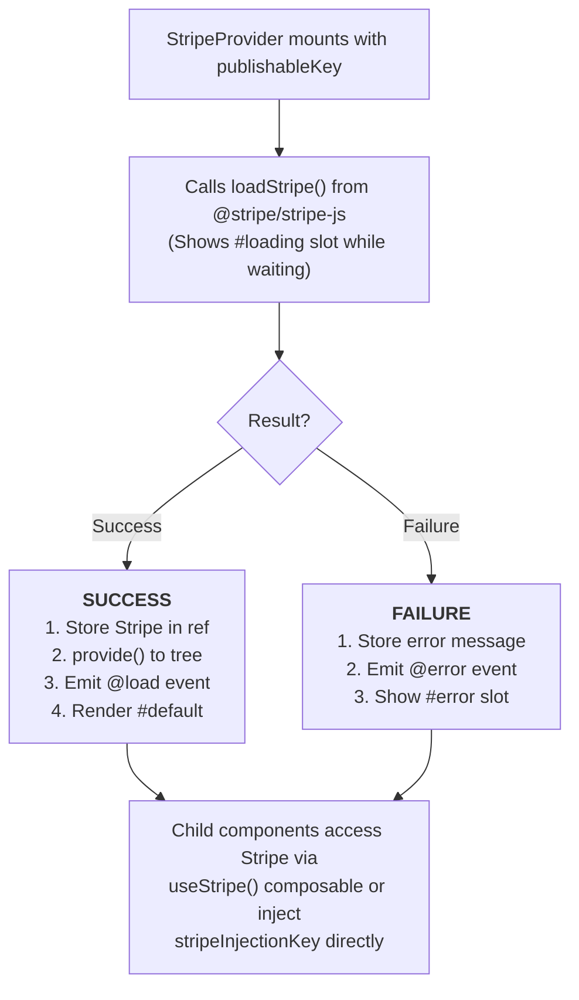

# VueStripeProvider

The root component that loads Stripe.js and provides the Stripe instance to all descendant components.

## What is StripeProvider?

StripeProvider is the foundation of any Vue Stripe integration. It handles:

| Capability | Description |
|------------|-------------|
| **Stripe.js Loading** | Asynchronously loads Stripe.js from Stripe's CDN |
| **Instance Management** | Creates and manages the Stripe instance lifecycle |
| **Context Provision** | Makes Stripe available to all child components via Vue's provide/inject |
| **Error Handling** | Catches and exposes loading errors for graceful degradation |

## How It Works



## Usage

```vue
<template>
  <VueStripeProvider
    :publishable-key="publishableKey"
    @load="onLoad"
    @error="onError"
  >
    <!-- Your payment components -->
  </VueStripeProvider>
</template>

<script setup>
import { VueStripeProvider } from '@vue-stripe/vue-stripe'

const publishableKey = import.meta.env.VITE_STRIPE_PUBLISHABLE_KEY

const onLoad = (stripe) => {
  console.log('Stripe loaded!', stripe)
}

const onError = (error) => {
  console.error('Failed to load Stripe:', error)
}
</script>
```

## Props

| Prop | Type | Required | Description |
|------|------|----------|-------------|
| `publishableKey` | `string` | Yes* | Your Stripe publishable key |
| `stripeKey` | `string` | Yes* | Alias for `publishableKey` (backwards compatibility) |
| `stripeAccount` | `string` | No | Connected account ID for Stripe Connect |
| `apiVersion` | `string` | No | Override Stripe API version |
| `locale` | `string` | No | Locale for Stripe.js (e.g., 'en', 'es', 'fr') |
| `betas` | `string[]` | No | Stripe beta flags, forwarded to `loadStripe()` (e.g. the [Tax ID Element](/api/components/stripe-tax-id-element)'s beta) |
| `developerTools` | `StripeConstructorOptions['developerTools']` | No | Stripe.js developer tooling, e.g. `{ assistant: { enabled: false } }`, forwarded to `loadStripe()` |
| `advancedFraudSignals` | `boolean` | No | Default `true`. `false` loads Stripe.js without advanced fraud signals. See [Advanced fraud signals](#advanced-fraud-signals) |
| `options` | `StripeConstructorOptions` | No | Any `loadStripe()` option. Explicit props win over the same key in `options` |

\* Either `publishableKey` or `stripeKey` is required.

The props are read once, when Stripe.js loads. To switch keys or accounts, re-mount the provider (e.g. with a `:key`).

### Options Object

Every `StripeConstructorOptions` key from `@stripe/stripe-js` (`stripeAccount`, `apiVersion`, `locale`, `betas`, `developerTools`) is a prop. The `options` prop accepts the same keys and is passed to `loadStripe()`. When a dedicated prop is also set, the prop wins:

```ts
import type { StripeConstructorOptions } from '@stripe/stripe-js'

// A few of the StripeConstructorOptions keys
const options: StripeConstructorOptions = {
  stripeAccount: 'acct_...',
  locale: 'auto',
  betas: ['custom_checkout_tax_id_1'],
  developerTools: { assistant: { enabled: false } }
}
```

```vue
<!-- betas as a prop (wins over options.betas) -->
<VueStripeProvider
  :publishable-key="publishableKey"
  :betas="['custom_checkout_tax_id_1']"
>
  <!-- ... -->
</VueStripeProvider>
```

### Developer Tools

`developerTools` configures Stripe.js's developer tooling. For example, turn off the Stripe.js assistant:

```vue
<VueStripeProvider
  :publishable-key="publishableKey"
  :developer-tools="{ assistant: { enabled: false } }"
>
  <!-- ... -->
</VueStripeProvider>
```

### Advanced Fraud Signals

By default Stripe.js collects [advanced fraud detection signals](https://docs.stripe.com/disputes/prevention/advanced-fraud-detection) for Radar. Set `advancedFraudSignals` to `false` to load Stripe.js without them:

```vue
<VueStripeProvider
  :publishable-key="publishableKey"
  :advanced-fraud-signals="false"
>
  <!-- ... -->
</VueStripeProvider>
```

The provider then calls `loadStripe.setLoadParameters({ advancedFraudSignals: false })` from `@stripe/stripe-js/pure` before it loads Stripe.js, and Stripe.js is requested as `https://js.stripe.com/endive/stripe.js?advancedFraudSignals=false`.

::: warning Trade-off
With the signals off, Radar has less information about each session, so it can be less accurate at telling fraudulent payments from legitimate ones. Turn them off only if you have a reason to, such as a privacy requirement, and keep Radar rules in mind.
:::

The setting is a load parameter of the Stripe.js script, so it only takes effect if this provider is the first thing on the page to load Stripe.js:

- Set it on every `VueStripeProvider` and on [`createVueStripe()`](/api/plugin) in the app. If another loader already started Stripe.js with the signals on, the provider logs a `[Vue Stripe]` warning and uses that Stripe.js. When several providers load with the signals off, Stripe.js logs that "existing script parameters will be used" for each load after the first; that script already has the parameter, so the notice is harmless.
- Do not import the default `@stripe/stripe-js` entry at runtime yourself (type imports are fine), and do not add a Stripe.js `<script>` tag. Both load Stripe.js with the signals on. Import `loadStripe` from `@vue-stripe/vue-stripe` instead: it is the `@stripe/stripe-js/pure` loader (with `setLoadParameters`), and it shares one Stripe.js load with every provider on the page.

Vue Stripe only loads Stripe.js through the `@stripe/stripe-js/pure` entry, so importing the library loads nothing: Stripe.js is requested when the first provider mounts (or, with the plugin, when something first needs Stripe). Providers that mount together share that one load. Stripe recommends loading Stripe.js on every page so the fraud signals cover the whole visit. If you want that, mount the provider high in the app, or import `@stripe/stripe-js` in your app entry (only when the signals stay on).

### Stripe.js Release Train

Each major version of `@stripe/stripe-js` loads one Stripe.js release train. `@stripe/stripe-js` 10, which Vue Stripe 6 requires, loads the `endive` train from `https://js.stripe.com/endive/stripe.js`, so the Stripe.js API follows the Endive release. A newer release train comes with a new `@stripe/stripe-js` major, and Vue Stripe moves to it in its own release. See Stripe's [Stripe.js versioning](https://docs.stripe.com/sdks/stripejs-versioning) guide.

The `ReleaseTrain` type is re-exported from `@stripe/stripe-js` for code that needs to name the train:

```ts
import type { ReleaseTrain } from '@vue-stripe/vue-stripe'

const train: ReleaseTrain = 'endive'
```

## Events

| Event | Payload | Description |
|-------|---------|-------------|
| `@load` | `Stripe` | Emitted when Stripe.js loads successfully |
| `@error` | `Error` | Emitted when Stripe.js fails to load |

## Slots

### Default Slot

Rendered when Stripe is ready:

```vue
<VueStripeProvider :publishable-key="key">
  <MyPaymentForm />
</VueStripeProvider>
```

### Loading Slot

Rendered while Stripe.js is loading:

```vue
<VueStripeProvider :publishable-key="key">
  <template #loading>
    <div class="spinner">Loading payment form...</div>
  </template>

  <MyPaymentForm />
</VueStripeProvider>
```

### Error Slot

Rendered when Stripe.js fails to load:

```vue
<VueStripeProvider :publishable-key="key">
  <template #error="{ error }">
    <div class="error">
      Failed to load payment form: {{ error }}
    </div>
  </template>

  <MyPaymentForm />
</VueStripeProvider>
```

## Provides

StripeProvider uses Vue's `provide` to expose a single object under the `stripeInjectionKey` symbol. That object groups the Stripe state together:

| Property | Type | Description |
|----------|------|-------------|
| `stripe` | `Ref<Stripe \| null>` | The Stripe instance |
| `loading` | `Ref<boolean>` | Whether Stripe is loading |
| `error` | `Ref<string \| null>` | Error message if loading failed |

Access this object using the [useStripe](/api/composables/use-stripe) composable, which injects `stripeInjectionKey` and returns `{ stripe, loading, error }`.

StripeProvider also provides the resolved configuration (`publishableKey`, `stripeAccount`, `apiVersion`, `locale`) as a separate object under the `stripeConfigInjectionKey` symbol, used internally by descendant components.

## Examples

### Basic Usage

```vue
<VueStripeProvider :publishable-key="pk_test_...">
  <VueStripeElements :client-secret="secret">
    <VueStripePaymentElement />
  </VueStripeElements>
</VueStripeProvider>
```

### With Stripe Connect

```vue
<VueStripeProvider
  :publishable-key="pk_test_..."
  stripe-account="acct_1234567890"
>
  <!-- Payments go to connected account -->
</VueStripeProvider>
```

### With Custom Locale

```vue
<VueStripeProvider
  :publishable-key="pk_test_..."
  locale="es"
>
  <!-- Stripe Elements will be in Spanish -->
</VueStripeProvider>
```

### With All Slots

```vue
<VueStripeProvider
  :publishable-key="publishableKey"
  @load="onStripeLoad"
  @error="onStripeError"
>
  <template #loading>
    <LoadingSpinner message="Connecting to payment provider..." />
  </template>

  <template #error="{ error }">
    <ErrorMessage
      :message="error"
      @retry="retryLoad"
    />
  </template>

  <PaymentForm />
</VueStripeProvider>
```

## Error Handling

StripeProvider handles these error cases:

| Error | Cause | Solution |
|-------|-------|----------|
| Missing key | No `publishableKey` or `stripeKey` provided | Provide a valid key |
| Network error | Failed to load Stripe.js from CDN | Check network, use `@error` to show retry option |

An invalid publishable key is not validated up front; it surfaces as a load failure through the `@error` event.

```vue
<script setup>
const handleError = (error) => {
  if (error.message.includes('network')) {
    // Show retry button
  } else {
    // Load failed (e.g. invalid key) - log to monitoring
  }
}
</script>
```

## TypeScript

```ts
import { VueStripeProvider } from '@vue-stripe/vue-stripe'
import type { Stripe } from '@stripe/stripe-js'

const onLoad = (stripe: Stripe) => {
  // stripe is fully typed
}
```

## See Also

- [useStripe](/api/composables/use-stripe) - Access Stripe instance in child components
- [StripeElements](/api/components/stripe-elements) - Create Elements instance
- [Architecture Guide](/guide/architecture) - Understand the component hierarchy
