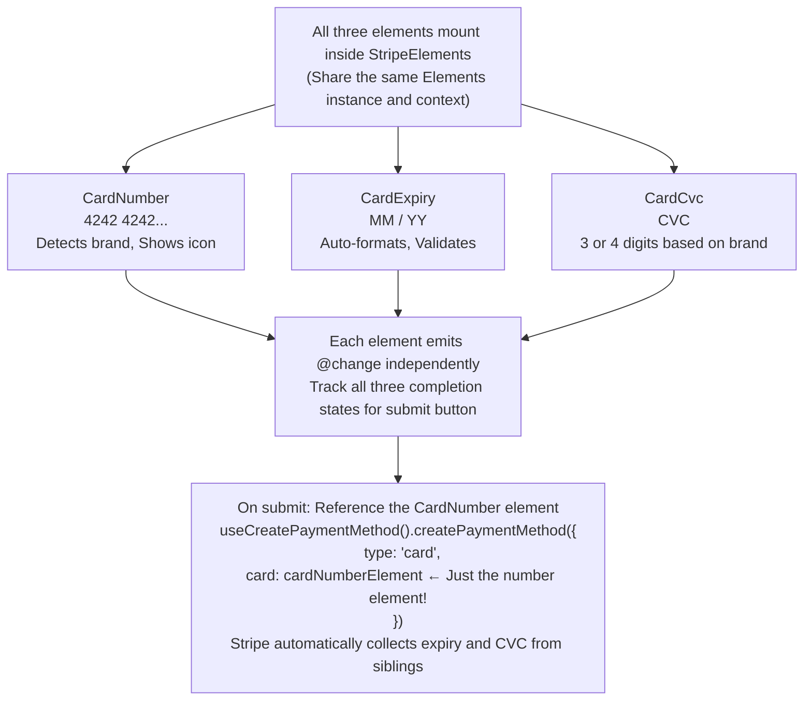

# Split Card Elements

Three separate input components for card number, expiration, and CVC. Use these when you need more control over layout and per-field validation.

::: tip When to Use
Use Split Card Elements when you need:
- Custom form layouts (horizontal, multi-column)
- Different styling per field
- Per-field validation display
- Better accessibility with separate labels

For simpler integration, consider [StripeCardElement](/api/components/stripe-card-element) instead.
:::

## What are Split Card Elements?

Split Card Elements give you granular control over card input layout:

| Component | Description |
|-----------|-------------|
| **VueStripeCardNumberElement** | Card number input with brand detection and Luhn validation |
| **VueStripeCardExpiryElement** | MM/YY expiration date with auto-formatting |
| **VueStripeCardCvcElement** | 3-4 digit security code (adapts to card brand) |

## How It Works



## Components

- **VueStripeCardNumberElement** - Card number input with brand detection
- **VueStripeCardExpiryElement** - MM/YY expiration date input
- **VueStripeCardCvcElement** - 3 or 4 digit security code input

## Usage

```vue
<template>
  <VueStripeProvider :publishable-key="publishableKey">
    <VueStripeElements>
      <div class="card-form">
        <div class="field">
          <label>Card Number</label>
          <VueStripeCardNumberElement
            :options="elementStyle"
            @change="onNumberChange"
          />
        </div>

        <div class="row">
          <div class="field">
            <label>Expiration</label>
            <VueStripeCardExpiryElement
              :options="elementStyle"
              @change="onExpiryChange"
            />
          </div>

          <div class="field">
            <label>CVC</label>
            <VueStripeCardCvcElement
              :options="elementStyle"
              @change="onCvcChange"
            />
          </div>
        </div>

        <button :disabled="!allComplete">Pay</button>
      </div>
    </VueStripeElements>
  </VueStripeProvider>
</template>

<script setup>
import { ref, computed } from 'vue'
import {
  VueStripeProvider,
  VueStripeElements,
  VueStripeCardNumberElement,
  VueStripeCardExpiryElement,
  VueStripeCardCvcElement
} from '@vue-stripe/vue-stripe'

const publishableKey = import.meta.env.VITE_STRIPE_PUBLISHABLE_KEY

const numberComplete = ref(false)
const expiryComplete = ref(false)
const cvcComplete = ref(false)

const allComplete = computed(() =>
  numberComplete.value && expiryComplete.value && cvcComplete.value
)

const elementStyle = {
  style: {
    base: {
      fontSize: '16px',
      color: '#32325d'
    }
  }
}

const onNumberChange = (event) => {
  numberComplete.value = event.complete
}

const onExpiryChange = (event) => {
  expiryComplete.value = event.complete
}

const onCvcChange = (event) => {
  cvcComplete.value = event.complete
}
</script>
```

## Props

All three components share the same props interface:

| Prop | Type | Required | Description |
|------|------|----------|-------------|
| `options` | `object` | No | Element configuration options |

::: info Updating options
Changes to `options` are applied to the mounted element with `element.update()`, and only when they really change: a re-render that passes a new but deep-equal object (e.g. an inline `:options="{ ... }"`) does not call `update()`.
:::

### Options Object

```ts
interface SplitCardElementOptions {
  style?: {
    base?: StripeElementStyle
    complete?: StripeElementStyle
    empty?: StripeElementStyle
    invalid?: StripeElementStyle
  }
  disabled?: boolean
  // CardNumber specific:
  showIcon?: boolean        // Show card brand icon
  iconStyle?: 'default' | 'solid'
}
```

## Events

All three components emit the same events:

| Event | Payload | Description |
|-------|---------|-------------|
| `@ready` | `StripeCardNumberElement` / `StripeCardExpiryElement` / `StripeCardCvcElement` | Emitted when the element is fully rendered (payload: that component's Stripe element) |
| `@change` | `StripeCardNumberElementChangeEvent` / `StripeCardExpiryElementChangeEvent` / `StripeCardCvcElementChangeEvent` | Emitted when the element value changes |
| `@focus` | - | Emitted when the element gains focus |
| `@blur` | - | Emitted when the element loses focus |
| `@escape` | - | Emitted when the escape key is pressed |

### Change Event Differences

**StripeCardNumberElement**
```ts
interface CardNumberChangeEvent {
  elementType: 'cardNumber'
  empty: boolean
  complete: boolean
  brand: 'visa' | 'mastercard' | 'amex' | 'discover' | 'diners' | 'jcb' | 'unionpay' | 'unknown'
  error?: { message: string }
}
```

**StripeCardExpiryElement**
```ts
interface CardExpiryChangeEvent {
  elementType: 'cardExpiry'
  empty: boolean
  complete: boolean
  error?: { message: string }
}
```

**StripeCardCvcElement**
```ts
interface CardCvcChangeEvent {
  elementType: 'cardCvc'
  empty: boolean
  complete: boolean
  error?: { message: string }
}
```

## Slots

Each component has the same slots:

| Slot | Slot Props | Description |
|------|-----------|-------------|
| `#loading` | - | Rendered while the element is loading (default: "Loading cardNumber...", "Loading cardExpiry...", "Loading cardCvc...") |
| `#error` | `{ error: string }` | Rendered when the element has an error: the validation message from `@change` or a creation error |

```vue
<VueStripeCardNumberElement>
  <template #loading>
    <div class="skeleton-loader">Loading...</div>
  </template>

  <template #error="{ error }">
    <p class="field-error">{{ error }}</p>
  </template>
</VueStripeCardNumberElement>
```

## Exposed Methods & Properties

Access via template ref on each component. Every component exposes the same members:

| Member | Type | Description |
|--------|------|-------------|
| `element` | `ShallowRef<StripeCardNumberElement \| null>` (`StripeCardExpiryElement` / `StripeCardCvcElement` for the others) | The Stripe element instance (`null` until created) |
| `loading` | `Ref<boolean>` | `true` until the element emits `ready` |
| `error` | `Ref<string \| null>` | Current error message (validation or creation error) |
| `focus()` | `() => void` | Focus the input |
| `blur()` | `() => void` | Blur the input |
| `clear()` | `() => void` | Clear the input value |

The component owns the element's lifecycle: it creates, mounts and destroys the element. Removing the component (for example with `v-if`) destroys the element, which takes the place of Stripe's `element.unmount()`; for a one-time listener use Vue's `.once` modifier (`@ready.once`) instead of `element.once()`.

Refs are unwrapped on the template ref, so `numberRef.value.element` is a `StripeCardNumberElement | null`. Type the template refs with the component types and the elements with the Stripe types:

```vue
<script setup lang="ts">
import { ref } from 'vue'
import {
  VueStripeCardNumberElement,
  VueStripeCardExpiryElement,
  VueStripeCardCvcElement
} from '@vue-stripe/vue-stripe'
import type { StripeCardNumberElement } from '@stripe/stripe-js'

const numberRef = ref<InstanceType<typeof VueStripeCardNumberElement> | null>(null)
const expiryRef = ref<InstanceType<typeof VueStripeCardExpiryElement> | null>(null)
const cvcRef = ref<InstanceType<typeof VueStripeCardCvcElement> | null>(null)

const focusNumber = () => numberRef.value?.focus()
const clearAll = () => {
  numberRef.value?.clear()
  expiryRef.value?.clear()
  cvcRef.value?.clear()
}

// Pass the number element to useCreatePaymentMethod().createPaymentMethod({ type: 'card', card })
const cardNumber = (): StripeCardNumberElement | null => numberRef.value?.element ?? null
</script>

<template>
  <VueStripeCardNumberElement ref="numberRef" />
  <VueStripeCardExpiryElement ref="expiryRef" />
  <VueStripeCardCvcElement ref="cvcRef" />
</template>
```

## Styling

Each component renders this markup around Stripe's iframe (`<type>` is `cardNumber`, `cardExpiry` or `cardCvc`):

```html
<div class="vue-stripe-<type>-element vue-stripe-element">
  <!-- only when there is an error (#error slot) -->
  <div class="vue-stripe-<type>-element-error vue-stripe-element-error">...</div>
  <!-- Stripe mounts its iframe here; plus -loading classes while loading -->
  <div class="vue-stripe-<type>-element-mount vue-stripe-element-mount"></div>
  <!-- only while loading (#loading slot) -->
  <div class="vue-stripe-<type>-element-loader vue-stripe-element-loader">...</div>
</div>
```

The default styles for these classes ship in the package stylesheet. Import it once in your app:

```ts
import '@vue-stripe/vue-stripe/style.css'
```

Target `.vue-stripe-element*` to style every element at once, or e.g. `.vue-stripe-cardNumber-element*` for one field.

## Examples

### Horizontal Layout

```vue
<template>
  <div class="horizontal-card-form">
    <VueStripeCardNumberElement class="number-field" />
    <VueStripeCardExpiryElement class="expiry-field" />
    <VueStripeCardCvcElement class="cvc-field" />
  </div>
</template>

<style scoped>
.horizontal-card-form {
  display: flex;
  gap: 1rem;
}

.number-field {
  flex: 2;
}

.expiry-field,
.cvc-field {
  flex: 1;
}
</style>
```

### With Per-Field Errors

```vue
<script setup>
import { ref } from 'vue'

const numberError = ref('')
const expiryError = ref('')
const cvcError = ref('')

const onNumberChange = (event) => {
  numberError.value = event.error?.message || ''
}

const onExpiryChange = (event) => {
  expiryError.value = event.error?.message || ''
}

const onCvcChange = (event) => {
  cvcError.value = event.error?.message || ''
}
</script>

<template>
  <div class="field">
    <label>Card Number</label>
    <VueStripeCardNumberElement @change="onNumberChange" />
    <span v-if="numberError" class="error">{{ numberError }}</span>
  </div>

  <div class="field">
    <label>Expiration</label>
    <VueStripeCardExpiryElement @change="onExpiryChange" />
    <span v-if="expiryError" class="error">{{ expiryError }}</span>
  </div>

  <div class="field">
    <label>CVC</label>
    <VueStripeCardCvcElement @change="onCvcChange" />
    <span v-if="cvcError" class="error">{{ cvcError }}</span>
  </div>
</template>
```

### Card Brand Detection

```vue
<script setup>
import { ref, computed } from 'vue'

const cardBrand = ref('unknown')

const brandIcon = computed(() => {
  const icons = {
    visa: 'https://js.stripe.com/v3/fingerprinted/img/visa-365725566f9578a9589553aa9296d178.svg',
    mastercard: 'https://js.stripe.com/v3/fingerprinted/img/mastercard-4d8844094130711885b5e41b28c9848f.svg',
    amex: 'https://js.stripe.com/v3/fingerprinted/img/amex-a49b82f46c5cd6a96a6e418a6ca1717c.svg',
    unknown: null
  }
  return icons[cardBrand.value] || null
})

const onNumberChange = (event) => {
  cardBrand.value = event.brand
}
</script>

<template>
  <div class="card-number-field">
    <VueStripeCardNumberElement @change="onNumberChange" />
    
  </div>
</template>
```

### Payment Submission

```vue
<!-- SplitCardForm.vue: rendered inside VueStripeElements -->
<script setup>
import {
  VueStripeCardNumberElement,
  VueStripeCardExpiryElement,
  VueStripeCardCvcElement,
  useConfirmCardPayment,
  useStripeElements
} from '@vue-stripe/vue-stripe'

const props = defineProps({
  clientSecret: { type: String, required: true }
})

const { getElement } = useStripeElements()
const { confirmCardPayment, loading: processing } = useConfirmCardPayment()

const handleSubmit = async () => {
  // Get the card number element (expiry and CVC are linked automatically)
  const cardNumberElement = getElement('cardNumber')
  if (!cardNumberElement) return

  const { error, paymentIntent } = await confirmCardPayment(props.clientSecret, {
    payment_method: {
      card: cardNumberElement,
      billing_details: {
        name: 'Customer Name'
      }
    }
  })

  if (error) {
    console.error(error.message)
  } else if (paymentIntent.status === 'succeeded') {
    console.log('Payment successful!')
  }
}
</script>

<template>
  <form @submit.prevent="handleSubmit">
    <VueStripeCardNumberElement />
    <VueStripeCardExpiryElement />
    <VueStripeCardCvcElement />
    <button :disabled="processing">Pay</button>
  </form>
</template>
```

## TypeScript

```ts
import { ref } from 'vue'
import {
  VueStripeCardNumberElement,
  VueStripeCardExpiryElement,
  VueStripeCardCvcElement
} from '@vue-stripe/vue-stripe'
import type {
  StripeCardNumberElement,
  StripeCardNumberElementChangeEvent,
  StripeCardNumberElementOptions
} from '@stripe/stripe-js'

// Options
const options: StripeCardNumberElementOptions = {
  style: {
    base: { fontSize: '16px' }
  },
  showIcon: true
}

// Event handlers
const handleNumberChange = (event: StripeCardNumberElementChangeEvent) => {
  console.log('Brand:', event.brand)
  console.log('Complete:', event.complete)
}

// Template refs
const numberRef = ref<InstanceType<typeof VueStripeCardNumberElement> | null>(null)
const expiryRef = ref<InstanceType<typeof VueStripeCardExpiryElement> | null>(null)
const cvcRef = ref<InstanceType<typeof VueStripeCardCvcElement> | null>(null)
```

## Test Cards

Use these test card numbers in test mode:

| Card | Number |
|------|--------|
| Visa | `4242 4242 4242 4242` |
| Visa (debit) | `4000 0566 5566 5556` |
| Mastercard | `5555 5555 5555 4444` |
| American Express | `3782 822463 10005` |
| Discover | `6011 1111 1111 1117` |
| Declined | `4000 0000 0000 0002` |

Use any future expiration date and any 3-digit CVC (4-digit for Amex).

## Comparison: Split vs Unified

| Feature | Split Elements | Unified CardElement |
|---------|----------------|---------------------|
| Layout Control | Full control | Limited |
| Per-field Styling | Yes | Shared styles |
| Per-field Errors | Yes | Single error |
| Accessibility | Better (separate labels) | Basic |
| Implementation | More code | Simpler |
| Brand Detection | Via change event | Via change event |

## See Also

- [StripeCardElement](/api/components/stripe-card-element) - Unified card input
- [StripeElements](/api/components/stripe-elements) - Parent container
- [useStripeElements](/api/composables/use-stripe-elements) - Access elements
