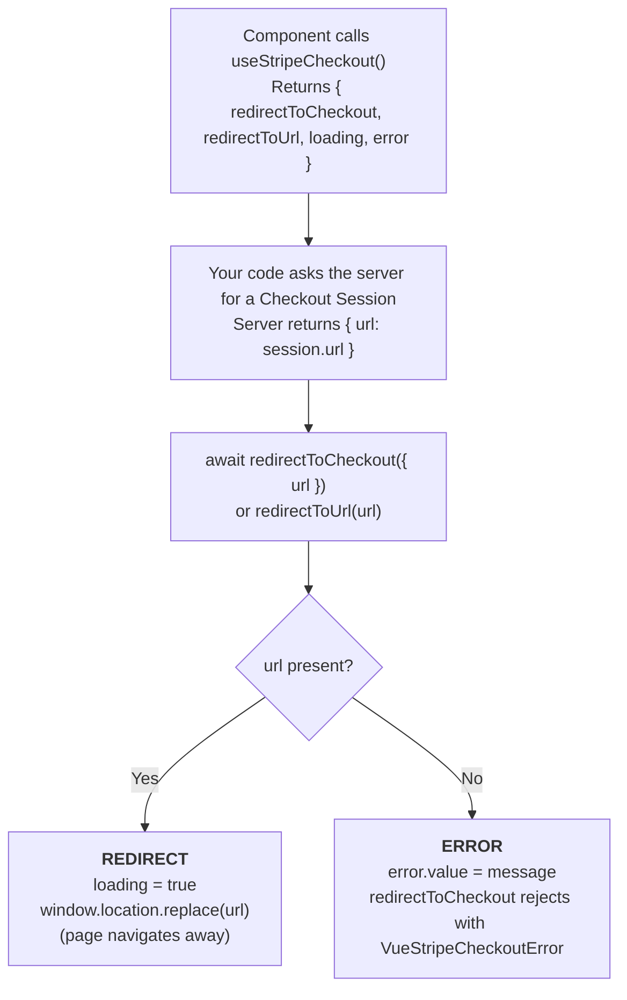

# useStripeCheckout

A composable for programmatically redirecting users to Stripe's hosted Checkout page.

::: warning URL-only since v6
Stripe.js removed `stripe.redirectToCheckout()` in Stripe.js Clover, so the client can no longer start Checkout from a session ID, price IDs or line items. Your server creates the Checkout Session and returns `session.url`; the composable redirects to that URL.
:::

## What is useStripeCheckout?

A small redirect helper with built-in state:

| Capability | Description |
|------------|-------------|
| **URL Redirect** | Navigates to the hosted Checkout Session URL from your server |
| **Validation** | `redirectToCheckout` rejects with `VueStripeCheckoutError` when the URL is missing |
| **Loading State** | Tracks whether a redirect has started |
| **Error State** | Exposes the last validation error |

It is also exported as `useCheckout`.

## How It Works



::: tip Usage Context
No Stripe instance is involved, so the composable works with or without `VueStripeProvider`, and does not need `VueStripeElements`.
:::

## Usage

```vue
<script setup>
import { useStripeCheckout } from '@vue-stripe/vue-stripe'

const { redirectToCheckout, loading, error } = useStripeCheckout()

const handleCheckout = async () => {
  const response = await fetch('/api/create-checkout-session', { method: 'POST' })
  const { url } = await response.json() // Backend returns session.url
  await redirectToCheckout({ url })
}
</script>

<template>
  <button @click="handleCheckout" :disabled="loading">
    {{ loading ? 'Redirecting...' : 'Checkout' }}
  </button>
  <p v-if="error" class="error">{{ error }}</p>
</template>
```

## Return Value

```ts
interface UseStripeCheckoutReturn {
  redirectToCheckout: (options: CheckoutRedirectOptions) => Promise<void>
  redirectToUrl: (url: string) => void
  loading: Readonly<Ref<boolean>>
  error: Readonly<Ref<string | null>>
}

interface CheckoutRedirectOptions {
  /** Hosted Checkout URL (session.url) returned by your server. */
  url: string
}
```

| Property | Type | Description |
|----------|------|-------------|
| `redirectToCheckout` | `({ url }: CheckoutRedirectOptions) => Promise<void>` | Redirect to the session URL. Rejects with `VueStripeCheckoutError` when `url` is empty |
| `redirectToUrl` | `(url: string) => void` | Redirect to the session URL without validation |
| `loading` | `Readonly<Ref<boolean>>` | `true` once a redirect has started (stays `true` while the page navigates away) |
| `error` | `Readonly<Ref<string \| null>>` | Error message from the last `redirectToCheckout` call |

## Examples

### Session Created Up Front

```vue
<script setup>
import { ref, onMounted } from 'vue'
import { useStripeCheckout } from '@vue-stripe/vue-stripe'

const { redirectToUrl, loading } = useStripeCheckout()
const sessionUrl = ref('')

onMounted(async () => {
  const response = await fetch('/api/create-checkout-session', { method: 'POST' })
  const data = await response.json()
  sessionUrl.value = data.url
})
</script>

<template>
  <button @click="redirectToUrl(sessionUrl)" :disabled="loading || !sessionUrl">
    {{ loading ? 'Redirecting...' : 'Checkout' }}
  </button>
</template>
```

### Cart Checkout

Send the cart to your server and let it build the line items (look prices up on the server; never trust amounts from the client):

```vue
<script setup>
import { ref } from 'vue'
import { useStripeCheckout } from '@vue-stripe/vue-stripe'

const { redirectToCheckout, loading } = useStripeCheckout()

const cart = ref([
  { sku: 'shirt', quantity: 2 },
  { sku: 'hat', quantity: 1 }
])

const handleCheckout = async () => {
  const response = await fetch('/api/create-checkout-session', {
    method: 'POST',
    headers: { 'Content-Type': 'application/json' },
    body: JSON.stringify({ items: cart.value })
  })
  const { url } = await response.json()
  await redirectToCheckout({ url })
}
</script>
```

### Plan Picker

```vue
<script setup lang="ts">
import { useStripeCheckout } from '@vue-stripe/vue-stripe'

defineProps<{ plans: Array<{ id: string; name: string; price: string }> }>()

const { redirectToCheckout, loading, error } = useStripeCheckout()

const handleSelectPlan = async (planId: string) => {
  try {
    const response = await fetch('/api/create-checkout-session', {
      method: 'POST',
      headers: { 'Content-Type': 'application/json' },
      body: JSON.stringify({ planId })
    })
    const { url } = await response.json()
    await redirectToCheckout({ url })
  } catch (err) {
    console.error('Failed to start checkout:', (err as Error).message)
  }
}
</script>

<template>
  <div class="pricing-grid">
    <div v-for="plan in plans" :key="plan.id" class="plan-card">
      <h3>{{ plan.name }}</h3>
      <p class="price">{{ plan.price }}</p>
      <button @click="handleSelectPlan(plan.id)" :disabled="loading">
        {{ loading ? 'Processing...' : 'Select Plan' }}
      </button>
    </div>
  </div>
  <p v-if="error" class="error">{{ error }}</p>
</template>
```

## TypeScript

```ts
import { useStripeCheckout, VueStripeCheckoutError } from '@vue-stripe/vue-stripe'
import type { CheckoutRedirectOptions, UseStripeCheckoutReturn } from '@vue-stripe/vue-stripe'

const { redirectToCheckout, redirectToUrl }: UseStripeCheckoutReturn = useStripeCheckout()

const checkout = async (url: string) => {
  const options: CheckoutRedirectOptions = { url }
  try {
    await redirectToCheckout(options)
  } catch (err) {
    if (err instanceof VueStripeCheckoutError) {
      // The server did not return a URL
    }
  }
}
```

## Error Handling

`redirectToCheckout` only fails when no URL is given: it sets `error.value` and rejects with a `VueStripeCheckoutError`. Errors from Stripe itself (an expired or invalid session) are shown on Stripe's hosted page after the redirect.

```vue
<script setup>
import { useStripeCheckout, VueStripeCheckoutError } from '@vue-stripe/vue-stripe'

const { redirectToCheckout } = useStripeCheckout()

const handleCheckout = async () => {
  const response = await fetch('/api/create-checkout-session', { method: 'POST' })
  if (!response.ok) {
    console.error('Could not create the Checkout Session')
    return
  }
  const { url } = await response.json()
  try {
    await redirectToCheckout({ url })
    // The browser is navigating away now
  } catch (err) {
    if (err instanceof VueStripeCheckoutError) {
      console.error(err.message) // "useStripeCheckout: `url` is required ..."
    }
  }
}
</script>
```

## useStripeCheckout vs VueStripeCheckout Component

| Aspect | useStripeCheckout | VueStripeCheckout Component |
|--------|-------------------|-----------------------------|
| **Use Case** | Custom UI, session created on click | Quick integration with a ready URL |
| **UI** | You build it | Pre-styled button (or your slot) |
| **Flexibility** | Full control | Limited customization |
| **Code** | More code | Less code |

Use **useStripeCheckout** when you need custom checkout triggers (e.g. form submission, multi-step flow).
Use the **VueStripeCheckout** component for a simple button-click checkout.

## Requirements

| Requirement | Details |
|-------------|---------|
| **Checkout Session URL** | Created on your server (`session.url`) |
| **No provider needed** | Works without `VueStripeProvider` and `VueStripeElements` |

## Creating Checkout Sessions (Backend)

```js
// Node.js example
const stripe = require('stripe')('sk_test_...')

app.post('/api/create-checkout-session', async (req, res) => {
  const session = await stripe.checkout.sessions.create({
    line_items: [
      {
        price: 'price_xxx',
        quantity: 1
      }
    ],
    mode: 'payment', // or 'subscription'
    success_url: 'https://example.com/success?session_id={CHECKOUT_SESSION_ID}',
    cancel_url: 'https://example.com/cancel'
  })

  res.json({ url: session.url })
})
```

## See Also

- [VueStripeCheckout](/api/components/stripe-checkout) - Pre-built checkout button component
- [useCheckoutSession](/api/composables/use-checkout-session) - Checkout Sessions with embedded Elements
- [Checkout Guide](/guide/checkout) - Step-by-step implementation guide
- [Stripe Checkout Docs](https://docs.stripe.com/payments/checkout) - Official documentation
