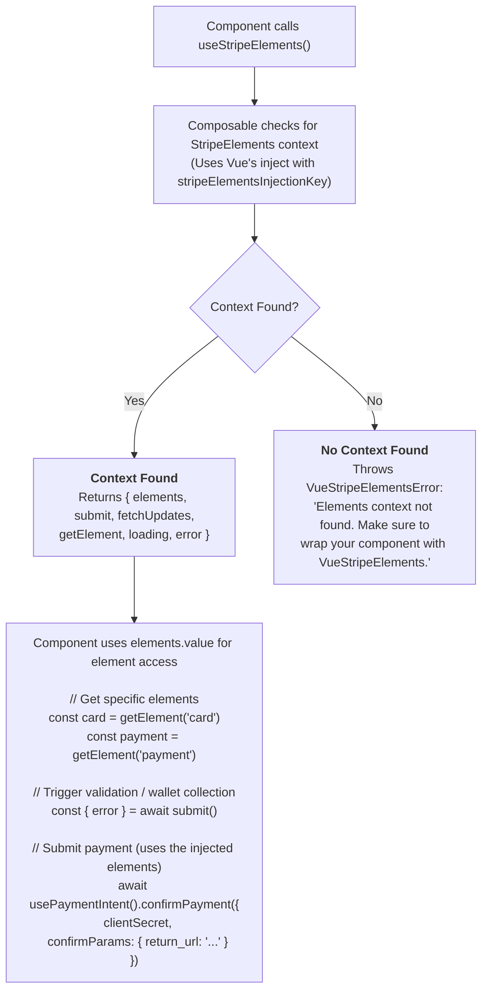

# useStripeElements

Access the Stripe Elements instance from any component within `VueStripeElements`.

## What is useStripeElements?

A composable that provides access to the Stripe Elements instance from any child component:

| Capability | Description |
|------------|-------------|
| **Elements Instance Access** | Get the StripeElements instance for element retrieval |
| **Element Retrieval** | Look up a mounted element by type with `getElement()` |
| **Form Submission** | Trigger validation and wallet collection via `submit()` |
| **Loading State** | Know when Elements is still initializing |
| **Error State** | Detect if Elements creation failed |
| **Payment Submission** | The intent composables (`usePaymentIntent`, `useSetupIntent`, ...) confirm with this same instance |

## How It Works



## Usage

```vue
<script setup>
import { useStripeElements } from '@vue-stripe/vue-stripe'

// Must be called inside a component that's within StripeElements
const { elements, submit, loading, error } = useStripeElements()
</script>
```

## Return Value

| Property | Type | Description |
|----------|------|-------------|
| `elements` | `Readonly<Ref<StripeElements \| null>>` | The Elements instance |
| `submit` | `() => Promise<ElementsSubmitResult>` | Triggers form validation and collects data required for wallets (Apple Pay, Google Pay). Call before `confirmPayment`/`confirmSetup` |
| `fetchUpdates` | `() => Promise<{ error?: { message: string; status?: string } }>` | Re-fetches the Elements' data from Stripe after you updated the Intent on your server (e.g. a new amount). Wraps `elements.fetchUpdates()` |
| `getElement` | `StripeElements['getElement']` | Looks up the element of a type created on this Elements group, e.g. `getElement('payment')`. Typed through Stripe's per-type overloads; returns `null` when there is none |
| `loading` | `Readonly<Ref<boolean>>` | True while Elements is initializing |
| `error` | `Readonly<Ref<string \| null>>` | Error message if initialization failed |

The `elements`, `loading` and `error` return values are **readonly refs**; `submit`, `fetchUpdates` and `getElement` are functions. Called before the Elements group exists, `submit` and `fetchUpdates` resolve to `{ error: { message: 'Elements not initialized' } }` and `getElement` returns `null`, instead of throwing.

### getElement

`getElement(type)` wraps `elements.getElement()`. It has the same overloads as Stripe's method, so the return type follows the element type you pass (`StripePaymentElement | null` for `'payment'`, `StripeCardElement | null` for `'card'`, and so on), and the Address Element's lookup options pass through:

```ts
const { getElement } = useStripeElements()

const payment = getElement('payment') // StripePaymentElement | null
const shipping = getElement('address', { mode: 'shipping' }) // StripeAddressElement | null
payment?.collapse()
```

It reads the current group on every call, so after `VueStripeElements` re-creates the group (a new `clientSecret` or amount) it returns the element remounted on the new group. To know when an `appearance` / `locale` update has been applied, listen to [`@update-end`](/api/components/stripe-elements#update-end) on `VueStripeElements`.

### fetchUpdates

When your server changes the PaymentIntent (amount, currency, payment method options, ...) after the Payment Element has mounted, call `fetchUpdates()` so the mounted elements reflect it:

```ts
const { fetchUpdates } = useStripeElements()

const applyCoupon = async (code: string) => {
  // Your server updates the PaymentIntent amount
  await fetch('/api/apply-coupon', { method: 'POST', body: JSON.stringify({ code }) })

  const { error } = await fetchUpdates()
  if (error) console.error(error.message)
}
```

## Examples

### Basic Usage

```vue
<script setup>
import { useStripeElements, usePaymentIntent } from '@vue-stripe/vue-stripe'

const props = defineProps({ clientSecret: { type: String, required: true } })

const { loading, error } = useStripeElements()
// Confirms with the same injected Elements instance
const { confirmPayment } = usePaymentIntent()

const handleSubmit = async () => {
  const { error } = await confirmPayment({
    clientSecret: props.clientSecret,
    confirmParams: {
      return_url: 'https://example.com/complete'
    },
    redirect: 'always'
  })
}
</script>
```

### Getting a Specific Element

```vue
<script setup>
import { useStripeElements } from '@vue-stripe/vue-stripe'

const { getElement } = useStripeElements()

const focusCard = () => {
  getElement('card')?.focus()
}

const clearCard = () => {
  getElement('card')?.clear()
}
</script>
```

### Submitting Elements

For the Payment Element, confirm with [`usePaymentIntent()`](/api/composables/use-payment-intent): it passes the injected Elements instance to Stripe for you:

```vue
<script setup>
import { usePaymentIntent } from '@vue-stripe/vue-stripe'

const props = defineProps({ clientSecret: { type: String, required: true } })

const { confirmPayment } = usePaymentIntent()

const pay = async () => {
  const { error } = await confirmPayment({
    clientSecret: props.clientSecret,
    confirmParams: {
      return_url: window.location.href
    },
    redirect: 'always'
  })

  if (error) {
    console.error(error.message)
  }
}
</script>
```

### Submitting for Validation

Call `submit()` to trigger form validation and collect data required for wallets (Apple Pay, Google Pay) before confirming payment. It resolves to an `ElementsSubmitResult` (`{ error }` on failure, or `{ selectedPaymentMethod }` on success). Calling it yourself is useful when you need to do something between validating and confirming; then pass `skipSubmit: true` so the composable does not submit again:

```vue
<!-- Rendered inside <VueStripeElements mode="payment" :amount="1099" currency="usd"> -->
<script setup>
import { useStripeElements, usePaymentIntent } from '@vue-stripe/vue-stripe'

const { submit } = useStripeElements()
const { confirmPayment } = usePaymentIntent()

const pay = async () => {
  // Trigger form validation and wallet collection
  const { error: submitError } = await submit()
  if (submitError) {
    console.error(submitError.message)
    return
  }

  // e.g. create the PaymentIntent only once the form is valid
  const response = await fetch('/api/create-payment-intent', { method: 'POST' })
  const { clientSecret } = await response.json()

  const { error } = await confirmPayment({
    clientSecret,
    confirmParams: { return_url: window.location.href },
    skipSubmit: true
  })

  if (error) {
    console.error(error.message)
  }
}
</script>
```

> `usePaymentIntent` and `useSetupIntent` call `submit()` automatically unless `skipSubmit` is `true`.

### Getting Element Data

Retrieve data from elements for validation:

```vue
<script setup>
import { ref } from 'vue'
import { useStripeElements } from '@vue-stripe/vue-stripe'

const { getElement } = useStripeElements()
const cardComplete = ref(false)

// The Payment Element emits change events that you can listen to
// But you can also check elements directly
const checkElements = () => {
  // For card element (null before the Elements group exists)
  const cardElement = getElement('card')
  // Note: getElement returns the element but not its state
  // Use the @change event on components to track completeness
}
</script>
```

## Error Handling

`useStripeElements()` throws a `VueStripeElementsError` with the message `'Elements context not found. Make sure to wrap your component with VueStripeElements.'` if called outside of `VueStripeElements`:

```vue
<!-- Wrong - outside StripeElements -->
<script setup>
const { elements } = useStripeElements() // Throws VueStripeElementsError
</script>

<template>
  <VueStripeProvider :publishable-key="key">
    <VueStripeElements :client-secret="secret">
      <MyPaymentForm />
    </VueStripeElements>
  </VueStripeProvider>
</template>
```

```vue
<!-- Correct - inside StripeElements -->
<!-- MyPaymentForm.vue -->
<script setup>
const { elements } = useStripeElements() // Works!
</script>

<!-- Parent.vue -->
<template>
  <VueStripeProvider :publishable-key="key">
    <VueStripeElements :client-secret="secret">
      <MyPaymentForm />
    </VueStripeElements>
  </VueStripeProvider>
</template>
```

## Element Types

You can retrieve different element types:

```ts
// Get elements by type
const { getElement } = useStripeElements()
const paymentElement = getElement('payment')
const cardElement = getElement('card')
const cardNumberElement = getElement('cardNumber')
const cardExpiryElement = getElement('cardExpiry')
const cardCvcElement = getElement('cardCvc')
const expressCheckoutElement = getElement('expressCheckout')
const addressElement = getElement('address')
const linkAuthenticationElement = getElement('linkAuthentication')
```

## TypeScript

```ts
import { useStripeElements } from '@vue-stripe/vue-stripe'
import type {
  StripeElements,
  StripeCardElement,
  StripePaymentElement
} from '@stripe/stripe-js'

const { elements, submit, fetchUpdates, getElement, loading, error } = useStripeElements()
// elements:     Readonly<Ref<StripeElements | null>>
// submit:       () => Promise<ElementsSubmitResult>
// fetchUpdates: () => Promise<{ error?: { message: string; status?: string } }>
// getElement:   StripeElements['getElement']

// Trigger validation / wallet collection.
// submit() resolves to { error } on failure or { selectedPaymentMethod } on success.
const validate = async () => {
  const { error: submitError } = await submit()
  return submitError
}

// Typed through Stripe's getElement overloads
const cardElement: StripeCardElement | null = getElement('card')
const paymentElement: StripePaymentElement | null = getElement('payment')
```

## Common Patterns

### Safe Elements Access

`submit()`, `fetchUpdates()` and `getElement()` already handle the group not existing yet (they resolve to `{ error }` or return `null`), and the intent composables report `'Stripe not initialized'` the same way, so you only check the element you look up:

```ts
const { getElement } = useStripeElements()

const focusPayment = () => {
  const paymentElement = getElement('payment')
  if (!paymentElement) {
    console.error('Payment Element not mounted yet')
    return
  }
  paymentElement.focus()
}
```

### With Card Element

```ts
import { useConfirmCardPayment, useStripeElements } from '@vue-stripe/vue-stripe'

const { getElement } = useStripeElements()
const { confirmCardPayment } = useConfirmCardPayment()

const payWithCard = async (clientSecret: string) => {
  const cardElement = getElement('card')
  if (!cardElement) return

  const { error, paymentIntent } = await confirmCardPayment(clientSecret, {
    payment_method: {
      card: cardElement,
      billing_details: {
        name: 'Customer Name'
      }
    }
  })

  return { error, paymentIntent }
}
```

## See Also

- [StripeElements](/api/components/stripe-elements) - The Elements provider component
- [useStripe](/api/composables/use-stripe) - Access Stripe instance
- [Payment Element Guide](/guide/payment-element) - Using Payment Element
