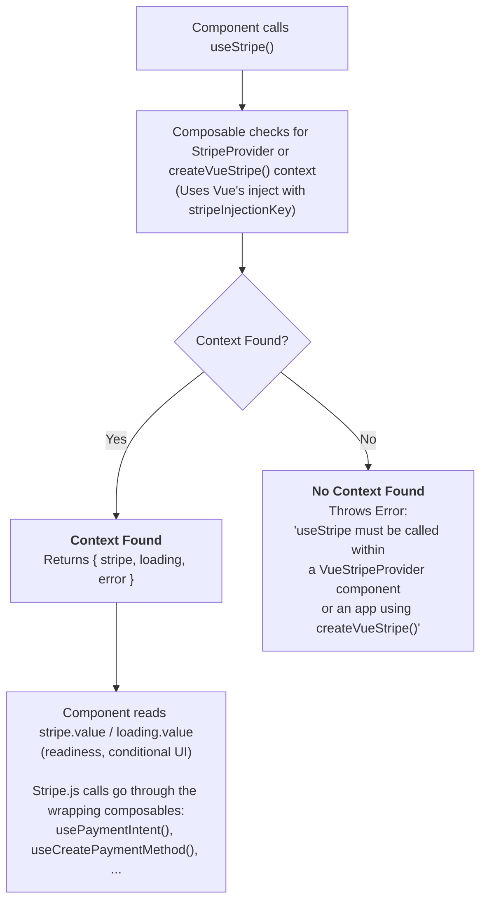

# useStripe

Access the Stripe instance from any component within `VueStripeProvider`, or anywhere in an app that installs [`createVueStripe()`](/api/plugin).

## What is useStripe?

A composable that provides access to the Stripe.js instance from any child component:

| Capability | Description |
|------------|-------------|
| **Stripe Instance Access** | Get the initialized Stripe.js instance for API calls |
| **Loading State** | Know when Stripe.js is still loading |
| **Error State** | Detect if Stripe.js failed to load |
| **Reactive Updates** | Values update automatically when Stripe loads |
| **Type Safety** | Full TypeScript support with proper typing |

## How It Works



## Usage

```vue
<script setup>
import { useStripe } from '@vue-stripe/vue-stripe'

// Must be called inside VueStripeProvider, or in an app that installs createVueStripe()
const { stripe, loading, error } = useStripe()
</script>
```

## Return Value

| Property | Type | Description |
|----------|------|-------------|
| `stripe` | `Readonly<Ref<Stripe \| null>>` | The Stripe instance |
| `loading` | `Readonly<Ref<boolean>>` | True while Stripe.js is loading |
| `error` | `Readonly<Ref<string \| null>>` | Error message if loading failed |
| `initialize` | `() => Promise<void>` | No-op kept for API consistency; initialization is handled by the provider. |

All return values are **readonly refs** - you can read their `.value` but cannot modify them.

::: tip Calling Stripe.js
Every Stripe.js method has a wrapping composable ([`usePaymentIntent`](/api/composables/use-payment-intent), [`useSetupIntent`](/api/composables/use-setup-intent), [`useCreatePaymentMethod`](/api/composables/use-create-payment-method), the [`useConfirm*` composables](/api/composables/confirm/), ...). They inject the same instance, track `loading` / `error`, and handle the not-yet-loaded case, so use `useStripe()` for readiness and state rather than for calling `stripe.value.<method>()` yourself.
:::

## Examples

### Basic Usage

```vue
<!-- Rendered inside VueStripeProvider and VueStripeElements -->
<script setup>
import { useStripe, usePaymentIntent } from '@vue-stripe/vue-stripe'

const props = defineProps({ clientSecret: { type: String, required: true } })

const { loading, error } = useStripe()
const { confirmPayment } = usePaymentIntent()

const pay = () =>
  confirmPayment({
    clientSecret: props.clientSecret,
    confirmParams: { return_url: `${window.location.origin}/complete` }
  })
</script>

<template>
  <div v-if="loading">Loading...</div>
  <div v-else-if="error">{{ error }}</div>
  <button v-else @click="pay">Pay</button>
</template>
```

### Watching for Stripe Ready

```vue
<script setup>
import { watch } from 'vue'
import { useStripe } from '@vue-stripe/vue-stripe'

const { stripe } = useStripe()

watch(stripe, (newStripe) => {
  if (newStripe) {
    console.log('Stripe is now available!')
  }
})
</script>
```

### In a Computed Property

```vue
<script setup>
import { computed } from 'vue'
import { useStripe } from '@vue-stripe/vue-stripe'

const { stripe, loading, error } = useStripe()

const isReady = computed(() => {
  return !loading.value && !error.value && stripe.value !== null
})
</script>
```

### Creating Payment Methods

Use [`useCreatePaymentMethod()`](/api/composables/use-create-payment-method) with the element from [`useStripeElements()`](/api/composables/use-stripe-elements):

```vue
<script setup>
import { useCreatePaymentMethod, useStripeElements } from '@vue-stripe/vue-stripe'

const { getElement } = useStripeElements()
const { createPaymentMethod } = useCreatePaymentMethod()

const savePaymentMethod = async () => {
  const cardElement = getElement('card')
  if (!cardElement) return

  const { error, paymentMethod } = await createPaymentMethod({
    type: 'card',
    card: cardElement
  })

  if (error) {
    console.error(error)
  } else {
    console.log('Created payment method:', paymentMethod.id)
  }
}
</script>
```

### Retrieving a PaymentIntent

Use `retrievePaymentIntent` from [`usePaymentIntent()`](/api/composables/use-payment-intent):

```vue
<script setup>
import { onMounted } from 'vue'
import { usePaymentIntent } from '@vue-stripe/vue-stripe'

const { retrievePaymentIntent } = usePaymentIntent()

onMounted(async () => {
  const clientSecret = new URLSearchParams(window.location.search).get(
    'payment_intent_client_secret'
  )

  if (clientSecret) {
    // Resolves to { error } instead of throwing while Stripe.js is not loaded
    const { paymentIntent } = await retrievePaymentIntent(clientSecret)
    console.log('Payment status:', paymentIntent?.status)
  }
})
</script>
```

## Error Handling

`useStripe()` throws an error if called outside of `VueStripeProvider` in an app that does not install [`createVueStripe()`](/api/plugin):

```vue
<!-- Wrong - useStripe() called outside StripeProvider -->
<script setup>
const { stripe } = useStripe() // Throws: "useStripe must be called within a VueStripeProvider component or an app using createVueStripe()"
</script>

<template>
  <VueStripeProvider :publishable-key="key">
    <MyForm />
  </VueStripeProvider>
</template>
```

```vue
<!-- Correct - create a child component -->
<!-- MyForm.vue -->
<script setup>
const { stripe } = useStripe() // Works!
</script>

<!-- Parent.vue -->
<template>
  <VueStripeProvider :publishable-key="key">
    <MyForm />
  </VueStripeProvider>
</template>
```

## TypeScript

```ts
import { computed } from 'vue'
import { useStripe, usePaymentIntent } from '@vue-stripe/vue-stripe'
import type { ConfirmPaymentResult } from '@vue-stripe/vue-stripe'

const { stripe, loading, error } = useStripe()
const { confirmPayment } = usePaymentIntent()

// stripe.value is typed as Stripe | null
const isReady = computed(() => !loading.value && !error.value && stripe.value !== null)

// The composable is typed end to end and handles the not-loaded case
const pay = (clientSecret: string): Promise<ConfirmPaymentResult> =>
  confirmPayment({
    clientSecret,
    confirmParams: {
      return_url: 'https://example.com/complete'
    }
  })
```

## Common Patterns

### With Loading State

`useStripe().loading` covers Stripe.js loading; the composable's own `loading` covers the call in flight:

```vue
<script setup>
import { useStripe, usePaymentIntent } from '@vue-stripe/vue-stripe'

const props = defineProps({ clientSecret: { type: String, required: true } })

const { loading } = useStripe()
const { confirmPayment, loading: processing } = usePaymentIntent()

const handleSubmit = () =>
  confirmPayment({
    clientSecret: props.clientSecret,
    confirmParams: { return_url: `${window.location.origin}/complete` }
  })
</script>

<template>
  <button
    @click="handleSubmit"
    :disabled="loading || processing"
  >
    {{ loading ? 'Loading...' : processing ? 'Processing...' : 'Pay' }}
  </button>
</template>
```

## See Also

- [StripeProvider](/api/components/stripe-provider) - The provider component
- [useStripeElements](/api/composables/use-stripe-elements) - Access Elements instance
- [Architecture Guide](/guide/architecture) - Understand the provider pattern
