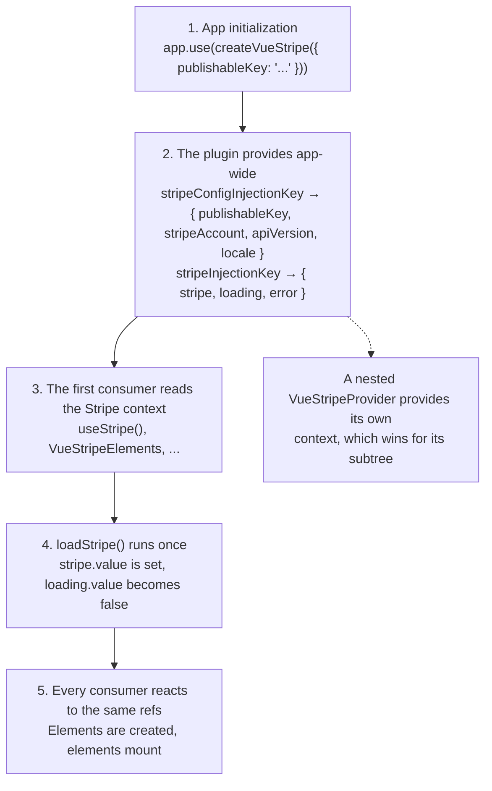

# createVueStripe Plugin

A Vue plugin that provides Stripe to your whole app, as an alternative to wrapping your tree in `VueStripeProvider`.

## What is createVueStripe?

`createVueStripe` is a Vue plugin factory. Install it once and every component in the app can use `useStripe()`, `VueStripeElements`, the element components, the intent composables, `VueStripeCheckoutElementsProvider` and `VueStripePricingTable` without a `VueStripeProvider` ancestor.

| Feature | Description |
|---------|-------------|
| **Global provider** | Provides the Stripe instance and config under the same injection keys `VueStripeProvider` uses |
| **Loads once, on demand** | Stripe.js loads the first time a component or composable needs it, then every consumer shares that instance |
| **Provider still wins** | A nested `VueStripeProvider` shadows the plugin for everything inside it |
| **Vue 2.7 and Vue 3** | `app.use(...)` on Vue 3, `Vue.use(...)` on Vue 2.7 |
| **SSR safe** | Nothing loads at install time or on the server |

## When to Use

| Scenario | Use Plugin | Use VueStripeProvider |
|----------|------------|-------------------|
| Single Stripe account for the entire app | <DocIcon name="check" /> Yes | <DocIcon name="check" /> Yes |
| Stripe in many unrelated parts of the app | <DocIcon name="check" /> Yes | <DocIcon name="warning" /> Repeated wrappers |
| Multiple Stripe accounts (Connect) | <DocIcon name="warning" /> As the default, plus a provider per account | <DocIcon name="check" /> Yes |
| Key or account known only at runtime | <DocIcon name="x" /> No | <DocIcon name="check" /> Yes |
| Custom `#loading` / `#error` slots for Stripe.js loading | <DocIcon name="warning" /> Use `useStripe()` state | <DocIcon name="check" /> Yes |

::: tip Mixing both
Install the plugin for the common case and add a `VueStripeProvider` where one subtree needs a different key, connected account or `betas`. Vue resolves the nearest provider first, so the provider wins inside its subtree and the plugin covers everything else.
:::

## How It Works



## Installation

::: code-group

```ts [Vue 3]
// main.ts
import { createApp } from 'vue'
import { createVueStripe } from '@vue-stripe/vue-stripe'
import '@vue-stripe/vue-stripe/style.css'
import App from './App.vue'

const app = createApp(App)

app.use(createVueStripe({
  publishableKey: import.meta.env.VITE_STRIPE_PUBLISHABLE_KEY
}))

app.mount('#app')
```

```js [Vue 2.7]
// main.js
import Vue from 'vue'
import { createVueStripe } from '@vue-stripe/vue-stripe'
import '@vue-stripe/vue-stripe/style.css'
import App from './App.vue'

Vue.use(createVueStripe({
  publishableKey: process.env.VUE_APP_STRIPE_PUBLISHABLE_KEY
}))

new Vue({ render: (h) => h(App) }).$mount('#app')
```

:::

On Vue 2.7 the plugin provides through a global mixin that only runs on root instances, so it never overrides a nested `VueStripeProvider`.

## Options

```ts
import type { StripeConstructorOptions } from '@stripe/stripe-js'

interface VueStripeOptions {
  /** Stripe publishable key (required) */
  publishableKey: string

  /** Connected account ID for Stripe Connect (optional) */
  stripeAccount?: string

  /** Stripe API version (optional) */
  apiVersion?: string

  /** Locale for Stripe elements (optional) */
  locale?: StripeConstructorOptions['locale']

  /** Stripe.js developer tooling (optional) */
  developerTools?: StripeConstructorOptions['developerTools']

  /** false: no advanced fraud signals (optional, default true) */
  advancedFraudSignals?: boolean
}
```

| Option | Type | Required | Description |
|--------|------|----------|-------------|
| `publishableKey` | `string` | Yes | Your Stripe publishable key (`pk_test_...` or `pk_live_...`) |
| `stripeAccount` | `string` | No | Connected account ID for Stripe Connect (`acct_...`) |
| `apiVersion` | `string` | No | Stripe API version (e.g., `'2023-10-16'`) |
| `locale` | `StripeConstructorOptions['locale']` | No | Locale for Stripe Elements UI — a constrained union of Stripe-supported locales (`'auto'`, `'en'`, `'fr'`, `'de'`, etc.) |
| `developerTools` | `StripeConstructorOptions['developerTools']` | No | Stripe.js developer tooling, e.g. `{ assistant: { enabled: false } }` |
| `advancedFraudSignals` | `boolean` | No | Default `true`. `false` loads Stripe.js without advanced fraud signals, as on [`VueStripeProvider`](/api/components/stripe-provider#advanced-fraud-signals) |

The options are passed to `loadStripe(publishableKey, { stripeAccount, apiVersion, locale, developerTools })`. With `advancedFraudSignals: false`, the plugin first calls `loadStripe.setLoadParameters({ advancedFraudSignals: false })` from `@stripe/stripe-js/pure`; read the [trade-off and requirements](/api/components/stripe-provider#advanced-fraud-signals) before you turn the signals off. For `betas`, use a `VueStripeProvider` with its `betas` prop.

## Provided Values

The plugin provides two values app-wide, under the same injection keys `VueStripeProvider` uses:

```ts
// Config (stripeConfigInjectionKey), read by VueStripePricingTable
{
  publishableKey: '...',
  stripeAccount: '...', // optional
  apiVersion: '...',    // optional
  locale: '...'         // optional
}

// Stripe context (stripeInjectionKey), read by useStripe(), VueStripeElements, ...
{
  stripe: Ref<Stripe | null>,  // null until Stripe.js has loaded
  loading: Ref<boolean>,       // true until loadStripe() settles
  error: Ref<string | null>    // the load error, if any
}
```

Stripe.js is loaded the first time something reads the Stripe context. An app that installs the plugin but renders no Stripe UI loads nothing. One plugin object loads one Stripe instance, even when it is installed into more than one app.

## Usage Examples

### Accessing Stripe in Components

No wrapper is needed. Any component can call `useStripe()`:

```vue
<!-- CheckoutForm.vue -->
<script setup lang="ts">
import { useStripe } from '@vue-stripe/vue-stripe'

const { stripe, loading, error } = useStripe()
</script>

<template>
  <div v-if="loading">Loading Stripe...</div>
  <div v-else-if="error">{{ error }}</div>
  <div v-else-if="stripe">Stripe ready!</div>
</template>
```

`useStripe()` returns `{ stripe, loading, error, initialize }`, the same shape it returns under `VueStripeProvider`.

### With VueStripeElements

`VueStripeElements` and the element components get the Stripe instance from the plugin:

```vue
<script setup lang="ts">
import { ref } from 'vue'
import { VueStripeElements, VueStripePaymentElement } from '@vue-stripe/vue-stripe'

const clientSecret = ref('pi_xxx_secret_xxx')
</script>

<template>
  <VueStripeElements :client-secret="clientSecret">
    <VueStripePaymentElement />
  </VueStripeElements>
</template>
```

`VueStripeElements` shows its `#loading` slot until Stripe.js has loaded. If Stripe.js fails to load, it shows the load error in its `#error` slot (`VueStripeCheckoutElementsProvider` does the same).

### Confirming a Payment

The intent composables work the same way:

```vue
<script setup lang="ts">
import { VueStripePaymentElement, usePaymentIntent } from '@vue-stripe/vue-stripe'

const props = defineProps<{ clientSecret: string }>()
const { confirmPayment, loading } = usePaymentIntent()

const pay = () =>
  confirmPayment({
    clientSecret: props.clientSecret,
    confirmParams: { return_url: `${window.location.origin}/complete` }
  })
</script>

<template>
  <!-- Rendered inside <VueStripeElements :client-secret="clientSecret"> -->
  <VueStripePaymentElement />
  <button :disabled="loading" @click="pay">Pay</button>
</template>
```

### Overriding with VueStripeProvider

A `VueStripeProvider` inside a plugin app wins for its own subtree, for example to act on a connected account:

```vue
<template>
  <!-- Uses the plugin's Stripe instance -->
  <PlatformCheckout />

  <!-- Uses its own Stripe instance, loaded for the connected account -->
  <VueStripeProvider publishable-key="pk_test_..." stripe-account="acct_...">
    <ConnectedAccountCheckout />
  </VueStripeProvider>
</template>
```

The provider does not inherit the plugin's options: give it its own `publishable-key` and any other options it needs.

## TypeScript

```ts
import { createVueStripe } from '@vue-stripe/vue-stripe'
import type { VueStripeOptions } from '@vue-stripe/vue-stripe'

const options: VueStripeOptions = {
  publishableKey: 'pk_test_...',
  stripeAccount: 'acct_...',
  apiVersion: '2023-10-16',
  locale: 'en'
}

app.use(createVueStripe(options))
```

```ts
import { useStripe } from '@vue-stripe/vue-stripe'

// stripe is Readonly<Ref<Stripe | null>>, from the nearest VueStripeProvider or the plugin
const { stripe, loading, error, initialize } = useStripe()
```

## Comparison with VueStripeProvider

| Feature | createVueStripe | VueStripeProvider |
|---------|-----------------|----------------|
| Configuration | Once at app init | Per component tree |
| Provides Stripe instance | Yes (loaded on first use) | Yes (loaded on mount) |
| Wrapper component needed | No | Yes |
| Multiple accounts | One default; add providers for others | Yes (one provider per account) |
| Runtime key changes | No | Yes (remount the provider) |
| `developerTools` / `advancedFraudSignals` | Yes | Yes |
| `betas` / `options` object | No | Yes (`betas`, `options` props) |
| Loading / error UI | `useStripe()` state, `VueStripeElements` slots | `#loading` / `#error` slots |
| `load` / `error` events | No | Yes |
| SSR | Never loads on the server | Loads in `onMounted` (client only) |

## Best Practices

### Do

```ts
// Use environment variables
app.use(createVueStripe({
  publishableKey: import.meta.env.VITE_STRIPE_PUBLISHABLE_KEY
}))

// Use a constrained locale value
app.use(createVueStripe({
  publishableKey: import.meta.env.VITE_STRIPE_PUBLISHABLE_KEY,
  locale: 'auto'
}))

// Read Stripe anywhere in the app
const { stripe, loading, error } = useStripe()
```

### Don't

```ts
// Don't hardcode keys
app.use(createVueStripe({
  publishableKey: 'pk_live_actual_key_here'
}))

// Don't install a second plugin to switch accounts
// Wrap the subtree that needs another account in a VueStripeProvider instead
```

## SSR Considerations

Installing the plugin is SSR-safe: `install()` only calls `app.provide()`, and the plugin never calls `loadStripe()` on the server. During server rendering `useStripe()` reports `loading: true` and `VueStripeElements` renders its `#loading` slot. In the browser, the first consumer starts the load.

## See Also

- [Installation Guide](/guide/installation) — Setup for different frameworks
- [VueStripeProvider](/api/components/stripe-provider) — Component-based alternative
- [useStripe](/api/composables/use-stripe) — Composable for accessing Stripe
- [VueStripeElements](/api/components/stripe-elements) — Elements group
