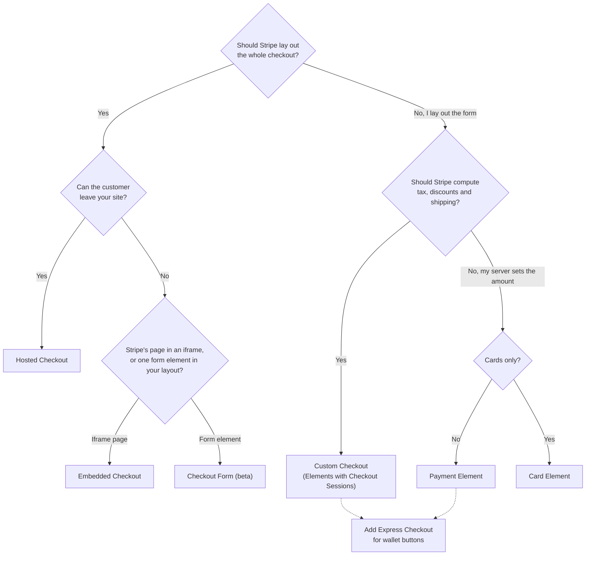

# Choosing an integration

Stripe offers several ways to take a payment in the browser, and Vue Stripe wraps all of them. They differ along two lines: who lays out the payment form, and where the order data (line items, tax, discounts, shipping) is computed. This page compares the options, and the smaller choices inside them, so you can pick one before you open a how-to guide.

## Two questions decide most of it

**Who lays out the form?** Stripe can render the whole checkout, either on its own domain or inside your page. You can also place Stripe's individual elements (payment details, address, contact details) in your own layout. In every option, the card number and other sensitive fields are rendered by Stripe inside Stripe-hosted frames. The choice is about layout and control, not about who handles card data. See [What runs where](/guide/security).

**Where does the order live?** A **Checkout Session** keeps the order on Stripe. Your server creates the session from prices or line items, and Stripe computes totals, tax, discounts, shipping options and currency conversion. With a **PaymentIntent** your server computes the amount itself and asks Stripe to collect exactly that. The Intent has no line items, tax or promotion codes unless your code adds them. [Payment objects](/guide/payment-objects) explains both objects.

## The options side by side

| Option | Where the customer pays | Who lays out the form | Order computed by |
|--------|------------------------|-----------------------|-------------------|
| [Hosted Checkout](/guide/checkout) | `checkout.stripe.com` | Stripe | Checkout Session |
| [Embedded Checkout](/guide/embedded-checkout) | Your page, inside a Stripe iframe | Stripe | Checkout Session |
| [Checkout Form](/guide/checkout-form) (beta) | Your page | Stripe, as one element | Checkout Session |
| [Custom Checkout](/guide/custom-checkout) | Your page | You, with individual elements | Checkout Session |
| [Payment Element](/guide/payment-element) | Your page | You, with individual elements | Your server |
| [Card Element](/guide/card-element) | Your page | You, card fields only | Your server |

What each option asks of your server, and which Vue Stripe pieces it uses:

| Option | Your server creates | Vue Stripe pieces |
|--------|---------------------|-------------------|
| Hosted Checkout | A session; sends its `url` | `VueStripeCheckout` or `useStripeCheckout()`, no provider needed |
| Embedded Checkout | A session with `ui_mode: 'embedded_page'`; sends its client secret | `VueStripeEmbeddedCheckout` |
| Checkout Form | A session with `ui_mode: 'form'` | `VueStripeCheckoutFormProvider`, `VueStripeCheckoutForm`, `useCheckoutForm()` |
| Custom Checkout | A session with `ui_mode: 'elements'` | `VueStripeCheckoutElementsProvider`, element components, `useCheckoutSession()` |
| Payment Element | A PaymentIntent or SetupIntent, before or after the customer fills the form | `VueStripeElements`, `VueStripePaymentElement`, `usePaymentIntent()` |
| Card Element | A PaymentIntent or SetupIntent | `VueStripeElements`, `VueStripeCardElement` (or the split card fields), `useConfirmCardPayment()` |

The [Express Checkout Element](/guide/express-checkout) is not a separate row. It adds wallet buttons (Apple Pay, Google Pay, Link and others) to the Payment Element or Custom Checkout options. See [Express Checkout and the Payment Element](#express-checkout-and-the-payment-element).

## Choosing among the Checkout options

All four Checkout options start from the same Checkout Session on your server. So they share what the session gives you: line items, automatic tax, promotion codes, shipping rates, Adaptive Pricing, subscriptions and saved payment methods, with no extra client code. They differ in how much of the page you own.

**Hosted Checkout** is the least code. The browser only follows `session.url`, and Stripe.js isn't loaded at all, which is why the redirect needs no `VueStripeProvider`. The cost is that the customer leaves your domain, and you can change the page only through the Dashboard's branding settings. Choose it when launch speed matters more than the look of the payment step.

**Embedded Checkout** shows the same Stripe-built page inside an iframe on your page. The customer stays on your domain, and you still write no form code. Stripe allows one Embedded Checkout on a page at a time, and the form looks like hosted Checkout, because it is hosted Checkout. Choose it when you want Checkout's completeness without the redirect.

**Checkout Form** (a Stripe beta) renders the whole form as one element in your own page layout. That covers contact details, addresses, wallets, the payment method, the total and the Pay button. You control the page around the form, while Stripe controls the fields and their order. Your account needs access to `ui_mode: 'form'`. Choose it when Embedded Checkout's iframe page doesn't fit your layout but you don't want to assemble the form yourself.

**Custom Checkout** (Elements with Checkout Sessions) gives you the individual elements and the session's actions: apply a promotion code, change the shipping option, update the email, confirm. You build the layout and the Pay button. Stripe still recomputes totals, tax and discounts as the session changes, and `useCheckoutSession()` exposes the updated session for your summary. Only the elements the Checkout SDK supports are available: Payment, Address, Express Checkout, Contact Details, Tax ID, Currency Selector, Terms and Link Signup. Choose it when you want your own UI but don't want to compute tax, discounts or shipping yourself.

The options also take their language from different places. Hosted and Embedded Checkout use the Checkout Session's `locale`, set on your server, and ignore the provider's `locale`; Custom Checkout and the Checkout Form follow the provider's `locale` too. Checkout Sessions accept no right-to-left locale, so an Arabic or Hebrew store can localize Custom Checkout and the Checkout Form, but not Hosted or Embedded Checkout. See [Locale](/api/components/stripe-provider#locale).

For subscriptions sold from a fixed list of plans, Stripe's no-code [Pricing Table](/guide/pricing-table) is a fifth option. You configure the products, prices, trials and the table's look in the Dashboard, and `VueStripePricingTable` embeds it. When the customer picks a plan, the table starts a hosted Checkout Session itself, so your server creates nothing; it only receives the webhooks. A change in the Dashboard shows up on your page without a deploy. In exchange, the table only sells what Stripe's pricing tables support: a few products per billing interval, flat, per-seat and tiered prices, and no usage-based (metered) prices. Compared with Custom Checkout, it's the opposite trade-off: no code and no server, against no control over the layout and subscriptions only.

## Checkout Session or PaymentIntent

The bottom two rows of the table use Elements directly against a PaymentIntent or SetupIntent, with no Checkout Session. Your server decides the amount, and the browser collects and confirms. This costs more code than Custom Checkout, because tax, discounts and shipping are yours to compute. In return you get full control: the amount can come from any pricing logic, you can confirm on your server ([Confirm payments on your server](/guide/tokens)), and every Stripe.js method confirmer is available.

A common path is to start with Hosted Checkout and move to Custom Checkout or the Payment Element when the design needs it. Moving between the Checkout options mostly changes the client and one `ui_mode` value on the server. Moving from a Checkout Session to a PaymentIntent also moves order computation onto your server, so it is the larger change.

## Payment Element or Card Element

The **Payment Element** is one element for every payment method your account offers: cards, wallets, bank debits, bank redirects, buy now pay later and vouchers. Stripe chooses which methods to show for the amount, currency and customer location, and adds new ones without a code change. One `confirmPayment()` call confirms whatever method the customer picked, including redirects and next actions. It needs an Intent's client secret, or `mode`, `amount` and `currency` on `VueStripeElements` so the Intent can be created at submit time.

The **Card Element** collects cards and nothing else. It comes as one combined field (`VueStripeCardElement`) or as three separate fields for number, expiry and CVC (`VueStripeCardNumberElement`, `VueStripeCardExpiryElement`, `VueStripeCardCvcElement`). The split fields let you place each input in your own grid, label each one, and show an error under the field it belongs to. The combined field takes one line and shows one error. Card Elements need no client secret on `VueStripeElements`. You confirm with `useConfirmCardPayment()` and the Intent's client secret, or create a PaymentMethod with `useCreatePaymentMethod()` first. Wallets aren't part of the Card Element, so add the Express Checkout Element if you want them.

Choose the Payment Element unless you have a reason to accept only cards: an existing card-only integration, a point-of-sale style screen, or a design that needs each card field placed by hand. Moving from the Card Element to the Payment Element is mostly a client change. The server keeps creating PaymentIntents, though it should then let Stripe choose the payment methods.

Stripe removed the standalone iDEAL, P24, EPS and FPX elements in Stripe.js Clover. The Payment Element collects those methods now. [Stripe.js versions](/guide/stripe-js-versions) explains the change.

## Express Checkout and the Payment Element

The Express Checkout Element and the Payment Element are not alternatives. The Express Checkout Element shows one-tap wallet buttons for customers who have a wallet set up. The Payment Element is the full form for everyone else, and it can show wallets too. Most checkouts put the Express Checkout buttons at the top, above an "or pay another way" divider, with the Payment Element below it. Both elements live in the same Elements group or Checkout Session, so the order and the amount are shared.

On its own, the Express Checkout Element only serves customers with a wallet, and wallets appear only on HTTPS pages and on devices and browsers that support them. So it rarely works as the only way to pay.

## PaymentIntent or SetupIntent

Use a PaymentIntent to charge now and a SetupIntent to save a payment method for later without charging. A PaymentIntent with `setup_future_usage` does both: it charges now and saves the method. In Vue Stripe the choice changes the composable (`usePaymentIntent()` or `useSetupIntent()`) and, in the deferred flow, `mode` on `VueStripeElements`. [Payment objects](/guide/payment-objects#paymentintent-or-setupintent) covers when each one fits, including free trials and "authorize now, capture later".

## Confirm in the browser or on your server

By default the browser confirms the Intent, through `usePaymentIntent()`, `useSetupIntent()`, a method confirmer or `useCheckoutSession().confirm()`. Confirming on your server instead lets you run your own checks, or call other services, between collecting the details and charging. The browser creates a ConfirmationToken, your server confirms with it, and the browser finishes any next action. [How confirming works](/guide/confirming-payments) explains both flows.

## Plugin or provider

`VueStripeProvider` and the `createVueStripe()` plugin both provide the `Stripe` instance under the same injection key. They differ in scope and in when Stripe.js loads.

| Aspect | `VueStripeProvider` | `createVueStripe()` plugin |
|---|---|---|
| Scope | The subtree inside it | The whole app |
| Stripe.js loads | When the provider mounts | The first time a component or composable needs it |
| Children render | Once Stripe.js is ready (`#loading` and `#error` slots until then) | Immediately; show loading from `useStripe()` or `VueStripeElements`' slots |
| Different keys or connected accounts | One provider per key or account | One default; add a provider where a subtree needs another |
| `betas` and other `loadStripe()` options | Yes | Not supported; use a provider |
| `load` and `error` events | Yes | No |

Use the plugin when Stripe appears on many unrelated pages with one key, so you don't repeat a wrapper on each. Use a provider when the key or connected account is known only at runtime, when a page needs `betas`, or when you want the provider's own loading and error slots. The two mix well: install the plugin for the common case and add a provider where one subtree needs something different. The nearest provider wins inside its subtree. [How Stripe.js is loaded](/guide/stripe-js-loading#where-to-mount-the-provider) covers where to put either one.

## The Checkout redirect: component or composable

`VueStripeCheckout` and `useStripeCheckout()` both send the browser to a hosted Checkout Session's `url`. The component renders a ready-made button (or your slot content) for a URL you already have. The composable fits when the session is created on click, for example after a cart form submits or at the end of a multi-step flow. Both need only the URL. Stripe.js removed client-side session creation, so neither one takes a price or a session ID anymore.

## A decision path

## Without a form

Some flows need no payment form, only a composable inside `VueStripeProvider`:

- [`useFinancialConnections`](/api/composables/use-financial-connections) opens Stripe's bank login modal, for ACH Direct Debit or Financial Connections data.
- [`useIdentity`](/api/composables/use-identity) opens Stripe Identity's verification modal.
- [`usePaymentRequest`](/api/composables/use-payment-request) shows the browser's wallet sheet behind a button of your own. New integrations should use the Express Checkout Element instead.
- A [method confirmer](/api/composables/confirm/) confirms with a PaymentMethod saved earlier, with no element at all.
