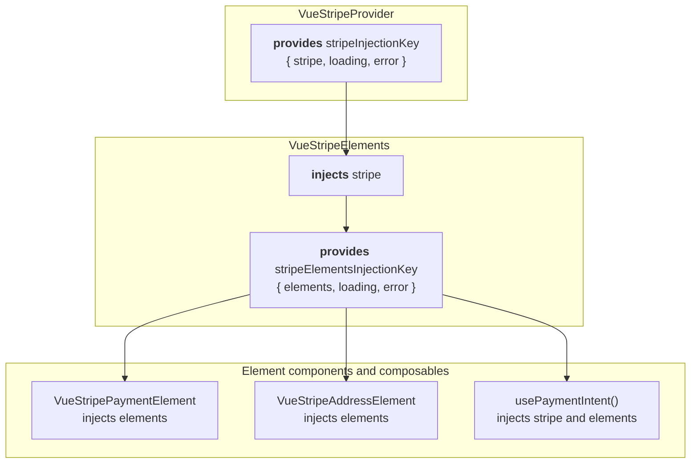

# How Vue Stripe works

Vue Stripe passes Stripe's objects down the component tree with Vue's provide/inject. Providers create the objects, and components and composables inject them. This page follows that chain, explains when each part renders, and explains why a composable only works below the provider it needs.

## The provider chain

A payment form built on Elements has three layers, one per Stripe object: the `Stripe` instance, an Elements group, and the elements in it. Each line shows the Stripe.js call, or the composable, behind it:

```text
VueStripeProvider                 loadStripe()
└─ VueStripeElements              stripe.elements()
   ├─ VueStripePaymentElement     elements.create('payment')
   ├─ VueStripeAddressElement     elements.create('address')
   └─ PayButton                   usePaymentIntent()
```

Each layer provides one object under its own injection key, a `Symbol`, so two libraries or two Stripe accounts never collide:



The layers follow Stripe's own scoping rules. An element belongs to the Elements group that created it. `stripe.confirmPayment({ elements })` confirms what that group collected, and `elements.submit()` validates every element in it. Collecting with one group and confirming with another doesn't work, so Vue Stripe makes the nearest group the default everywhere. An element component creates itself in the nearest `VueStripeElements`. `usePaymentIntent()` confirms with that same group.

The values are refs. `stripe` is `null` until Stripe.js has loaded, and `elements` is `null` until the group exists. Each layer also exposes `loading` and `error` refs, so any descendant can show the state of the layer above it.

### Other trees

The same chain has a few variants. Each swaps one layer for a different Stripe object:

- **Elements with Checkout Sessions.** `VueStripeCheckoutElementsProvider` takes the place of `VueStripeElements`. It calls `stripe.initCheckoutElementsSdk()` for a session created with `ui_mode: 'elements'` and provides the SDK, its session actions and the current session. Element components inside it are created by the SDK instead of an Elements group ([Custom Checkout](/guide/custom-checkout)).
- **Checkout Form.** `VueStripeCheckoutFormProvider` does the same with `stripe.initCheckoutFormSdk()` for `ui_mode: 'form'`, and `VueStripeCheckoutForm` renders inside it ([Checkout Form](/guide/checkout-form)).
- **Embedded Checkout.** `VueStripeEmbeddedCheckout` needs only the `Stripe` instance and sits directly in `VueStripeProvider` ([Embedded Checkout](/guide/embedded-checkout)).
- **No Elements at all.** The [method confirmers](/api/composables/confirm/), [`useFinancialConnections`](/api/composables/use-financial-connections), [`useIdentity`](/api/composables/use-identity) and [`usePaymentRequest`](/api/composables/use-payment-request) need only the `Stripe` instance, so they work anywhere inside `VueStripeProvider`.
- **No provider component.** The [`createVueStripe()`](/api/plugin) plugin provides the `Stripe` instance under the same key for the whole app, so `VueStripeElements` and the composables work without a `VueStripeProvider` above them.

An Elements context always wins. If a `VueStripeElements` sits inside a Checkout provider, the element components inside it use the Elements group, because `inject()` returns the nearest provider of each key and the element factory checks for an Elements group first.

## When each layer renders its children

The layers differ in when they render the slot content below them. That timing decides what a child component can rely on.

`VueStripeProvider` starts loading Stripe.js in `onMounted`. Until the load settles it renders its `#loading` slot, and if the load fails it renders `#error`. It renders its default slot only once Stripe.js is ready. As a result, every component inside a `VueStripeProvider` is created after `stripe` has a value. A Pay button there never sees a missing Stripe instance.

`VueStripeElements` waits the same way. It creates the group as soon as `stripe` has a value, then renders its children. When the client secret or the deferred-Intent parameters change (`mode`, `currency`, `amount`, `setupFutureUsage`), it creates a new group. Each element component tears its element down and recreates it in the new group. Without that step, an element left on the old group would not be confirmed by the new one. Appearance and locale changes are different: they go through `elements.update()`, so the mounted elements keep what the customer typed.

`VueStripeCheckoutElementsProvider` renders its children immediately. Since Stripe.js Clover, `initCheckoutElementsSdk()` returns synchronously, so the elements can mount and show Stripe's skeleton loaders while the session loads. The session actions arrive later, once `loadActions()` resolves. `useCheckoutSession()` therefore returns a "not ready yet" error result if a call comes in before then, rather than throwing.

With the plugin, nothing waits. Stripe.js starts loading the first time something reads the Stripe context, and components render straight away with `loading` set to `true`. `VueStripeElements` shows its own `#loading` slot until the instance arrives. A composable called before then fails the way its reference page describes: `usePaymentIntent()` resolves to an `{ error }` result, and a method confirmer rejects.

The provider's slots and events are listed in the [`VueStripeProvider` reference](/api/components/stripe-provider).

## Why composables must run inside the providers

A composable is a thin `inject()` call plus some state. `inject()` reads from the component's **ancestors**. It cannot see what the same component provides, or what a child component it renders provides.

So this doesn't work: a page component that renders `<VueStripeProvider>` in its template and calls `useStripe()` in its own `setup()`. The provider in the template is the page component's child, not its ancestor. `useStripe()` finds no Stripe context and throws `VueStripeProviderError`, with a message naming the provider it looked for. `useStripeElements()` and the element components throw `VueStripeElementsError` the same way when no Elements group is above them. `useCheckoutSession()` throws `VueStripeCheckoutError` when no Checkout provider is above it.

That is why the guides put the provider in a parent component and the form, with its composables, in a child component. Errors at call time are a different case. A failed Stripe call is reported when the call runs, through the composable's `error` ref and its result, never thrown from `setup()`. [How confirming works](/guide/confirming-payments#two-error-styles) explains which calls resolve and which reject.

The common mistakes this causes, and how to fix them, are collected in [Troubleshoot common problems](/guide/troubleshooting).

## One factory for every element

Every element component is built by the same factory, `createStripeElement()`, from a short definition: the Stripe element type, the events Stripe declares for it, and any extra methods to expose. That is why the Payment, Card, IBAN, Address and other element components behave alike:

- The element is created in `onMounted`, from the nearest Elements group or Checkout SDK, and mounted into the component's own DOM node.
- The factory attaches a listener for each event Stripe.js 10 declares for that element type, re-emits it as a Vue event, and detaches it on unmount before calling `destroy()`.
- `loading` stays `true` until Stripe's `ready` event. `error` follows the latest `change` or `loaderror` event, and the `#loading` and `#error` slots render from these two refs.
- A change to the `options` prop reaches `element.update()` only when the options are different. Templates often pass a new but equal inline object on every render, and those renders don't call `update()`.
- Every element exposes `element`, `loading`, `error`, `focus()`, `blur()` and `clear()` on its template ref. Some add their own methods, such as `getValue()` on the Address Element.

The rendered markup is the same for every element, so one stylesheet covers them all. The event lists are checked against the installed `@stripe/stripe-js` type declarations in the library's tests, so a component never emits an event Stripe doesn't send.

## Stripe objects and Vue reactivity

Stripe's objects hold internal state and are compared by identity: Stripe expects back the exact element it created. Vue Stripe keeps them in `shallowRef` (or marks them with `markRaw`) so Vue never wraps them in reactive proxies. The ref changes when the object changes, but Vue never looks inside the object.

The composables return these objects through `computed()`. On Vue 2.7, `readonly()` would copy a plain object, and Stripe would receive a copy instead of its own object. The `loading` and `error` refs, which hold plain values, are returned as `readonly()`.

## Vue 2.7 and Vue 3

The components are render functions, not single-file components, and every Vue API comes from `vue-demi`. A small helper turns Vue 3 style props into the `{ attrs, on, class, style }` shape Vue 2 expects, and template refs are string refs, which resolve the same way on both. The plugin provides through `app.provide()` on Vue 3. On Vue 2.7 it uses a global mixin that applies only to root instances, so a nested `VueStripeProvider` still wins. See [Use Vue Stripe on Vue 2.7](/guide/vue-2) for the setup.

## Related pages

- [Choosing an integration](/guide/approaches): which tree to build.
- [How Stripe.js is loaded](/guide/stripe-js-loading): what happens before `stripe` gets a value.
- [VueStripeProvider](/api/components/stripe-provider) and [VueStripeElements](/api/components/stripe-elements): props, events and slots.
