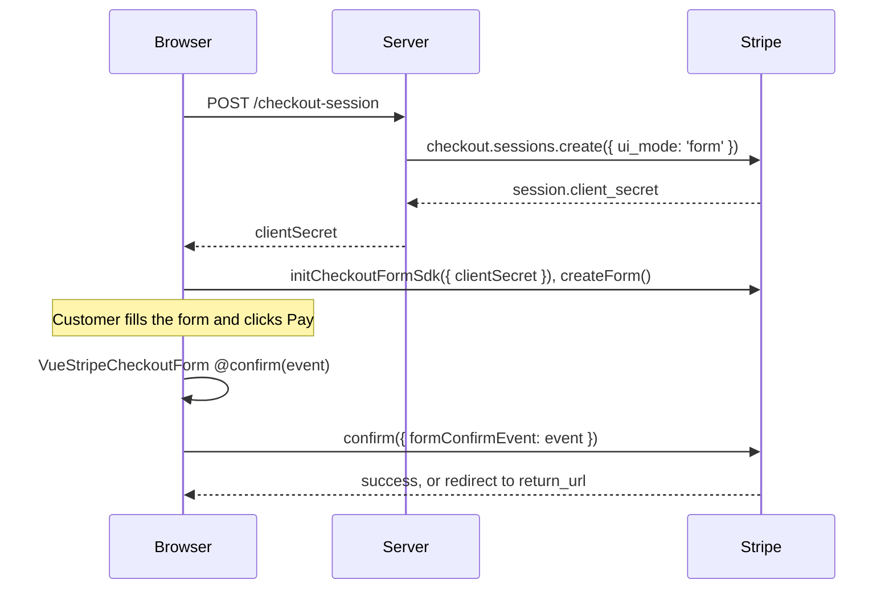

# Add the Checkout Form (beta)

Put Stripe's complete checkout form on your page with `VueStripeCheckoutForm`: contact details, addresses, shipping, tax ID, express checkout wallets, the payment method, the order total and the Pay button come as one element. A Checkout Session keeps the order, so Stripe calculates totals, tax, discounts and shipping. Stripe.js exposes it as the Checkout Form SDK (`stripe.initCheckoutFormSdk()`, `ui_mode: 'form'`). To compare it with the other Checkout integrations, see [Choosing an integration](/guide/approaches).

::: warning Beta: requires Stripe access
The Checkout Form is a Stripe beta. Your Stripe account needs access to `ui_mode: 'form'`; contact [Stripe support](https://support.stripe.com/). Some options have their own gate: the `compact` layout is a separate private preview. Without access, Stripe's error appears in the component's `#error` slot instead of the form.
:::

## Before you begin

- Your Stripe account has access to the Checkout Form beta (see above).
- Vue Stripe is installed and its stylesheet imported ([Install and set up](/guide/installation)).
- A Stripe secret key on your server and a Price (`price_...`) in your Stripe account.
- Your app can reach your server's `/api` routes during development ([Send API requests to your server](/guide/installation#_5-send-api-requests-to-your-server)).

## How the steps fit together



## 1. Create the session on your server

Create the session with `ui_mode: 'form'` and a `return_url`. `ui_mode: 'form'` needs Stripe API version `2026-03-25.dahlia` or later; older versions answer *"Invalid ui_mode: form"*.

```js
// Node.js (Express-style handler)
import Stripe from 'stripe'

const stripe = new Stripe(process.env.STRIPE_SECRET_KEY)

app.post('/api/checkout-session', async (req, res) => {
  const session = await stripe.checkout.sessions.create({
    ui_mode: 'form',
    mode: 'payment',
    line_items: [{ price: 'price_123', quantity: 1 }],
    return_url: 'https://example.com/checkout/complete?session_id={CHECKOUT_SESSION_ID}'
  })

  res.json({ clientSecret: session.client_secret })
})
```

## 2. Wrap the page in the provider

`VueStripeCheckoutFormProvider` calls `stripe.initCheckoutFormSdk()` and makes the session available to the components inside it. `client-secret` accepts a string or a **Promise**, so the form can mount while the session is being created.

```vue
<!-- CheckoutPage.vue -->
<template>
  <VueStripeProvider :publishable-key="publishableKey">
    <VueStripeCheckoutFormProvider
      :client-secret="clientSecret"
      :appearance="{ theme: 'stripe' }"
    >
      <template #error="{ error }">
        <p class="error">{{ error }}</p>
      </template>
      <PayForm />
    </VueStripeCheckoutFormProvider>
  </VueStripeProvider>
</template>

<script setup lang="ts">
import { VueStripeProvider, VueStripeCheckoutFormProvider } from '@vue-stripe/vue-stripe'
import '@vue-stripe/vue-stripe/style.css' // once, e.g. in main.ts
import PayForm from './PayForm.vue'

const publishableKey = import.meta.env.VITE_STRIPE_PUBLISHABLE_KEY

const clientSecret = fetch('/api/checkout-session', { method: 'POST' })
  .then((res) => res.json())
  .then((data) => data.clientSecret)
</script>
```

## 3. Render the form and confirm

`VueStripeCheckoutForm` renders the whole form, including the Pay button. When the customer clicks Pay (or authorizes a wallet), the form emits `@confirm`. Pass that event to `confirm()` from `useCheckoutForm()`:

```vue
<!-- PayForm.vue -->
<template>
  <VueStripeCheckoutForm :options="{ layout: 'expanded' }" @confirm="onConfirm" />
  <p v-if="message">{{ message }}</p>
</template>

<script setup>
import { ref } from 'vue'
import { VueStripeCheckoutForm, useCheckoutForm } from '@vue-stripe/vue-stripe'

const { confirm } = useCheckoutForm()
const message = ref('')

const onConfirm = async (event) => {
  // The session has return_url, so no returnUrl here.
  // redirect: 'if_required' keeps card payments on this page.
  const result = await confirm({ formConfirmEvent: event, redirect: 'if_required' })
  message.value =
    result.type === 'error' ? result.error.message : `Payment ${result.session.status.type}`
}
</script>
```

Nothing is charged until you call `confirm`. Payment methods that need a redirect (bank authentication, some wallets) leave the page and come back to `return_url`.

## Read the form values

`@change` reports whether the form is complete and its current values; `getValue()` on a template ref reads them on demand:

```vue
<script setup>
import { ref } from 'vue'

const formRef = ref(null)
const complete = ref(false)

const onChange = (event) => {
  complete.value = event.complete
}

const readEmail = async () => {
  const result = await formRef.value?.getValue()
  return result?.value.customerDetails.email
}
</script>

<template>
  <VueStripeCheckoutForm ref="formRef" @change="onChange" @confirm="onConfirm" />
</template>
```

In the `compact` layout (private preview), the change event also lists the form's `views`; call `formRef.value.setView(index)` to move between them.

## Place the currency selector yourself

With [Adaptive Pricing](https://docs.stripe.com/payments/checkout/adaptive-pricing), the form shows its own currency picker. To place it elsewhere on the page, render a `VueStripeCurrencySelectorElement` inside the provider; the form then leaves its built-in picker out:

```vue
<VueStripeCheckoutFormProvider :client-secret="clientSecret">
  <VueStripeCurrencySelectorElement />
  <VueStripeCheckoutForm @confirm="onConfirm" />
</VueStripeCheckoutFormProvider>
```

The selector can go above or below the form. Stripe.js expects the form to exist first, so the selector waits a tick after it mounts and is created after a `VueStripeCheckoutForm` rendered in the same update. If you show the form later (for example behind a `v-if`), render the selector with it or after it.

No other element component works inside `VueStripeCheckoutFormProvider`: the form already contains them.

## Change the order

The form collects the email, phone number, addresses and tax ID itself, so `useCheckoutForm()` has no `updateEmail` or address updates. It keeps the actions that change the order: `applyPromotionCode`, `updateLineItemQuantity`, `updateShippingOption` and `runServerUpdate`. (`addOptionalLineItem` / `removeOptionalLineItem` exist on the composable but resolve an error: Stripe does not accept optional items on `form` sessions.) The full list is in the [useCheckoutForm API](/api/composables/use-checkout-form).

Test data: see [Test your integration](/guide/testing#cards).

## See also

- [VueStripeCheckoutFormProvider API](/api/components/stripe-checkout-form-provider)
- [VueStripeCheckoutForm API](/api/components/stripe-checkout-form)
- [useCheckoutForm API](/api/composables/use-checkout-form)
- [Build your own checkout page on a Checkout Session](/guide/custom-checkout): arrange individual elements instead
- [Live demo](/live-demo/checkout-form): pay with the Checkout Form in this site's sandbox
