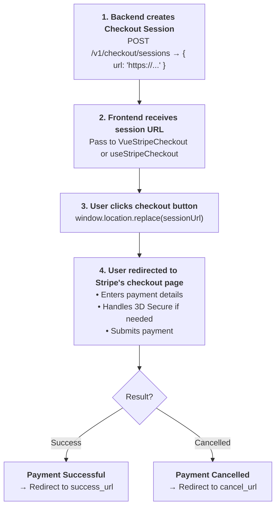

# Stripe Checkout

Redirect users to Stripe's hosted checkout page for a quick, secure payment experience without building custom payment UI.

::: info Session URL only
Stripe.js no longer offers a client-side `redirectToCheckout()`. Your backend creates the Checkout Session and returns its `url`; Vue Stripe redirects with `window.location.replace()`. See [Migrating from v5](/api/components/stripe-checkout#migrating-from-v5) if you used `sessionId` or `priceId` before.
:::

## Why Use Checkout?

| Feature | Benefit |
|---------|---------|
| **No custom UI** | Stripe handles the entire payment form |
| **PCI compliant** | Payment data never touches your servers |
| **Multiple payment methods** | Cards, wallets, bank transfers automatically |
| **Built-in features** | Taxes, shipping, discounts, receipts included |
| **Mobile optimized** | Responsive design works on all devices |

## When to Use Checkout

| Scenario | Description |
|----------|-------------|
| **Quick integration** | Get payments working in minutes |
| **Simple products** | One-time purchases or subscriptions |
| **Global customers** | Stripe auto-shows relevant payment methods |
| **Minimal frontend work** | Don't want to build payment UI |

::: tip Checkout vs Payment Element
- **Checkout** = Redirect to Stripe-hosted page (simplest)
- **Payment Element** = Embed payment UI in your app (customizable)

Choose Checkout when you want the fastest integration with minimal code.
:::

## How It Works



## Required Components

The redirect does not use Stripe.js, so Checkout needs **no provider** at all: no `VueStripeProvider`, no `VueStripeElements`.

| Component | Role |
|-----------|------|
| `VueStripeCheckout` | Renders the button, redirects to the session URL |

(`useStripeCheckout()` does the same from your own code.)

## Basic Implementation

### Step 1: Create a Checkout Session (Backend)

```js
// Node.js / Express
const stripe = require('stripe')('sk_test_...')

app.post('/api/create-checkout-session', async (req, res) => {
  const session = await stripe.checkout.sessions.create({
    line_items: [
      {
        price: 'price_xxx', // Decide the price on the server
        quantity: 1
      }
    ],
    mode: 'payment', // or 'subscription'
    success_url: 'https://example.com/success?session_id={CHECKOUT_SESSION_ID}',
    cancel_url: 'https://example.com/cancel'
  })

  res.json({ url: session.url })
})
```

### Step 2: Add the Checkout Button

```vue
<script setup>
import { ref, onMounted } from 'vue'
import { VueStripeCheckout } from '@vue-stripe/vue-stripe'

const sessionUrl = ref('')
const loading = ref(true)

// Fetch session on mount
onMounted(async () => {
  const response = await fetch('/api/create-checkout-session', { method: 'POST' })
  const data = await response.json()
  sessionUrl.value = data.url
  loading.value = false
})
</script>

<template>
  <div v-if="loading">Loading...</div>

  <VueStripeCheckout
    v-else
    :session-url="sessionUrl"
    button-text="Pay $49.99"
    @error="(err) => console.error(err.message)"
  />
</template>
```

## Using the Composable

For more control, use `useStripeCheckout` instead of the component:

```vue
<!-- CheckoutForm.vue (no provider needed) -->
<script setup>
import { useStripeCheckout } from '@vue-stripe/vue-stripe'

const { redirectToUrl, loading, error } = useStripeCheckout()

const handleCheckout = async () => {
  // Create session on backend
  const response = await fetch('/api/create-checkout-session', {
    method: 'POST',
    body: JSON.stringify({ product: 'pro_plan' })
  })
  const { url } = await response.json()

  // Redirect to the hosted Checkout page
  redirectToUrl(url)
}
</script>

<template>
  <button @click="handleCheckout" :disabled="loading">
    {{ loading ? 'Redirecting...' : 'Checkout' }}
  </button>
  <p v-if="error" class="error">{{ error }}</p>
</template>
```

## Subscription Checkout

For recurring payments, set `mode: 'subscription'`:

```js
// Backend
const session = await stripe.checkout.sessions.create({
  line_items: [
    {
      price: 'price_monthly_pro', // Recurring price
      quantity: 1
    }
  ],
  mode: 'subscription',
  success_url: 'https://example.com/welcome',
  cancel_url: 'https://example.com/pricing'
})
```

```vue
<!-- Frontend -->
<template>
  <div class="pricing-card">
    <h3>Pro Plan</h3>
    <p>$29/month</p>

    <VueStripeCheckout
      :session-url="proSessionUrl"
      button-text="Subscribe to Pro"
    />
  </div>
</template>
```

## Hosted Checkout vs Elements with Checkout Sessions

A Checkout Session can drive two UIs:

| | Hosted Checkout | Elements with Checkout Sessions |
|---|-----------------|---------------------------------|
| **Session** | `stripe.checkout.sessions.create({ ... })` | `stripe.checkout.sessions.create({ ui_mode: 'elements', ... })` |
| **Server returns** | `session.url` | `session.client_secret` |
| **Vue Stripe** | `VueStripeCheckout` / `useStripeCheckout()` | `VueStripeCheckoutElementsProvider` + element components + `useCheckoutSession()` |
| **Payment page** | Stripe-hosted | Your page, your layout |

For the embedded variant, see [VueStripeCheckoutElementsProvider](/api/components/stripe-checkout-provider):

```vue
<VueStripeProvider :publishable-key="publishableKey">
  <VueStripeCheckoutElementsProvider :client-secret="clientSecret">
    <VueStripePaymentElement />
    <PayButton /> <!-- calls useCheckoutSession().confirm() -->
  </VueStripeCheckoutElementsProvider>
</VueStripeProvider>
```

## Handling Success

After payment, Stripe redirects to your `success_url`:

```js
// success_url: 'https://example.com/success?session_id={CHECKOUT_SESSION_ID}'

// Backend: Retrieve the session to confirm payment
app.get('/success', async (req, res) => {
  const session = await stripe.checkout.sessions.retrieve(req.query.session_id)

  if (session.payment_status === 'paid') {
    // Fulfill the order
    await fulfillOrder(session)
    res.render('success')
  }
})
```

::: warning Don't Trust the Redirect
Always verify payment status on your backend. Users could navigate directly to your success URL.
:::

## Webhooks

For reliable payment tracking, use webhooks:

```js
app.post('/webhook', express.raw({ type: 'application/json' }), (req, res) => {
  const sig = req.headers['stripe-signature']
  const event = stripe.webhooks.constructEvent(req.body, sig, webhookSecret)

  if (event.type === 'checkout.session.completed') {
    const session = event.data.object
    fulfillOrder(session)
  }

  res.json({ received: true })
})
```

## Customizing Checkout

### Session Options

```js
const session = await stripe.checkout.sessions.create({
  line_items: [{ price: 'price_xxx', quantity: 1 }],
  mode: 'payment',

  // Customize
  customer_email: 'customer@example.com',
  client_reference_id: 'order_123',

  // Shipping
  shipping_address_collection: {
    allowed_countries: ['US', 'CA', 'GB']
  },

  // Discounts
  allow_promotion_codes: true,

  // Taxes
  automatic_tax: { enabled: true },

  // Branding (Dashboard → Settings → Branding)
  // Custom logo, colors, favicon

  success_url: 'https://example.com/success',
  cancel_url: 'https://example.com/cancel'
})
```

### Button Styling

Use `button-class` to style the default button:

```vue
<VueStripeCheckout
  :session-url="sessionUrl"
  button-class="my-checkout-button"
  button-text="Complete Purchase"
/>

<style>
.my-checkout-button {
  background: linear-gradient(135deg, #667eea, #764ba2);
  color: white;
  padding: 1rem 2rem;
  border-radius: 8px;
}
</style>
```

Or replace the button entirely with your own:

```vue
<VueStripeCheckout :session-url="sessionUrl">
  <button class="my-custom-button">
    <CreditCardIcon /> Complete Purchase
  </button>
</VueStripeCheckout>
```

::: tip Automatic Click Handling
When you pass custom content, clicking it automatically triggers checkout. No need to wire up click handlers manually.
:::

## Error Handling

`VueStripeCheckout` emits `@error` with a `VueStripeCheckoutError` when it is clicked without a `sessionUrl`. Problems with the session itself (expired, already paid) are shown by Stripe on the hosted page, so handle failures of your own session endpoint before rendering the button:

```vue
<script setup>
import { ref, onMounted } from 'vue'

const sessionUrl = ref('')
const failed = ref(false)

onMounted(async () => {
  const response = await fetch('/api/create-checkout-session', { method: 'POST' })
  if (!response.ok) {
    failed.value = true
    return
  }
  sessionUrl.value = (await response.json()).url
})

const handleError = (error) => {
  // VueStripeCheckoutError: no session URL yet
  console.error('Checkout error:', error.message)
}
</script>

<template>
  <p v-if="failed">Could not start checkout. Please try again.</p>
  <VueStripeCheckout
    v-else
    :session-url="sessionUrl"
    :disabled="!sessionUrl"
    @error="handleError"
  />
</template>
```

## Testing

### Test Cards

| Card Number | Behavior |
|-------------|----------|
| `4242 4242 4242 4242` | Succeeds |
| `4000 0000 0000 0002` | Declined |
| `4000 0025 0000 3155` | Requires 3D Secure |

Use any future expiry date and any 3-digit CVC.

### Stripe CLI

Create test sessions without a backend:

```bash
# Create a checkout session
stripe checkout sessions create \
  --line-items[0][price]=price_xxx \
  --line-items[0][quantity]=1 \
  --mode=payment \
  --success-url=https://example.com/success \
  --cancel-url=https://example.com/cancel

# Listen for webhooks
stripe listen --forward-to localhost:3000/webhook
```

## Next Steps

- [VueStripeCheckout API](/api/components/stripe-checkout) — Component reference
- [useStripeCheckout API](/api/composables/use-stripe-checkout) — Composable reference
- [VueStripeCheckoutElementsProvider](/api/components/stripe-checkout-provider) — Embedded Elements with Checkout Sessions
- [Payment Element](/guide/payment-element) — For embedded payment UI
- [Stripe Checkout Docs](https://stripe.com/docs/payments/checkout) — Official guide
