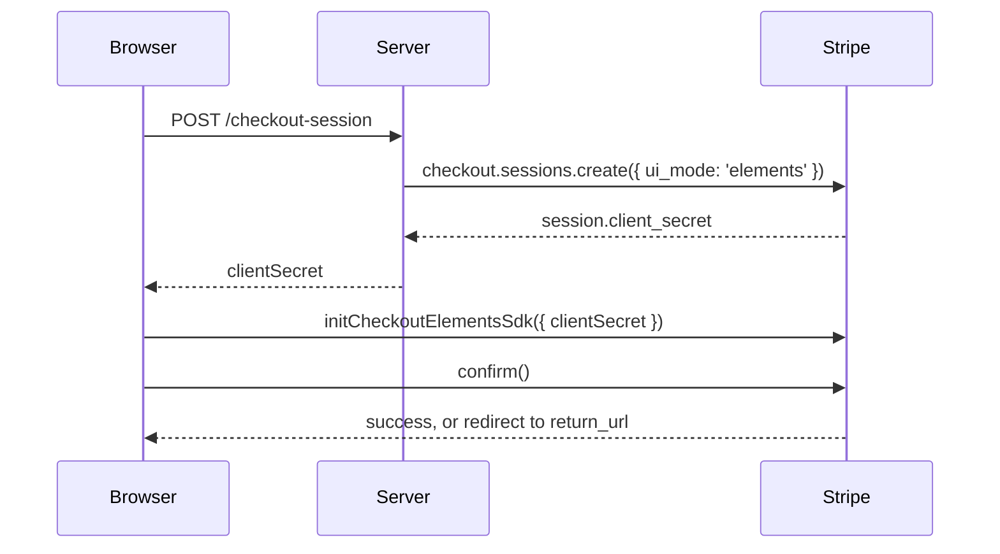

# Build your own checkout page on a Checkout Session

Put Stripe Elements on your own page while a Checkout Session keeps the order: line items, discounts, taxes, shipping and currency stay on the session. You choose the layout; Stripe calculates totals and runs the payment. Stripe calls this "Elements with the Checkout Sessions API", and Stripe.js exposes it as the Checkout Elements SDK (`stripe.initCheckoutElementsSdk()`). To compare it with hosted, embedded and Payment Element integrations, see [Choosing an integration](/guide/approaches).

## Before you begin

- Vue Stripe is installed and its stylesheet imported ([Install and set up](/guide/installation)).
- A Stripe secret key on your server and a Price (`price_...`) in your Stripe account.
- Your app can reach your server's `/api` routes during development ([Send API requests to your server](/guide/installation#_5-send-api-requests-to-your-server)).

## How the steps fit together



## 1. Create the session on your server

Create the session with `ui_mode: 'elements'` and a `return_url`, and send `client_secret` to the browser. There is no `success_url` or `cancel_url` because the customer never leaves your page unless a payment method needs a redirect.

```js
// Node.js (Express-style handler)
import Stripe from 'stripe'

const stripe = new Stripe(process.env.STRIPE_SECRET_KEY)

app.post('/api/checkout-session', async (req, res) => {
  const session = await stripe.checkout.sessions.create({
    ui_mode: 'elements',
    mode: 'payment',
    line_items: [{ price: 'price_123', quantity: 1 }],
    return_url: 'https://example.com/checkout/complete?session_id={CHECKOUT_SESSION_ID}'
  })

  res.json({ clientSecret: session.client_secret })
})
```

Stripe replaces `{CHECKOUT_SESSION_ID}` with the session ID when it redirects.

## 2. Wrap the page in the provider

`VueStripeCheckoutElementsProvider` calls `stripe.initCheckoutElementsSdk()` and makes the session available to the components inside it. `client-secret` accepts a string or a **Promise**. Pass the Promise from your request so the elements can mount while the session is being created.

```vue
<!-- CheckoutPage.vue -->
<script setup lang="ts">
import { VueStripeProvider, VueStripeCheckoutElementsProvider } from '@vue-stripe/vue-stripe'
import '@vue-stripe/vue-stripe/style.css' // once, e.g. in main.ts
import CheckoutForm from './CheckoutForm.vue'

const publishableKey = import.meta.env.VITE_STRIPE_PUBLISHABLE_KEY

const clientSecret = fetch('/api/checkout-session', { method: 'POST' })
  .then((response) => response.json())
  .then((data) => data.clientSecret)
</script>

<template>
  <VueStripeProvider :publishable-key="publishableKey">
    <VueStripeCheckoutElementsProvider :client-secret="clientSecret">
      <CheckoutForm />

      <template #loading>Loading checkout...</template>
      <template #error="{ error }">Checkout could not load: {{ error }}</template>
    </VueStripeCheckoutElementsProvider>
  </VueStripeProvider>
</template>
```

`fetch-client-secret` takes a function returning a Promise instead. The provider calls it only in the browser, after Stripe.js loads, so use it when the page is rendered on the server ([Use Vue Stripe with Nuxt and SSR](/guide/ssr#build-the-page-on-a-checkout-session-instead)). The previous name, `VueStripeCheckoutProvider`, still works as a deprecated alias.

## 3. Build the form

Inside the provider, element components are created from the Checkout session (`checkout.createPaymentElement()` and so on) instead of `stripe.elements()`, so you don't need `VueStripeElements`. `useCheckoutSession()` gives you the reactive session and its actions.

```vue
<!-- CheckoutForm.vue -->
<script setup>
import { computed, ref } from 'vue'
import {
  VueStripePaymentElement,
  VueStripeAddressElement,
  useCheckoutSession
} from '@vue-stripe/vue-stripe'

const { session, loading, confirm } = useCheckoutSession()

const email = ref('')
const message = ref('')
const total = computed(() => session.value?.total.total.amount)

async function pay() {
  message.value = ''
  const result = await confirm({ email: email.value })
  if (result.type === 'error') message.value = result.error.message
  // On success Stripe redirects to the session's return_url.
}
</script>

<template>
  <form @submit.prevent="pay">
    <input v-model="email" type="email" placeholder="you@example.com" required />

    <VueStripePaymentElement />
    <VueStripeAddressElement :options="{ mode: 'billing' }" />

    <button :disabled="loading">Pay {{ total }}</button>
    <p v-if="message">{{ message }}</p>
  </form>
</template>
```

Things to know about this form:

- **Email is required.** Set it when you create the session (`customer_email`), pass it to `confirm({ email })`, or call `updateEmail(email)` earlier.
- **`session.total.total.amount` is already formatted** for the session currency, so you don't need to format it yourself.
- **The Address Element needs `mode`.** Use `'billing'` or `'shipping'`. A shipping address also updates shipping rates and taxes on the session.
- **`loading` stays `true`** until the session actions have loaded. Any action called before that resolves to `{ type: 'error', error: { message: 'Checkout session is not ready yet' } }` instead of throwing.

## 4. Confirm

`confirm()` validates every mounted element, attaches the email and addresses, and confirms the payment.

```js
// Default: always redirect to return_url after payment
await confirm()

// Stay on the page when no redirect is needed (cards, most wallets)
const result = await confirm({ redirect: 'if_required' })
if (result.type === 'success') {
  // result.session is the updated session; show your success state
}
```

::: warning Don't pass `returnUrl` twice
If the session was created with a `return_url`, call `confirm()` **without** `returnUrl`. Stripe rejects a second one. `confirm({ returnUrl })` is only for sessions created without `return_url`.
:::

On the return page, read `session_id` from the URL and retrieve the session on your server (`stripe.checkout.sessions.retrieve(id)`) to show the outcome. Fulfil orders from the `checkout.session.completed` webhook, not from the return page.

## Add optional elements

### Currency selector

With [Adaptive Pricing](https://docs.stripe.com/payments/checkout/adaptive-pricing), customers can pay in their local currency. Pass `adaptive-pricing` to the provider and render the selector. The chosen currency is on `session.value.currency`, and the totals are recalculated.

```vue
<VueStripeCheckoutElementsProvider
  :client-secret="clientSecret"
  :adaptive-pricing="{ allowed: true }"
>
  <VueStripeCurrencySelectorElement />
  <VueStripePaymentElement />
</VueStripeCheckoutElementsProvider>
```

See the [Currency Selector API](/api/components/stripe-currency-selector-element).

### Tax ID

Business customers can enter a VAT/GST number. Create the session with `tax_id_collection: { enabled: true }` and render the element. No beta flag is needed:

```vue
<VueStripeProvider :publishable-key="publishableKey">
  <VueStripeCheckoutElementsProvider :client-secret="clientSecret">
    <VueStripeTaxIdElement />
  </VueStripeCheckoutElementsProvider>
</VueStripeProvider>
```

To verify tax IDs as the customer types, pass `:options="{ verification: { taxId: { mode: 'if_supported' } } }"`; this needs a Tax Complete subscription or Tax Custom pricing. See the [Tax ID API](/api/components/stripe-tax-id-element).

### Contact details

`VueStripeContactDetailsElement` collects the customer's email and writes it to the session (`session.value.email`), in place of your own input plus `updateEmail()`. No beta is needed. See the [Contact Details API](/api/components/stripe-contact-details-element).

```vue
<VueStripeCheckoutElementsProvider :client-secret="clientSecret">
  <VueStripeContactDetailsElement />
  <VueStripePaymentElement />
</VueStripeCheckoutElementsProvider>
```

### Terms and Link Signup (Stripe betas)

`VueStripeTermsElement` shows the terms the customer accepts by paying, and `VueStripeLinkSignupElement` offers to save their details with Link. Both are Stripe betas: the Terms element needs access on your account, the Link Signup element also needs a beta flag on `VueStripeProvider`. See the [Terms API](/api/components/stripe-terms-element) and the [Link Signup API](/api/components/stripe-link-signup-element).

### Express Checkout buttons

`VueStripeExpressCheckoutElement` also works inside the provider. Confirm from its `confirm` event with `confirm({ expressCheckoutConfirmEvent: event })`. See [Add Apple Pay, Google Pay and Link buttons](/guide/express-checkout#use-the-buttons-on-a-checkout-session).

## Turn off saved payment methods

Starting with Stripe.js Clover (8.0), saved payment methods are on by default: a session created for an existing Customer offers that customer's saved payment methods and a "save for next time" checkbox. Turn either off with `elementsOptions.savedPaymentMethod` (`'auto'` or `'never'`):

```vue
<VueStripeCheckoutElementsProvider
  :client-secret="clientSecret"
  :elements-options="{
    savedPaymentMethod: { enableSave: 'never', enableRedisplay: 'auto' }
  }"
>
```

`elementsOptions` also takes `appearance`, `fonts`, `loader` and `syncAddressCheckbox`. To change the appearance after load, call `changeAppearance()` from `useCheckoutSession()`.

## Update the session

[`useCheckoutSession()`](/api/composables/use-checkout-session) forwards every session action: promotion codes, line item quantities, shipping options, contact details and server updates. Each one resolves to `{ type: 'success', session }` or `{ type: 'error', error }` and never rejects, even when Stripe.js throws (the throw becomes the error result); optional items are not available on `elements` sessions, so those two actions resolve an error, and the reactive `session` updates when the action finishes:

```ts
const { applyPromotionCode } = useCheckoutSession()

const result = await applyPromotionCode('SPRING25')
if (result.type === 'error') {
  // Show result.error.message
}
```

Test data: see [Test your integration](/guide/testing#cards).

## See also

- [VueStripeCheckoutElementsProvider API](/api/components/stripe-checkout-provider)
- [useCheckoutSession API](/api/composables/use-checkout-session): state and every session action
- [Add the Checkout Form (beta)](/guide/checkout-form): Stripe renders the whole form for you
- [Live demo](/live-demo/custom-checkout): pay a test session end to end
- [Stripe: Elements with the Checkout Sessions API](https://docs.stripe.com/payments/quickstart-checkout-sessions)
