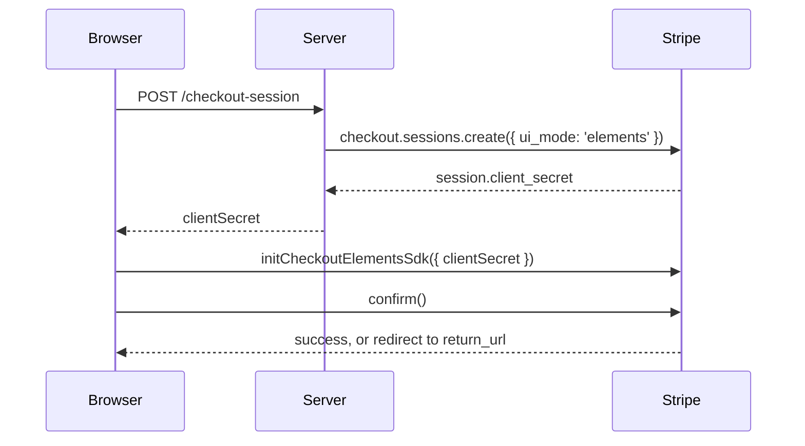

# Custom Checkout

Custom Checkout puts Stripe Elements on your own page while a **Checkout Session** keeps the order: line items, discounts, taxes, shipping and currency stay on the session. You choose the layout; Stripe calculates totals and runs the payment. Stripe calls this "Elements with the Checkout Sessions API", and Stripe.js exposes it as the Checkout Elements SDK (`stripe.initCheckoutElementsSdk()`).

## Which Checkout Should I Use?

| Approach | Where the customer pays | Who renders the page | Order data lives in |
|----------|------------------------|----------------------|---------------------|
| [Stripe Checkout](/guide/checkout) | `checkout.stripe.com` | Stripe | Checkout Session |
| **Custom Checkout** | Your page | You, with Stripe Elements | Checkout Session |
| [Payment Element](/guide/payment-element) | Your page | You, with Stripe Elements | Your server (PaymentIntent) |

Choose Custom Checkout when you want your own UI but don't want to recompute tax, discounts or shipping yourself.

## How It Works



## Step 1: Create the Session (Server)

Create the session with `ui_mode: 'elements'` and a `return_url`, and send `client_secret` to the browser. There is no `success_url` or `cancel_url` because the customer never leaves your page unless a payment method needs a redirect.

```js
// Node.js (Express-style handler)
import Stripe from 'stripe'

const stripe = new Stripe(process.env.STRIPE_SECRET_KEY)

app.post('/api/checkout-session', async (req, res) => {
  const session = await stripe.checkout.sessions.create({
    ui_mode: 'elements',
    mode: 'payment',
    line_items: [{ price: 'price_123', quantity: 1 }],
    return_url: 'https://example.com/checkout/complete?session_id={CHECKOUT_SESSION_ID}'
  })

  res.json({ clientSecret: session.client_secret })
})
```

Stripe replaces `{CHECKOUT_SESSION_ID}` with the session ID when it redirects.

## Step 2: Wrap the Page in the Provider

`VueStripeCheckoutElementsProvider` calls `stripe.initCheckoutElementsSdk()` and makes the session available to the components inside it. `client-secret` accepts a string or a **Promise**. Pass the Promise from your request so the elements can mount while the session is being created.

```vue
<!-- CheckoutPage.vue -->
<script setup>
import { VueStripeProvider, VueStripeCheckoutElementsProvider } from '@vue-stripe/vue-stripe'
import CheckoutForm from './CheckoutForm.vue'

const publishableKey = import.meta.env.VITE_STRIPE_PUBLISHABLE_KEY

const clientSecret = fetch('/api/checkout-session', { method: 'POST' })
  .then((response) => response.json())
  .then((data) => data.clientSecret)
</script>

<template>
  <VueStripeProvider :publishable-key="publishableKey">
    <VueStripeCheckoutElementsProvider :client-secret="clientSecret">
      <CheckoutForm />

      <template #loading>Loading checkout...</template>
      <template #error="{ error }">Checkout could not load: {{ error }}</template>
    </VueStripeCheckoutElementsProvider>
  </VueStripeProvider>
</template>
```

`fetchClientSecret` (a function returning a Promise) is still accepted for v5 code. The previous name, `VueStripeCheckoutProvider`, still works as a deprecated alias.

## Step 3: Build the Form

Inside the provider, element components are created from the Checkout session (`checkout.createPaymentElement()` and so on) instead of `stripe.elements()`, so you don't need `VueStripeElements`. `useCheckoutSession()` gives you the reactive session and its actions.

```vue
<!-- CheckoutForm.vue -->
<script setup>
import { computed, ref } from 'vue'
import {
  VueStripePaymentElement,
  VueStripeAddressElement,
  useCheckoutSession
} from '@vue-stripe/vue-stripe'

const { session, loading, confirm } = useCheckoutSession()

const email = ref('')
const message = ref('')
const total = computed(() => session.value?.total.total.amount)

async function pay() {
  message.value = ''
  const result = await confirm({ email: email.value })
  if (result.type === 'error') message.value = result.error.message
  // On success Stripe redirects to the session's return_url.
}
</script>

<template>
  <form @submit.prevent="pay">
    <input v-model="email" type="email" placeholder="you@example.com" required />

    <VueStripePaymentElement />
    <VueStripeAddressElement :options="{ mode: 'billing' }" />

    <button :disabled="loading">Pay {{ total }}</button>
    <p v-if="message">{{ message }}</p>
  </form>
</template>
```

Things to know about this form:

- **Email is required.** Set it when you create the session (`customer_email`), pass it to `confirm({ email })`, or call `updateEmail(email)` earlier.
- **`session.total.total.amount` is already formatted** for the session currency, so you don't need to format it yourself.
- **The Address Element needs `mode`.** Use `'billing'` or `'shipping'`. A shipping address also updates shipping rates and taxes on the session.
- **`loading` stays `true`** until the session actions have loaded. Any action called before that resolves to `{ type: 'error', error: { message: 'Checkout session is not ready yet' } }` instead of throwing.

## Step 4: Confirm

`confirm()` validates every mounted element, attaches the email and addresses, and confirms the payment.

```js
// Default: always redirect to return_url after payment
await confirm()

// Stay on the page when no redirect is needed (cards, most wallets)
const result = await confirm({ redirect: 'if_required' })
if (result.type === 'success') {
  console.log(result.session.status) // the updated session
}
```

::: warning Don't pass `returnUrl` twice
If the session was created with a `return_url`, call `confirm()` **without** `returnUrl`. Stripe rejects a second one. `confirm({ returnUrl })` is only for sessions created without `return_url`.
:::

On the return page, read `session_id` from the URL and retrieve the session on your server (`stripe.checkout.sessions.retrieve(id)`) to show the outcome. Fulfil orders from the `checkout.session.completed` webhook, not from the return page.

## Optional Elements

### Currency Selector

With [Adaptive Pricing](https://docs.stripe.com/payments/checkout/adaptive-pricing), customers can pay in their local currency. Pass `adaptive-pricing` to the provider and render the selector. The chosen currency is on `session.value.currency`, and the totals are recalculated.

```vue
<VueStripeCheckoutElementsProvider
  :client-secret="clientSecret"
  :adaptive-pricing="{ allowed: true }"
>
  <VueStripeCurrencySelectorElement />
  <VueStripePaymentElement />
</VueStripeCheckoutElementsProvider>
```

See the [Currency Selector API](/api/components/stripe-currency-selector-element).

### Tax ID

Business customers can enter a VAT/GST number. Create the session with `tax_id_collection: { enabled: true }`, enable the beta on `VueStripeProvider`, and render the element:

```vue
<VueStripeProvider :publishable-key="publishableKey" :betas="['custom_checkout_tax_id_1']">
  <VueStripeCheckoutElementsProvider :client-secret="clientSecret">
    <VueStripeTaxIdElement />
  </VueStripeCheckoutElementsProvider>
</VueStripeProvider>
```

The Tax ID element is a Stripe beta; your account needs access. See the [Tax ID API](/api/components/stripe-tax-id-element).

### Express Checkout

`VueStripeExpressCheckoutElement` also works inside the provider. Confirm from its `confirm` event with `confirm({ expressCheckoutConfirmEvent: event })`. See the [Express Checkout guide](/guide/express-checkout).

## Saved Payment Methods

Starting with Stripe.js Clover (8.0), saved payment methods are on by default: a session created for an existing Customer offers that customer's saved payment methods and a "save for next time" checkbox. Turn either off with `elementsOptions.savedPaymentMethod` (`'auto'` or `'never'`):

```vue
<VueStripeCheckoutElementsProvider
  :client-secret="clientSecret"
  :elements-options="{
    savedPaymentMethod: { enableSave: 'never', enableRedisplay: 'auto' }
  }"
>
```

`elementsOptions` also takes `appearance`, `fonts`, `loader` and `syncAddressCheckbox`. To change the appearance after load, call `changeAppearance()` from `useCheckoutSession()`.

## Updating the Session

`useCheckoutSession()` forwards every session action. Each one returns `{ type: 'success', session }` or `{ type: 'error', error }`, and the reactive `session` updates when the action finishes.

| Action | Use |
|--------|-----|
| `applyPromotionCode(code)` / `removePromotionCode()` | Discount codes |
| `updateLineItemQuantity({ lineItem, quantity })` | Cart quantity |
| `updateShippingOption(id)` | Pick a shipping rate |
| `updateEmail(email)` / `updatePhoneNumber(phone)` | Contact details |
| `updateTaxIdInfo(info)` | Tax ID without the element |
| `addOptionalLineItem(priceId)` / `removeOptionalLineItem(priceId)` | Optional items (upsells) |
| `validateElements()` | Validate every element without confirming |
| `runServerUpdate(fn)` | Update the session on your server, then refresh it in the browser |

The full list is in the [useCheckoutSession API](/api/composables/use-checkout-session).

## Next Steps

- [Live Demo](/live-demo/custom-checkout): pay a test session end to end
- [VueStripeCheckoutElementsProvider API](/api/components/stripe-checkout-provider)
- [useCheckoutSession API](/api/composables/use-checkout-session)
- [Stripe: Elements with the Checkout Sessions API](https://docs.stripe.com/payments/quickstart-checkout-sessions)
