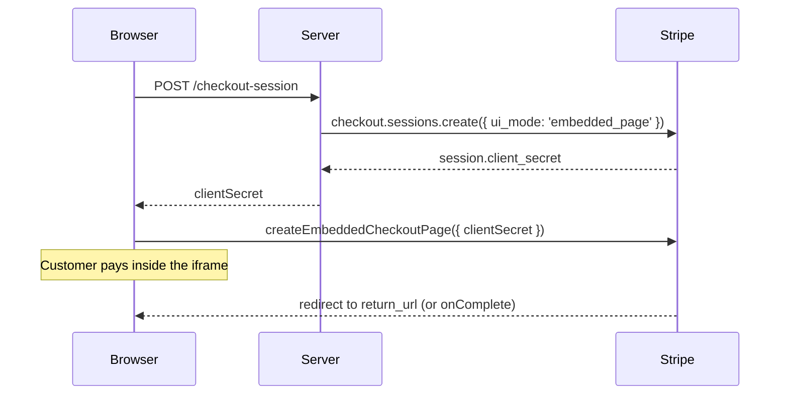

# Embed Stripe Checkout

Put Stripe's prebuilt Checkout page inside your own page with `VueStripeEmbeddedCheckout`. Stripe renders the full form (line items, totals, payment methods, addresses, tax IDs, promotion codes) in an iframe, and the customer never leaves your site. To compare it with hosted Checkout and your own Elements form, see [Choosing an integration](/guide/approaches).

## Before you begin

- Vue Stripe is installed and its stylesheet imported ([Install and set up](/guide/installation)).
- A Stripe secret key on your server and a Price (`price_...`) in your Stripe account.
- Your app can reach your server's `/api` routes during development ([Send API requests to your server](/guide/installation#_5-send-api-requests-to-your-server)).

## How the steps fit together



## 1. Create the session on your server

Create the session with `ui_mode: 'embedded_page'` and a `return_url`, and send `client_secret` to the browser:

```js
// Node.js (Express-style handler)
import Stripe from 'stripe'

const stripe = new Stripe(process.env.STRIPE_SECRET_KEY)

app.post('/api/checkout-session', async (req, res) => {
  const session = await stripe.checkout.sessions.create({
    ui_mode: 'embedded_page',
    mode: 'payment',
    line_items: [{ price: 'price_123', quantity: 1 }],
    return_url: 'https://example.com/checkout/complete?session_id={CHECKOUT_SESSION_ID}'
  })

  res.json({ clientSecret: session.client_secret })
})
```

Stripe replaces `{CHECKOUT_SESSION_ID}` with the session ID when it redirects.

## 2. Render the component

Put `VueStripeEmbeddedCheckout` inside `VueStripeProvider`. Pass either a `client-secret` you already have, or a `fetch-client-secret` function that Stripe calls when it creates the page:

```vue
<!-- CheckoutPage.vue -->
<script setup lang="ts">
import { VueStripeProvider, VueStripeEmbeddedCheckout } from '@vue-stripe/vue-stripe'
import '@vue-stripe/vue-stripe/style.css' // once, e.g. in main.ts

const publishableKey = import.meta.env.VITE_STRIPE_PUBLISHABLE_KEY

const fetchClientSecret = () =>
  fetch('/api/checkout-session', { method: 'POST' })
    .then((response) => response.json())
    .then((data) => data.clientSecret)
</script>

<template>
  <VueStripeProvider :publishable-key="publishableKey">
    <VueStripeEmbeddedCheckout :fetch-client-secret="fetchClientSecret">
      <template #loading>Loading checkout...</template>
      <template #error="{ error }">Checkout could not load: {{ error }}</template>
    </VueStripeEmbeddedCheckout>
  </VueStripeProvider>
</template>
```

That is the whole integration. Stripe handles the payment form, validation, 3D Secure and wallets.

## 3. Handle completion

After a successful payment Stripe redirects the customer to your `return_url`. Read the session ID from the URL and check the session on your server:

```js
// GET /checkout/complete?session_id=cs_test_...
app.get('/api/checkout-session/:id', async (req, res) => {
  const session = await stripe.checkout.sessions.retrieve(req.params.id)
  res.json({ status: session.status, paymentStatus: session.payment_status })
})
```

`status: 'complete'` and `payment_status: 'paid'` mean the payment went through. Fulfil orders from the `checkout.session.completed` webhook, not from the return page, so a closed browser tab does not lose an order.

### Stay on the page

To show your own success message instead of redirecting, create the session with `redirect_on_completion: 'if_required'` (only redirect-based payment methods use `return_url`) or `'never'`, and listen for `@complete`:

```vue
<script setup>
import { ref } from 'vue'

const done = ref(false)
</script>

<template>
  <p v-if="done">Thank you for your order.</p>
  <VueStripeEmbeddedCheckout
    v-else
    :client-secret="clientSecret"
    @complete="done = true"
  />
</template>
```

The component destroys the embedded page when `v-if` removes it.

## Switch to another session

Stripe allows a single Embedded Checkout on a page at a time. If a second `VueStripeEmbeddedCheckout` mounts while another one is on the page, it renders its `#error` slot and emits `@error` instead of loading. To switch to a different Checkout Session, re-mount the component, for example with `:key`:

```vue
<VueStripeEmbeddedCheckout :key="clientSecret" :client-secret="clientSecret" />
```

## Let customers change quantities

Set `adjustable_quantity` on a line item when you create the session; Stripe shows a quantity picker and updates the total itself:

```ts
line_items: [
  { price: 'price_123', quantity: 1, adjustable_quantity: { enabled: true, minimum: 1, maximum: 10 } }
]
```

The embedded page can't ask your server to approve a line item change: Stripe's API has no session setting that turns on the component's `on-line-items-change` prop ([onLineItemsChange](/api/components/stripe-embedded-checkout#onlineitemschange)). To change line items from your server during checkout, use the [Checkout Form](/guide/checkout-form) or [build your own checkout page](/guide/custom-checkout), both of which have `runServerUpdate()`.

## Track the checkout funnel

`@analytics` forwards Stripe's analytics events (`rendered`, `deviceData`, `promotionCodeApplied`, `lineItemChange`, `checkoutSubmitted`, `checkoutSubmitFailed`), so you can track the funnel without reaching into the iframe:

```vue
<VueStripeEmbeddedCheckout
  :client-secret="clientSecret"
  @analytics="(event) => track(event.eventType, event.details)"
/>
```

Test data: see [Test your integration](/guide/testing#cards).

## See also

- [VueStripeEmbeddedCheckout API](/api/components/stripe-embedded-checkout): props, events and slots
- [Build your own checkout page on a Checkout Session](/guide/custom-checkout)
- [Redirect to Stripe Checkout](/guide/checkout)
- [Live demo](/live-demo/embedded-checkout)
