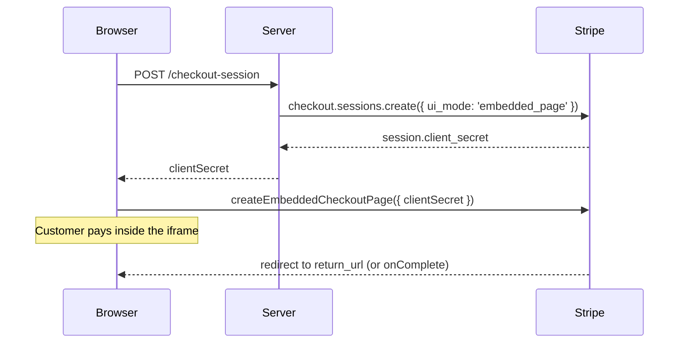

# Embedded Checkout

Embedded Checkout puts Stripe's prebuilt Checkout page inside your own page. Stripe renders the full form (line items, totals, payment methods, addresses, tax IDs, promotion codes) in an iframe, and the customer never leaves your site. Stripe.js 10 creates it with `stripe.createEmbeddedCheckoutPage()`; Vue Stripe wraps that in `VueStripeEmbeddedCheckout`.

## Which Checkout Should I Use?

| Approach | Where the customer pays | Who renders the form | Code you write |
|----------|------------------------|----------------------|----------------|
| [Stripe Checkout](/guide/checkout) | `checkout.stripe.com` | Stripe | A redirect |
| **Embedded Checkout** | Your page (Stripe iframe) | Stripe | One component |
| [Custom Checkout](/guide/custom-checkout) | Your page | You, with Stripe Elements | Your own form |

Choose Embedded Checkout when you want Stripe's complete checkout form without sending the customer to another domain.

## How It Works



## Step 1: Create the Session (Server)

Create the session with `ui_mode: 'embedded_page'` and a `return_url`, and send `client_secret` to the browser:

```js
// Node.js (Express-style handler)
import Stripe from 'stripe'

const stripe = new Stripe(process.env.STRIPE_SECRET_KEY)

app.post('/api/checkout-session', async (req, res) => {
  const session = await stripe.checkout.sessions.create({
    ui_mode: 'embedded_page',
    mode: 'payment',
    line_items: [{ price: 'price_123', quantity: 1 }],
    return_url: 'https://example.com/checkout/complete?session_id={CHECKOUT_SESSION_ID}'
  })

  res.json({ clientSecret: session.client_secret })
})
```

Stripe replaces `{CHECKOUT_SESSION_ID}` with the session ID when it redirects.

## Step 2: Render the Component

Put `VueStripeEmbeddedCheckout` inside `VueStripeProvider`. Pass either a `client-secret` you already have, or a `fetch-client-secret` function that Stripe calls when it creates the page:

```vue
<!-- CheckoutPage.vue -->
<script setup>
import { VueStripeProvider, VueStripeEmbeddedCheckout } from '@vue-stripe/vue-stripe'

const publishableKey = import.meta.env.VITE_STRIPE_PUBLISHABLE_KEY

const fetchClientSecret = () =>
  fetch('/api/checkout-session', { method: 'POST' })
    .then((response) => response.json())
    .then((data) => data.clientSecret)
</script>

<template>
  <VueStripeProvider :publishable-key="publishableKey">
    <VueStripeEmbeddedCheckout :fetch-client-secret="fetchClientSecret">
      <template #loading>Loading checkout...</template>
      <template #error="{ error }">Checkout could not load: {{ error }}</template>
    </VueStripeEmbeddedCheckout>
  </VueStripeProvider>
</template>
```

That is the whole integration. Stripe handles the payment form, validation, 3D Secure and wallets.

## Step 3: Handle Completion

After a successful payment Stripe redirects the customer to your `return_url`. Read the session ID from the URL and check the session on your server:

```js
// GET /checkout/complete?session_id=cs_test_...
app.get('/api/checkout-session/:id', async (req, res) => {
  const session = await stripe.checkout.sessions.retrieve(req.params.id)
  res.json({ status: session.status, paymentStatus: session.payment_status })
})
```

`status: 'complete'` and `payment_status: 'paid'` mean the payment went through. Fulfil orders from the `checkout.session.completed` webhook, not from the return page, so a closed browser tab does not lose an order.

### Staying on the page

To show your own success message instead of redirecting, create the session with `redirect_on_completion: 'if_required'` (only redirect-based payment methods use `return_url`) or `'never'`, and listen for `@complete`:

```vue
<script setup>
import { ref } from 'vue'

const done = ref(false)
</script>

<template>
  <p v-if="done">Thank you for your order.</p>
  <VueStripeEmbeddedCheckout
    v-else
    :client-secret="clientSecret"
    @complete="done = true"
  />
</template>
```

The component destroys the embedded page when `v-if` removes it.

## One Embedded Checkout per Page

Stripe allows a single Embedded Checkout on a page at a time. If a second `VueStripeEmbeddedCheckout` mounts while another one is on the page, it renders its `#error` slot and emits `@error` instead of loading. To switch to a different Checkout Session, re-mount the component, for example with `:key`:

```vue
<VueStripeEmbeddedCheckout :key="clientSecret" :client-secret="clientSecret" />
```

## Line Item Changes

When the session lets customers change line items and sets `permissions.update.line_items: 'server_only'`, Stripe asks you to approve each change. Pass an `on-line-items-change` function that updates the session on your server and resolves `{ type: 'accept' }` or `{ type: 'reject', errorMessage }`. See [onLineItemsChange](/api/components/stripe-embedded-checkout#onlineitemschange) in the API reference.

## Analytics

`@analytics` forwards Stripe's analytics events (`rendered`, `deviceData`, `promotionCodeApplied`, `lineItemChange`, `checkoutSubmitted`, `checkoutSubmitFailed`), so you can track the funnel without reaching into the iframe:

```vue
<VueStripeEmbeddedCheckout
  :client-secret="clientSecret"
  @analytics="(event) => track(event.eventType, event.details)"
/>
```

## Testing

Use a test-mode publishable key and the card `4242 4242 4242 4242` with any future expiry, any CVC and any postal code. Try the [live demo](/live-demo/embedded-checkout) to see the full flow.

## Next Steps

- [VueStripeEmbeddedCheckout API Reference](/api/components/stripe-embedded-checkout) - Props, events, slots
- [Custom Checkout](/guide/custom-checkout) - Your own layout on a Checkout Session
- [Stripe Checkout](/guide/checkout) - Redirect to the hosted page
