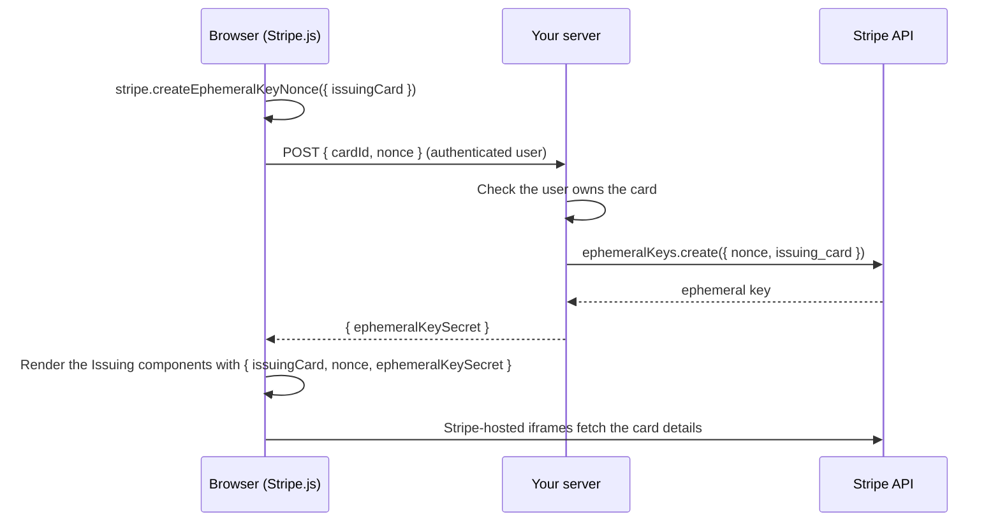

# Display issued card details

Show cardholders the details of cards you issue with [Stripe Issuing](https://docs.stripe.com/issuing). Issuing Elements show the card number, CVC, expiry date and PIN inside Stripe-hosted iframes, so the details never pass through your page or your server and stay out of your PCI scope.

Vue Stripe wraps the six Issuing elements as components. Their reference is on one page: [Issuing Elements API](/api/components/stripe-issuing-elements).

| Component | Shows |
|-----------|-------|
| `VueStripeIssuingCardNumberDisplayElement` | Card number |
| `VueStripeIssuingCardCvcDisplayElement` | CVC |
| `VueStripeIssuingCardExpiryDisplayElement` | Expiry date |
| `VueStripeIssuingCardPinDisplayElement` | PIN |
| `VueStripeIssuingCardCopyButtonElement` | A copy-to-clipboard button for one of the above |
| `VueStripeIssuingAddToWalletButtonElement` | An Add to Wallet button (Stripe private preview) |

::: info Not yet verified end to end
Vue Stripe's tests and dogfood runs use a Stripe account without Stripe Issuing. They confirm what happens without access, as described on this page, but not a complete flow with access. See [what is not yet verified](/coverage#not-yet-verified-end-to-end), and [open an issue](https://github.com/vue-stripe/vue-stripe/issues/new/choose) if something does not work for you.
:::

## Before you begin

- Issuing is enabled on your Stripe account, and you have an issued card (`ic_...`).
- Vue Stripe is installed and its stylesheet imported ([Install and set up](/guide/installation)).
- Your app can reach your server's `/api` routes during development ([Send API requests to your server](/guide/installation#_5-send-api-requests-to-your-server)).

In a sandbox, test cards created in the Dashboard or with the API work; there every card shows its number and CVC. In live mode the number and CVC are available for virtual cards only, unless Stripe enables physical card details for your account.

## How the steps fit together

Stripe.js fetches the card details with an **ephemeral key**: a short-lived key, scoped to one card, that your server creates with your secret key. The browser proves it asked for that key with a single-use **nonce**.



## 1. Create the ephemeral key on your server

Your endpoint receives the card ID and the nonce, checks that the signed-in user may see that card, and returns the ephemeral key secret. Stripe needs API version `2020-03-02` or later for the key; Stripe's own example pins `2026-09-30.endive`, the Endive release that Stripe.js 10 belongs to.

```ts
// POST /api/issuing/ephemeral-keys (Node, stripe-node)
import Stripe from 'stripe'

const stripe = new Stripe(process.env.STRIPE_SECRET_KEY!)

export async function createIssuingEphemeralKey(user: { id: string }, body: { cardId: string; nonce: string }) {
  // Important: only the card's own cardholder may get a key for it.
  await assertUserOwnsCard(user.id, body.cardId)

  const ephemeralKey = await stripe.ephemeralKeys.create(
    { nonce: body.nonce, issuing_card: body.cardId },
    { apiVersion: '2026-09-30.endive' }
  )
  return { ephemeralKeySecret: ephemeralKey.secret }
}
```

::: danger Authenticate this endpoint
Anyone who can call it for a card ID can read that card's number and CVC. Check the session and the card's owner before you create the key. To show the PIN, Stripe also requires two-factor authentication before the page that renders `VueStripeIssuingCardPinDisplayElement`.
:::

## 2. Create the nonce and fetch the key

Create the nonce with [`useEphemeralKeyNonce()`](/api/composables/use-ephemeral-key-nonce), which wraps `stripe.createEphemeralKeyNonce()`, in a component inside `<VueStripeProvider>`. It returns Stripe's result untouched and tracks `loading` and `error`.

```ts
import { useEphemeralKeyNonce } from '@vue-stripe/vue-stripe'

const { createEphemeralKeyNonce } = useEphemeralKeyNonce()

async function loadIssuingCard(cardId: string) {
  const { nonce, error } = await createEphemeralKeyNonce({ issuingCard: cardId })
  if (error) throw new Error(error.message)

  const response = await fetch('/api/issuing/ephemeral-keys', {
    method: 'POST',
    headers: { 'Content-Type': 'application/json' },
    body: JSON.stringify({ cardId, nonce })
  })
  // Without this check a failed request renders the elements with no key
  if (!response.ok) throw new Error(`Could not load the card (HTTP ${response.status})`)
  const { ephemeralKeySecret } = await response.json()
  return { issuingCard: cardId, nonce: nonce!, ephemeralKeySecret: ephemeralKeySecret as string }
}
```

## 3. Retrieve the card

Stripe's guide calls `stripe.retrieveIssuingCard()` with the key before it creates Issuing Elements; with the `issuing_elements_2` beta (Connect, physical card details) element creation fails without it ("Issuing card has not been retrieved."). Stripe.js 10.0.0 does not declare this method, so call it on the Stripe instance from [`useStripe()`](/api/composables/use-stripe) through a narrow type:

```ts
import { useStripe } from '@vue-stripe/vue-stripe'

const { stripe } = useStripe()

type RetrieveIssuingCard = (
  cardId: string,
  options: { ephemeralKeySecret: string; nonce: string }
) => Promise<unknown>

async function retrieveIssuingCard(card: { issuingCard: string; nonce: string; ephemeralKeySecret: string }) {
  const retrieve = (stripe.value as unknown as { retrieveIssuingCard?: RetrieveIssuingCard })
    .retrieveIssuingCard
  await retrieve?.call(stripe.value, card.issuingCard, {
    ephemeralKeySecret: card.ephemeralKeySecret,
    nonce: card.nonce
  })
}
```

## 4. Render the elements

The components create their Stripe element when they mount, so render `<VueStripeElements>` only after the key is there. It needs no `clientSecret` and no `mode`.

```vue
<!-- IssuedCard.vue: render it inside <VueStripeProvider> -->
<script setup lang="ts">
import { onMounted, ref } from 'vue'
import {
  VueStripeElements,
  VueStripeIssuingCardNumberDisplayElement,
  VueStripeIssuingCardExpiryDisplayElement,
  VueStripeIssuingCardCvcDisplayElement,
  VueStripeIssuingCardCopyButtonElement
} from '@vue-stripe/vue-stripe'
// loadIssuingCard() and retrieveIssuingCard() from steps 2 and 3

const props = defineProps<{ cardId: string }>()
const card = ref<{ issuingCard: string; nonce: string; ephemeralKeySecret: string } | null>(null)
const loadError = ref('')
const copied = ref(false)

onMounted(async () => {
  try {
    const loaded = await loadIssuingCard(props.cardId)
    await retrieveIssuingCard(loaded)
    card.value = loaded
  } catch (error) {
    loadError.value = error instanceof Error ? error.message : 'Could not load the card'
  }
})

const style = { base: { color: '#ffffff', fontSize: '18px', letterSpacing: '0.08em' } }

const onCopied = () => {
  copied.value = true
  setTimeout(() => (copied.value = false), 2000)
}
</script>

<template>
  <p v-if="loadError">{{ loadError }}</p>
  <p v-else-if="!card">Loading card...</p>
  <VueStripeElements v-else>
    <div class="issued-card">
      <div class="number">
        <VueStripeIssuingCardNumberDisplayElement :options="{ ...card, style }" />
        <div class="copy" :title="copied ? 'Copied' : 'Copy number'">
          <VueStripeIssuingCardCopyButtonElement
            :options="{ toCopy: 'number' }"
            @click="onCopied"
          />
        </div>
      </div>
      <div class="meta">
        <VueStripeIssuingCardExpiryDisplayElement :options="{ ...card, style }" />
        <VueStripeIssuingCardCvcDisplayElement :options="{ ...card, style }" />
      </div>
    </div>
  </VueStripeElements>
</template>

<style scoped>
.issued-card {
  padding: 24px;
  border-radius: 12px;
  background: #1a1f36;
}
.number {
  display: flex;
  align-items: center;
  gap: 12px;
}
.copy {
  position: relative;
  width: 24px;
  height: 24px;
}
.meta {
  display: flex;
  gap: 24px;
  margin-top: 16px;
}
</style>
```

The copy button is a transparent iframe that fills its parent: give the parent a size and an icon, and use `@click` for "Copied" feedback.

## Refresh the key

Ephemeral keys expire after 15 minutes. For longer sessions, run steps 2 and 3 again and assign the new values to `card`: each component passes the changed `options` to `element.update()`.

```ts
import { onUnmounted } from 'vue'

const timer = setInterval(async () => {
  try {
    const fresh = await loadIssuingCard(props.cardId)
    await retrieveIssuingCard(fresh)
    card.value = fresh
  } catch (error) {
    loadError.value = error instanceof Error ? error.message : 'Could not refresh the card'
  }
}, 14 * 60 * 1000)
onUnmounted(() => clearInterval(timer))
```

## If the card does not load

- **No Issuing on the account, or a card it does not own**: step 2's `createEphemeralKeyNonce()` still succeeds, but `stripe.ephemeralKeys.create()` on your server fails with `No such issuing card: 'ic_...'` (HTTP 400, code `resource_missing`). `loadIssuingCard()` throws, and the page shows the error instead of "Loading card...".
- **The elements get no key**: if the components render with `nonce` or `ephemeralKeySecret` missing, for example because the key request was not checked, each one shows "You must set the nonce and ephemeralKeySecret options to use this Element." in its `#error` slot. Look at the key request, not the options.
- **The card was not retrieved**: when the elements get a nonce and key but `retrieveIssuingCard()` (step 3) was skipped or did not succeed for them, each one shows "Issuing card ic_... has not been retrieved." in its `#error` slot.
- **A wrong or expired key** for a card the account owns: the elements are created, and Stripe.js logs the failed fetch to the browser console only. Run steps 2 and 3 again ([Refresh the key](#refresh-the-key)).

## Show the PIN

`VueStripeIssuingCardPinDisplayElement` takes the same options as the other displays. Stripe requires you to put two-factor authentication in front of any page that shows a PIN, and may suspend access to the element otherwise. Issuing Elements do not integrate with Stripe's Issuing verifications, so the 2FA step is yours to build.

## Add an Add to Wallet button

`VueStripeIssuingAddToWalletButtonElement` is a Stripe private preview. Pass the betas Stripe lists for it on the provider, and the same card options plus `wallet`:

```vue
<VueStripeProvider
  :publishable-key="publishableKey"
  :betas="['issuing_add_to_wallet_button_element_1', 'issuing_elements_2']"
>
  <IssuedCardWallet :card-id="cardId" />
</VueStripeProvider>
```

```vue
<VueStripeElements v-if="card">
  <VueStripeIssuingAddToWalletButtonElement
    :options="{ ...card, wallet: 'apple' }"
    @click="onWalletClick"
    @success="onAddedToWallet"
  />
</VueStripeElements>
```

`@success` fires when the wallet flow completes. Follow Apple's and Google's badge guidelines when you place the button.

## Show cards of a connected account

To show cards of a connected account, set `stripe-account` on `<VueStripeProvider>` and create the ephemeral key with the `stripeAccount` request option on your server. Stripe must enable Issuing Elements for connected accounts first; ask Stripe support.

## See also

- [Issuing Elements API](/api/components/stripe-issuing-elements): props, events, slots and exposed members
- [How Vue Stripe works](/guide/architecture): how the provider and Elements context reach the components
- [Stripe docs: Using Issuing Elements](https://docs.stripe.com/issuing/elements)
