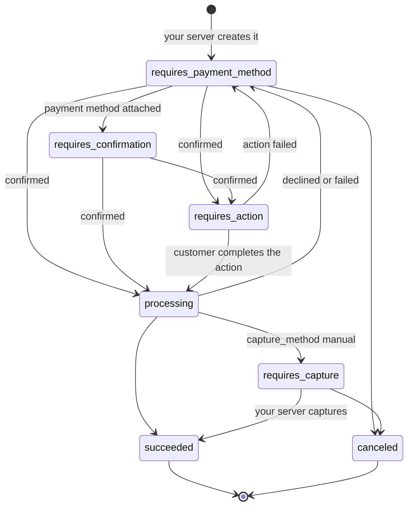

# Payment objects: Intents, Sessions and tokens

A Stripe integration passes a few kinds of objects between your server, the browser and Stripe. Each Vue Stripe component and composable works with one of them, so knowing what each object is for explains most of the library's API: why `VueStripeElements` takes a client secret, why some flows confirm on the server, and why a bank debit is still undecided after you confirm it.

## The objects at a glance

| Object | ID prefix | Created by | What it represents |
|--------|-----------|------------|--------------------|
| PaymentIntent | `pi_` | Your server | One attempt to collect a specific amount, from creation to success or failure |
| SetupIntent | `seti_` | Your server | Saving a payment method for later use, with any authentication done up front |
| Checkout Session | `cs_` | Your server | An order: line items, totals, tax, discounts and customer details, which Stripe turns into a PaymentIntent, SetupIntent or subscription |
| PaymentMethod | `pm_` | The browser (or Stripe, during confirmation) | Reusable payment details: a card, a bank account, a wallet |
| ConfirmationToken | `ctoken_` | The browser | A one-time snapshot of what the customer entered, for your server to confirm with |
| Token | `tok_` | The browser | The older single-use object for card and bank details, and for Connect account and person data |
| Customer | `cus_` | Your server | The person or business you charge, holding their saved PaymentMethods |
| Radar Session | `rse_` | The browser | Stripe's fraud signals for a payment whose details Stripe.js didn't collect |

The browser-side objects each have a composable: `useCreatePaymentMethod()`, `useCreateConfirmationToken()`, `useCreateToken()` and `useRadarSession()`. [PaymentMethods, ConfirmationTokens and Tokens](#paymentmethods-confirmationtokens-and-tokens) explains when to use which.

Your server creates the objects that decide how much is charged, using your secret key. The browser creates the objects that carry what the customer typed, using your publishable key. This split is the basis of Stripe's security model. [What runs where](/guide/security) explains it.

## Intents and client secrets

A PaymentIntent tracks one payment through every step, including retries. If the first card is declined, the customer tries another on the same Intent, and Stripe never charges the amount twice. Your server creates it with the amount and currency, so the browser can't change what gets charged.

Each Intent has a **client secret**. It lets a browser holding your publishable key confirm that one Intent and read its status, and nothing more. That's why `VueStripeElements` takes a `clientSecret`. The Elements group binds to that Intent, shows the payment methods that fit its amount and currency, and confirms against it. The secret belongs only to the customer paying. Send it to that customer's browser, but don't log it or put it anywhere others can read it.

The Payment Element can also start without an Intent. With `mode`, `amount` and `currency` on `VueStripeElements`, the group shows the right payment methods for a payment that doesn't exist yet. The Intent is created when the customer clicks Pay. This **deferred Intent** flow fits checkouts where the amount changes while the customer is on the page, and the server-confirmation flow is built on it. The amount you pass to `VueStripeElements` only drives what the form displays. The amount charged is the one your server puts on the Intent.

## The life of a PaymentIntent

Most browser flows attach the payment method and confirm in one call, so an Intent often goes straight from `requires_payment_method` to `succeeded`. The other statuses appear when something stands in the way:

- `requires_action` means the customer has to act: authenticate with their bank, approve on a redirect page, or pay a voucher. Stripe.js handles the action inside the confirm call when the browser confirms. When your server confirms, the browser handles it with `useHandleNextAction`.
- `processing` is brief for cards, and lasts days for bank debits. See [Payments that settle later](#payments-that-settle-later).
- `requires_capture` appears only when your server creates the Intent with `capture_method: 'manual'`. The bank has authorized the amount, and your server captures it later. Hotels and marketplaces use this to authorize now and charge when the service is delivered. `VueStripeElements` takes a `captureMethod` prop for the deferred flow.
- A failure sends the Intent back to `requires_payment_method`, ready for another attempt with the same amount.

[How confirming works](/guide/confirming-payments) covers what the browser does at each of these steps.

## PaymentIntent or SetupIntent

A **SetupIntent** saves a payment method without charging it. It runs the same collection and authentication steps as a payment, with no amount. When it succeeds, it holds a PaymentMethod you can attach to a Customer and charge later from your server, while the customer is away (`off_session`).

The reason to use a SetupIntent instead of storing the details any other way is authentication. Banks in many regions, such as under Europe's Strong Customer Authentication rules, may ask the cardholder to authenticate. A later off-session charge can't show the customer a challenge. Authenticating while the customer is present, and recording that they agreed to future charges, makes those later charges far more likely to go through without one.

When to use which:

- **Charge now**: a PaymentIntent, with `usePaymentIntent()`.
- **Charge now and save for next time**: a PaymentIntent with `setup_future_usage`. One step, one authentication. `VueStripeElements` takes a `setupFutureUsage` prop for the deferred flow.
- **Save now, charge later or never**: a SetupIntent, with `useSetupIntent()`. Examples are a card on file in the customer's account, a free trial that converts to a paid plan when it ends, a subscription that starts on a later date, or metered billing at the end of a period.
- **Authorize now, capture later**: a PaymentIntent with manual capture, not a SetupIntent. The amount is held on the card.

Subscriptions use both objects behind the scenes. A subscription's first invoice carries a PaymentIntent, or a SetupIntent when there's nothing to charge yet, as in a free trial. The browser confirms whichever one the server sends back.

## Checkout Sessions

A Checkout Session sits one level above the Intents. Your server creates it from prices or line items. Stripe computes the totals, tax, discounts, shipping and currency conversion, then creates the PaymentIntent, SetupIntent or subscription itself when the customer confirms. The session's `ui_mode` decides how the customer sees it:

| `ui_mode` | The browser gets | Vue Stripe |
|-----------|------------------|------------|
| (hosted, the default) | `session.url`, a page on `checkout.stripe.com` | `VueStripeCheckout`, `useStripeCheckout()` |
| `embedded_page` | A client secret for Stripe's page in an iframe | `VueStripeEmbeddedCheckout` |
| `elements` | A client secret for individual elements on your page | `VueStripeCheckoutElementsProvider`, `useCheckoutSession()` |
| `form` (beta) | A client secret for Stripe's form as one element | `VueStripeCheckoutFormProvider`, `useCheckoutForm()` |

With a session, you don't touch the Intent from the browser. `useCheckoutSession().confirm()` confirms the session, and the session confirms its own Intent. [Choosing an integration](/guide/approaches#checkout-session-or-paymentintent) compares sessions with plain Intents.

## PaymentMethods, ConfirmationTokens and Tokens

These three objects all hold what the customer entered. They differ in lifetime and in who uses them.

A **PaymentMethod** is the durable form. Attached to a Customer, it can be charged again and again, and it's what a succeeded SetupIntent leaves behind. Stripe creates one during confirmation. You can also create one in the browser with `useCreatePaymentMethod()`, for example to show the card brand and last four digits before confirming, or to send its ID to a server that confirms.

A **ConfirmationToken** is the recommended way to hand the details to your server for confirmation. It's a short-lived, single-use snapshot of the Payment Element's state. That includes the payment method details, the billing and shipping details, and whether the customer chose to save the method. Your server passes it as `confirmation_token` when it creates and confirms the Intent. Unlike a PaymentMethod, it carries everything the Payment Element collected, so the server confirms exactly what the customer saw. Create one with `useCreateConfirmationToken()`.

A **Token** is the oldest of the three. It's a single-use representation of card or bank details from the time of the Charges API. Stripe still uses Tokens for a few things the newer objects don't cover: Connect account and person tokens, personal ID numbers, and recollecting a CVC for a saved card. `useCreateToken()` wraps all of these. New payment integrations don't need Tokens.

A **Radar Session** (`useRadarSession()`) is related but holds no payment details. It carries Stripe's fraud signals from the browser for flows where Stripe.js didn't collect the payment details itself, so Radar can still assess the payment.

## Payments that settle later

A card network answers within seconds, so a card payment is decided by the time confirmation returns. Bank debits don't work that way. A SEPA, BECS or ACH debit is a request to pull money from an account, sent through the banking network in batches. The bank answers days later, after it has checked the account, the balance and the mandate. During that time the PaymentIntent is `processing`. It ends `succeeded`, or goes back to `requires_payment_method` if the debit fails.

How long that takes, and how long the customer can reverse it afterwards, depends on the scheme. These figures are from Stripe's documentation for each payment method, for standard settlement:

| | Cards | SEPA Direct Debit | BECS Direct Debit | ACH Direct Debit |
|---|---|---|---|---|
| Currency | Many | EUR | AUD | USD |
| Status after confirming | `succeeded` (after any 3D Secure) | `processing` | `processing` | `processing` |
| Outcome known | Within seconds | Most failures within 6 business days; Stripe advises waiting 6 business days before treating it as paid | Up to 3 business days | Up to 4 business days |
| Mandate needed | No | Yes | Yes (a Direct Debit Request) | Yes |
| Customer can dispute | Under card network rules | Up to 8 weeks with no questions asked, up to 13 months if unauthorized | Up to 7 years with no questions asked | 60 calendar days for personal accounts, 2 business days for business accounts |

Stripe's guides for [SEPA](https://docs.stripe.com/payments/sepa-debit), [BECS](https://docs.stripe.com/payments/au-becs-debit) and [ACH](https://docs.stripe.com/payments/ach-direct-debit) have the current figures, including faster settlement options.

So bank debits trade speed for other things. They often cost less than cards, which matters for large amounts such as rent or tuition. Bank accounts don't expire the way cards do, which suits recurring billing. And many customers in these regions, especially businesses, prefer paying by debit. They fit poorly when you deliver goods right after checkout, and when disputes would hurt, because the schemes favour the customer and their disputes can't be appealed.

Because of this:

- The browser can't show "paid" when confirmation returns. Show "payment submitted" instead.
- The outcome reaches your server by webhook (`payment_intent.succeeded` or `payment_intent.payment_failed`). Fulfil orders there, not on the return page; [Fulfil orders with webhooks](/guide/webhooks) shows how.
- Even a succeeded debit isn't final. The customer can still dispute it for the period shown above, and a late failure from the bank shows up as a dispute.

Debits also need a **mandate**: the customer's permission for you to debit the account, shown as text at the time of collection and recorded by Stripe when you confirm. The SEPA, BECS and ACH guides show where the mandate text goes. Saving a bank account for later use goes through a SetupIntent, so the mandate covers future debits too.

Vouchers (OXXO, Boleto, Konbini) are slow for a different reason. The customer pays in cash or through their bank after checkout. The Intent stays in `requires_action` until they pay or the voucher expires, and the webhook tells you which.

## Related pages

- [How confirming works](/guide/confirming-payments): what each confirm call does with these objects.
- [Save a payment method for later](/guide/setup-intent): SetupIntents in practice.
- [Confirm payments on your server](/guide/tokens): ConfirmationTokens in practice.
- Stripe's guides on [PaymentIntents](https://docs.stripe.com/payments/paymentintents/lifecycle), [SetupIntents](https://docs.stripe.com/payments/setupintents) and [Checkout Sessions](https://docs.stripe.com/payments/checkout).
