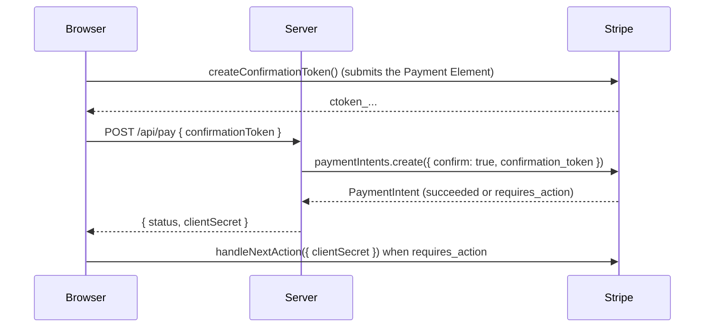

# Confirm payments on your server

Collect payment details with the Payment Element, turn them into a ConfirmationToken with [`useCreateConfirmationToken()`](/api/composables/use-create-confirmation-token), and create and confirm the PaymentIntent on your server. This follows Stripe's [finalize payments on the server](https://docs.stripe.com/payments/finalize-payments-on-the-server) flow: the Payment Element runs without an Intent, and the Intent only exists once the customer clicks Pay. [Payment objects](/guide/payment-objects#paymentmethods-confirmationtokens-and-tokens) explains how ConfirmationTokens relate to PaymentMethods and Tokens.

## Before you begin

- Vue Stripe is installed and its stylesheet imported ([Install and set up](/guide/installation)).
- Your server can create PaymentIntents with your secret key.

## ConfirmationToken: confirm on your server {#confirmationtoken-confirm-on-your-server}



### 1. Render the Payment Element without an Intent

Give `VueStripeElements` a `mode`, `amount` and `currency` instead of a client secret ([Collect payment details before creating an Intent](/guide/deferred-intent) covers this setup):

```vue
<!-- CheckoutPage.vue -->
<script setup lang="ts">
import { VueStripeProvider, VueStripeElements, VueStripePaymentElement } from '@vue-stripe/vue-stripe'
import '@vue-stripe/vue-stripe/style.css' // once, e.g. in main.ts
import PayButton from './PayButton.vue'

const publishableKey = import.meta.env.VITE_STRIPE_PUBLISHABLE_KEY
</script>

<template>
  <VueStripeProvider :publishable-key="publishableKey">
    <VueStripeElements mode="payment" :amount="1099" currency="usd">
      <VueStripePaymentElement />
      <PayButton />
    </VueStripeElements>
  </VueStripeProvider>
</template>
```

Set `amount` from the cart before the customer starts typing: changing `mode`, `amount` or `currency` creates a new Elements group, so the Payment Element remounts empty.

### 2. Create the token and send it to your server

`createConfirmationToken()` runs `elements.submit()` first, so a validation error (an incomplete card number, say) resolves as `{ error }` without creating a token. If the server's PaymentIntent needs 3D Secure, [`useHandleNextAction()`](/api/composables/use-handle-next-action) finishes it in the browser:

```vue
<!-- PayButton.vue: rendered inside <VueStripeElements> -->
<script setup lang="ts">
import { ref } from 'vue'
import { useCreateConfirmationToken, useHandleNextAction } from '@vue-stripe/vue-stripe'

const { createConfirmationToken, loading, error } = useCreateConfirmationToken()
const { handleNextAction, error: actionError } = useHandleNextAction()
const status = ref('')

const pay = async () => {
  const { confirmationToken } = await createConfirmationToken({
    params: { return_url: `${window.location.origin}/complete` }
  })
  if (!confirmationToken) return // `error` holds the message

  const response = await fetch('/api/pay', {
    method: 'POST',
    headers: { 'Content-Type': 'application/json' },
    body: JSON.stringify({ confirmationToken: confirmationToken.id })
  })
  const result: { status: string; clientSecret: string } = await response.json()

  if (result.status === 'requires_action') {
    const { paymentIntent } = await handleNextAction({ clientSecret: result.clientSecret })
    status.value = paymentIntent?.status ?? 'failed'
  } else {
    status.value = result.status
  }
}
</script>

<template>
  <button :disabled="loading" @click="pay">Pay</button>
  <p v-if="error || actionError">{{ error || actionError }}</p>
  <p v-if="status">Payment {{ status }}</p>
</template>
```

`confirmationToken.payment_method_preview` describes what the customer chose (`type`, `card.brand`, `card.last4`, ...) if you want to show it or check it before charging.

### 3. Create and confirm the PaymentIntent on your server

```js
// Node.js (Express-style handler)
import Stripe from 'stripe'

const stripe = new Stripe(process.env.STRIPE_SECRET_KEY)

app.post('/api/pay', async (req, res) => {
  const paymentIntent = await stripe.paymentIntents.create({
    amount: 1099, // compute from the cart on the server, never trust the browser
    currency: 'usd',
    automatic_payment_methods: { enabled: true },
    confirm: true,
    confirmation_token: req.body.confirmationToken,
    return_url: 'https://example.com/complete'
  })

  res.json({ status: paymentIntent.status, clientSecret: paymentIntent.client_secret })
})
```

The same token confirms a SetupIntent (`stripe.setupIntents.create({ confirm: true, confirmation_token })`) when you render the Elements group with `mode="setup"`.

## Create a PaymentMethod to charge later

[`useCreatePaymentMethod()`](/api/composables/use-create-payment-method) creates a reusable PaymentMethod (`pm_...`) for your server to attach to a customer or charge later. Inside a Payment Element group (with `:options="{ paymentMethodCreation: 'manual' }"` on `VueStripeElements`), call it with no arguments; with the Card Element, pass the element:

```vue
<script setup lang="ts">
import { ref } from 'vue'
import { VueStripeCardElement, useCreatePaymentMethod } from '@vue-stripe/vue-stripe'

const cardRef = ref<InstanceType<typeof VueStripeCardElement> | null>(null)
const { createPaymentMethod, loading, error } = useCreatePaymentMethod()

const save = async () => {
  const card = cardRef.value?.element
  if (!card) return
  const { paymentMethod } = await createPaymentMethod({ type: 'card', card })
  if (paymentMethod) {
    // Send paymentMethod.id to your server, e.g. to attach it to a customer
  }
}
</script>

<template>
  <VueStripeCardElement ref="cardRef" />
  <button :disabled="loading" @click="save">Save card</button>
  <p v-if="error">{{ error }}</p>
</template>
```

To save a card with authentication up front, use a SetupIntent instead: see [Save a payment method for later](/guide/setup-intent).

## Tokens and Radar sessions

- [`useCreateToken()`](/api/composables/use-create-token) wraps every `stripe.createToken()` overload: card tokens for the legacy Charges API, and account, person and PII tokens for Connect.
- [`useRadarSession()`](/api/composables/use-radar-session) gives Radar the browser signals it needs when card details reach Stripe without Stripe.js; pass the session ID to your server as `radar_options.session`.

## See also

- [How confirming works](/guide/confirming-payments): confirming in the browser instead
- [Tokens live demo](/live-demo/tokens) and [Create Payment Method demo](/live-demo/create-payment-method)
- [useHandleNextAction API](/api/composables/use-handle-next-action)
