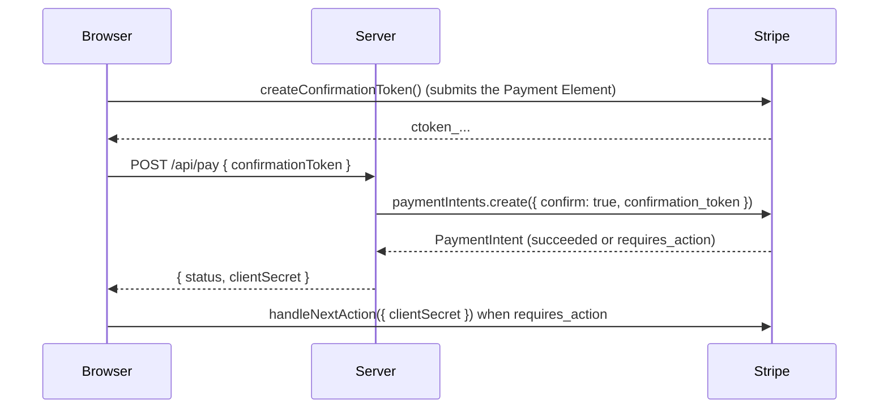

# Tokens and Payment Methods

Sometimes the browser should only **collect** payment details and leave the charge for later or for your server. Stripe turns what the customer entered into an object your server can use, and Vue Stripe has a composable for each:

| Composable | Creates | Use it to |
|------------|---------|-----------|
| [`useCreateConfirmationToken`](/api/composables/use-create-confirmation-token) | ConfirmationToken (`ctoken_...`) | Confirm the PaymentIntent or SetupIntent **on your server** (recommended for server-side confirmation) |
| [`useCreatePaymentMethod`](/api/composables/use-create-payment-method) | PaymentMethod (`pm_...`) | Save details to a customer, or charge them later |
| [`useCreateToken`](/api/composables/use-create-token) | Token (`tok_...`) | Legacy Charges integrations, Connect account / person tokens, PII, CVC recollection |
| [`useRadarSession`](/api/composables/use-radar-session) | Radar Session (`rse_...`) | Give Radar device signals when payment details are collected outside Stripe.js |

Try all of them in the [Tokens live demo](/live-demo/tokens) and [Create Payment Method demo](/live-demo/create-payment-method).

## ConfirmationToken: Confirm on Your Server

In Stripe's [finalize payments on the server](https://docs.stripe.com/payments/finalize-payments-on-the-server) flow, the Payment Element runs **without an Intent**: `VueStripeElements` gets `mode`, `amount` and `currency` instead of a client secret. The Intent only exists once the customer clicks Pay.



### Step 1: The Payment Element With a Deferred Intent

```vue
<!-- CheckoutPage.vue -->
<template>
  <VueStripeProvider :publishable-key="publishableKey">
    <VueStripeElements mode="payment" :amount="1099" currency="usd">
      <VueStripePaymentElement />
      <PayButton />
    </VueStripeElements>
  </VueStripeProvider>
</template>

<script setup lang="ts">
import { VueStripeProvider, VueStripeElements, VueStripePaymentElement } from '@vue-stripe/vue-stripe'
import PayButton from './PayButton.vue'

const publishableKey = import.meta.env.VITE_STRIPE_PUBLISHABLE_KEY
</script>
```

Set `amount` from the cart before the customer starts typing: changing `mode`, `amount` or `currency` creates a new Elements group, so the Payment Element remounts empty.

### Step 2: Create the Token and Send It to the Server

`createConfirmationToken()` runs `elements.submit()` first, so a validation error (an incomplete card number, say) resolves as `{ error }` without creating a token. If the server's PaymentIntent needs 3D Secure, `useHandleNextAction` finishes it in the browser:

```vue
<!-- PayButton.vue: rendered inside <VueStripeElements> -->
<script setup lang="ts">
import { ref } from 'vue'
import { useCreateConfirmationToken, useHandleNextAction } from '@vue-stripe/vue-stripe'

const { createConfirmationToken, loading, error } = useCreateConfirmationToken()
const { handleNextAction, error: actionError } = useHandleNextAction()
const status = ref('')

const pay = async () => {
  const { confirmationToken } = await createConfirmationToken({
    params: { return_url: `${window.location.origin}/complete` }
  })
  if (!confirmationToken) return // `error` holds the message

  const response = await fetch('/api/pay', {
    method: 'POST',
    headers: { 'Content-Type': 'application/json' },
    body: JSON.stringify({ confirmationToken: confirmationToken.id })
  })
  const result: { status: string; clientSecret: string } = await response.json()

  if (result.status === 'requires_action') {
    const { paymentIntent } = await handleNextAction({ clientSecret: result.clientSecret })
    status.value = paymentIntent?.status ?? 'failed'
  } else {
    status.value = result.status
  }
}
</script>

<template>
  <button :disabled="loading" @click="pay">Pay</button>
  <p v-if="error || actionError">{{ error || actionError }}</p>
  <p v-if="status">Payment {{ status }}</p>
</template>
```

`confirmationToken.payment_method_preview` describes what the customer chose (`type`, `card.brand`, `card.last4`, ...) if you want to show it or check it before charging.

### Step 3: Confirm on the Server

```js
// Node.js (Express-style handler)
import Stripe from 'stripe'

const stripe = new Stripe(process.env.STRIPE_SECRET_KEY)

app.post('/api/pay', async (req, res) => {
  const paymentIntent = await stripe.paymentIntents.create({
    amount: 1099, // compute from the cart on the server, never trust the browser
    currency: 'usd',
    automatic_payment_methods: { enabled: true },
    confirm: true,
    confirmation_token: req.body.confirmationToken,
    return_url: 'https://example.com/complete'
  })

  res.json({ status: paymentIntent.status, clientSecret: paymentIntent.client_secret })
})
```

The same token confirms a SetupIntent (`stripe.setupIntents.create({ confirm: true, confirmation_token })`) when you render the Elements group with `mode="setup"`.

## PaymentMethod: Save or Charge Later

[`useCreatePaymentMethod`](/api/composables/use-create-payment-method) creates a reusable PaymentMethod. Inside a Payment Element group (with `:options="{ paymentMethodCreation: 'manual' }"` on `VueStripeElements`), call it with no arguments; with the Card Element, pass the element:

```vue
<script setup lang="ts">
import { ref } from 'vue'
import { VueStripeCardElement, useCreatePaymentMethod } from '@vue-stripe/vue-stripe'

const cardRef = ref<InstanceType<typeof VueStripeCardElement> | null>(null)
const { createPaymentMethod, loading, error } = useCreatePaymentMethod()

const save = async () => {
  const card = cardRef.value?.element
  if (!card) return
  const { paymentMethod } = await createPaymentMethod({ type: 'card', card })
  if (paymentMethod) {
    // Send paymentMethod.id to your server, e.g. to attach it to a customer
  }
}
</script>

<template>
  <VueStripeCardElement ref="cardRef" />
  <button :disabled="loading" @click="save">Save card</button>
  <p v-if="error">{{ error }}</p>
</template>
```

To save a card for future payments with authentication up front, prefer a SetupIntent: see [Saving Payment Methods](/guide/setup-intent).

## Token: Legacy and Connect

[`useCreateToken`](/api/composables/use-create-token) exposes every `stripe.createToken()` overload. Card tokens only serve the legacy Charges API; the other token types remain current for Connect onboarding and identity data:

```ts
const { createToken } = useCreateToken()

// Card Element -> tok_... for the Charges API
await createToken(cardRef.value!.element!, { name: 'Jenny Rosen' })

// Connect: account and person tokens collected in the browser
await createToken('account', { business_type: 'individual', tos_shown_and_accepted: true })
await createToken('person', { first_name: 'Jenny', last_name: 'Rosen' })

// Personally identifiable information
await createToken('pii', { personal_id_number: '000000000' })
```

## Radar Session

When card details reach Stripe without Stripe.js (a vault, a third-party form), Radar misses the browser signals it uses to score fraud. [`useRadarSession`](/api/composables/use-radar-session) captures them; pass the ID to the server and on to Stripe as `radar_options.session`:

```ts
const { createRadarSession } = useRadarSession()

const { radarSession } = await createRadarSession()
if (radarSession) {
  await fetch('/api/pay', { method: 'POST', body: JSON.stringify({ radarSession: radarSession.id }) })
}
```

## Next Steps

- [Confirming Payments](/guide/confirming-payments): confirm in the browser instead
- [Tokens live demo](/live-demo/tokens)
- [useHandleNextAction API](/api/composables/use-handle-next-action)
